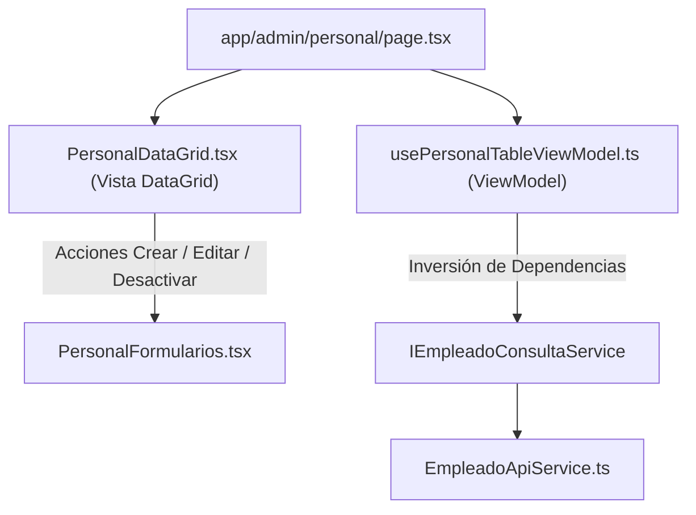

# Documentación Técnica: Historia de Usuario US-009
**Módulo:** Front-End Web (`mejora-sjr-admin/`)  
**Desarrollador a Cargo:** Oscar Abraham Granados  
**Rama de Entrega:** `sP2`  
**Estado:** ✅ Completado y Verificado

---

## 1. Resumen y Valor de Negocio (US-009)
* **Identificador:** US-009
* **Título:** UI Tabla de Gestión - Personal Municipal (DataGrid)
* **Objetivo:** Desarrollar la pantalla administrativa de Personal Municipal (`/admin/personal` y `/dashboard/personal`) con un componente **DataGrid** interactivo que liste de forma reactiva a los empleados municipales, proveyendo:
  - Tarjetas superiores de métricas KPI (Total, Activos, Inactivos, Admins Depto, Operativos).
  - Barra de búsqueda reactiva por texto (Nombre o Correo) y selectores de filtro por Rol y Estado.
  - Columnas de ID, Empleado (avatar con iniciales, nombre y correo), Rol con insignia distintiva, Departamento e indicador de Estado (`Activo` / `Inactivo`).
  - Botones de acción por fila: **Lápiz (`Pencil`)** para editar y **Basurero (`Trash2`)** para desactivar (*Soft Delete*), más botón primario **`+ Nuevo Empleado`**.

---

## 2. Arquitectura MVVM del DataGrid

---

## 3. Archivos Implementados y Principios SOLID

| Archivo | Capa | Principio SOLID | Responsabilidad |
|---|---|---|---|
| `mejora-sjr-admin/src/models/empleado.types.ts` | Modelos | **ISP** | Define la entidad `Empleado` y los contratos de datos del personal municipal. |
| `mejora-sjr-admin/src/services/contracts/IEmpleadoConsultaService.ts` | Contratos | **DIP** | Abstrae la consulta del catálogo de empleados (`listarEmpleados`). |
| `mejora-sjr-admin/src/services/api/EmpleadoApiService.ts` | Servicios | **LSP** | Consume `GET /api/empleados` con autenticación Bearer JWT. |
| `mejora-sjr-admin/src/viewModels/usePersonalTableViewModel.ts` | ViewModel | **SRP** / **MVVM** | Gestiona el estado reactivo de la tabla, búsqueda, filtros, métricas y apertura de modales. |
| `mejora-sjr-admin/src/views/personal/PersonalDataGrid.tsx` | Vista | **SRP** | Renderiza las tarjetas KPI, controles de filtrado, tabla de datos y botones de acción (`Pencil` / `Trash2`). |
| `mejora-sjr-admin/src/app/admin/personal/page.tsx` | Página | **MVVM** | Ensambla los servicios y el ViewModel para la ruta `/admin/personal`. |

