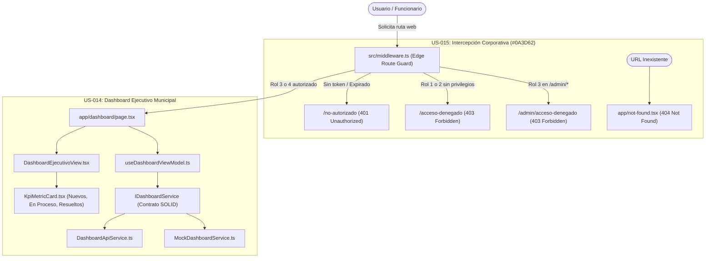

# Documentación Técnica: Historias de Usuario US-014 y US-015
**Módulo:** Front-End Web Administrativo (`mejora-sjr-admin/`)  
**Desarrollador a Cargo:** Oscar  
**Rama de Entrega:** `sP3`  
**Estado:** ✅ Completado y Verificado

---

## 1. Resumen y Valor de Negocio

### A. US-014: Dashboard Ejecutivo (Sustitución de UI)
* **Identificador:** US-014
* **Objetivo:** Reemplazar la antigua vista técnica de validación e impresión de claims del JWT (`/dashboard`) por un **Dashboard Ejecutivo real** enfocado en la gestión municipal de San Juan del Río.
* **Entregables Clave:**
  1. **Tarjetas de Métricas Ejecutivas (KPIs):** Renderizado interactivo de **"Nuevos Reportes"**, **"En Proceso"**, **"Resueltos"** y **"Total Canalizados"** (con tasa de efectividad y tiempo promedio de respuesta).
  2. **Enfoque Jurisdiccional RBAC:**
     - **Administrador de Departamento (`IdRol = 3`):** Visualiza automáticamente los indicadores acotados a su dependencia asignada (`JAPAM` o `Servicios Públicos`).
     - **Superadministrador (`IdRol = 4`):** Cuenta con supervisión global de todo el municipio y conmutador instantáneo por dependencia.
  3. **Carga Operativa y Seguimiento:** Barras segmentadas de progreso por categoría (`Fugas de agua`, `Alcantarillado`, `Alumbrado`, `Bacheo`) y bandeja filtrable de reportes ciudadanos recientes.

### B. US-015: Vistas de Intercepción Corporativas (401 / 403 / 404)
* **Identificador:** US-015
* **Objetivo:** Diseñar páginas institucionales profesionales para los estados **401 Unauthorized**, **403 Forbidden** y **404 Not Found**, integradas directamente con el **Route Guard** (`src/middleware.ts`), empleando el color corporativo oficial **`#0A3D62`** para indicar falta de privilegios o sesión en lugar de exponer errores crudos de sistema.
* **Entregables Clave:**
  1. **401 Unauthorized (`/no-autorizado` y `/401`):** Intercepta accesos sin sesión activa, tokens inválidos o sesiones expiradas en `/dashboard/*` y `/admin/*`.
  2. **403 Forbidden (`/acceso-denegado`, `/admin/acceso-denegado` y `/403`):** Cuando el Route Guard expulsa a un usuario sin privilegios (Roles 1 y 2 intentando ingresar al panel web, o Rol 3 intentando acceder a `/admin/personal`), aterriza en una pantalla corporativa `#0A3D62` explicando claramente su nivel de acceso y ofreciendo navegación asistida.
  3. **404 Not Found (`src/app/not-found.tsx`):** Captura cualquier URL inexistente en toda la aplicación web bajo la misma línea gráfica `#0A3D62`.
  4. **Error Boundary (`src/app/error.tsx`):** Protege ante cualquier fallo inesperado de renderizado sin mostrar pantallas técnicas del framework.

---

## 2. Diagrama de Arquitectura (Edge Route Guard + MVVM + SOLID)

---

## 3. Matriz de Componentes e Implementación MVVM / SOLID

| Archivo | Extensión / Regla | Capa | Responsabilidad |
|---|---|---|---|
| `src/models/dashboard.types.ts` | `.ts` | Modelo | Contratos de KPIs (`nuevosReportes`, `enProceso`, `resueltos`), categorías y reportes recientes. |
| `src/models/intercepcion.types.ts` | `.ts` | Modelo | Tipado de códigos `401 \| 403 \| 404` y descriptores institucionales de intercepción. |
| `src/services/contracts/IDashboardService.ts` | `.ts` | Contrato SOLID | Interfaz abstracta (**DIP**) para consulta de métricas ejecutivas. |
| `src/services/api/DashboardApiService.ts` | `.ts` | Servicio API | Sincroniza catálogos oficiales desde `/api/catalogos/categorias` y consolida indicadores (**LSP**). |
| `src/services/mocks/MockDashboardService.ts` | `.ts` | Servicio Mock | Proveedor determinista de métricas operativas municipales por dependencia (**LSP**). |
| `src/viewModels/useDashboardViewModel.ts` | `.ts` | ViewModel | Orquesta estado reactivo, filtrado jurisdiccional (`JAPAM` / `Servicios Públicos`) y filtro por KPI. |
| `src/viewModels/useIntercepcionViewModel.ts` | `.ts` | ViewModel | Construye mensajes contextuales 401/403/404, audita ruta de origen y limpia sesiones inválidas. |
| `src/components/dashboard/KpiMetricCard.tsx` | `.tsx` | Componente UI | Tarjeta reutilizable de métrica ejecutiva con acentos semánticos y filtro interactivo. |
| `src/views/dashboard/DashboardEjecutivoView.tsx` | `.tsx` | Vista | Interfaz limpia del Dashboard Ejecutivo Municipal (sustituye el visor de JWT). |
| `src/views/errors/IntercepcionErrorView.tsx` | `.tsx` | Vista | Pantalla institucional `#0A3D62` reutilizable para 401, 403 y 404 (completa o embebida). |
| `src/middleware.ts` | `.ts` | Seguridad Edge | Redirige expulsiones de sesión y privilegios hacia las vistas corporativas 401 y 403. |

---

## 4. Matriz de Validación Rápida

| Escenario | Acción de Prueba | Resultado Esperado |
|---|---|---|
| **Dashboard Ejecutivo (US-014)** | Iniciar sesión con `superadmin@test.com` o `admin@test.com` | Se muestra el Dashboard Ejecutivo limpio con tarjetas **"Nuevos Reportes"**, **"En Proceso"** y **"Resueltos"**, sin JSON técnico del JWT. |
| **Intercepción 401** | Abrir `/dashboard` en ventana privada sin iniciar sesión | Redirección inmediata a `/no-autorizado` con diseño corporativo `#0A3D62` (`401 Unauthorized`). |
| **Intercepción 403 (Rol 1 / 2)** | Iniciar sesión con `ciudadano@test.com` o `trabajador@test.com` | El Route Guard elimina la cookie y expulsa al usuario a `/acceso-denegado` (`403 Forbidden`, diseño `#0A3D62`) indicando falta de privilegios. |
| **Intercepción 403 (Rol 3)** | Iniciar sesión con `admin@test.com` e ir a `/admin/personal` | El Route Guard intercepta la petición y presenta `/admin/acceso-denegado` con diseño corporativo `#0A3D62`. |
| **Intercepción 404** | Navegar a `/ruta-inexistente` o módulo aún no publicado | Renderiza `not-found.tsx` (`404 Not Found`) con diseño corporativo `#0A3D62` y botón de retorno seguro. |

