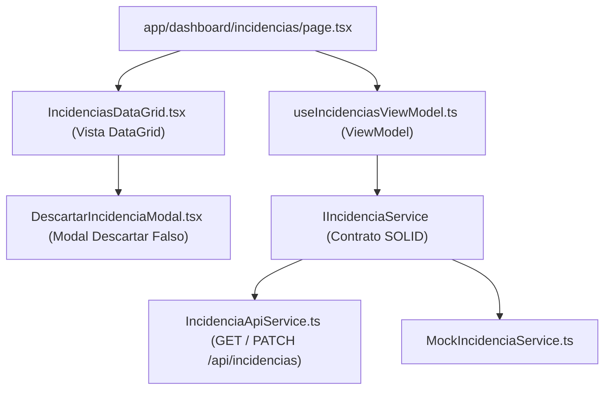

# Documentación Técnica: Historia de Usuario US-026
**Módulo:** Front-End Web Administrativo (`mejora-sjr-admin/`)  
**Desarrollador a Cargo:** Oscar Abraham Granados  
**Rama de Entrega:** `sP5`  
**Estado:** ✅ Completado y Verificado

---

## 1. Resumen y Valor de Negocio (US-026)
* **Identificador:** US-026
* **Título:** Bandeja de Incidencias en Admin (DataGrid y Acciones)
* **Objetivo:** Implementar la vista `/dashboard/incidencias` con un componente **DataGrid** que permita consultar las incidencias ciudadanas aplicando **filtros por secretaría** (`JAPAM` / `Servicios Públicos`), estado y búsqueda de texto, asignando reportes mediante un **selector de trabajador operativo** (`Rol 2`) y descartando reportes improcedentes a través de un **modal para descartar falsos** con motivo de auditoría.

---

## 2. Diagrama de Arquitectura MVVM (US-026)

---

## 3. Archivos Implementados y Principios SOLID

| Archivo | Extensión | Capa | Responsabilidad |
|---|---|---|---|
| `mejora-sjr-admin/src/models/incidencia.types.ts` | `.ts` | Modelo | Contratos de `Incidencia`, catálogo de estados (`1..5`) y métricas de bandeja. |
| `mejora-sjr-admin/src/services/contracts/IIncidenciaService.ts` | `.ts` | Contrato SOLID | Interfaz abstracta (**DIP**) para listar, asignar trabajador y descartar incidencias. |
| `mejora-sjr-admin/src/services/api/IncidenciaApiService.ts` | `.ts` | Servicio API | Consume `GET /api/incidencias`, `PATCH /api/incidencias/:id/asignar` y `PATCH /api/incidencias/:id/descartar`. |
| `mejora-sjr-admin/src/services/mocks/MockIncidenciaService.ts` | `.ts` | Servicio Mock | Proveedor en memoria para pruebas unitarias y resiliencia offline (**LSP**). |
| `mejora-sjr-admin/src/viewModels/useIncidenciasViewModel.ts` | `.ts` | ViewModel | Gestiona alcance RBAC por secretaría, filtros, asignación a trabajadores del mismo departamento y validación del modal de descarte (`>= 5` caracteres). |
| `mejora-sjr-admin/src/views/incidencias/DescartarIncidenciaModal.tsx` | `.tsx` | Vista Modal | Modal institucional `#0A3D62` para descartar reportes falsos con motivos sugeridos y justificación obligatoria. |
| `mejora-sjr-admin/src/views/incidencias/IncidenciasDataGrid.tsx` | `.tsx` | Vista DataGrid | Tabla interactiva con tarjetas KPI reactivas, filtro por secretaría, selector de trabajador y acción de descarte. |
| `mejora-sjr-admin/src/app/dashboard/incidencias/page.tsx` | `.tsx` | Página | Ruta `/dashboard/incidencias` ensamblada mediante inversión de dependencias. |

