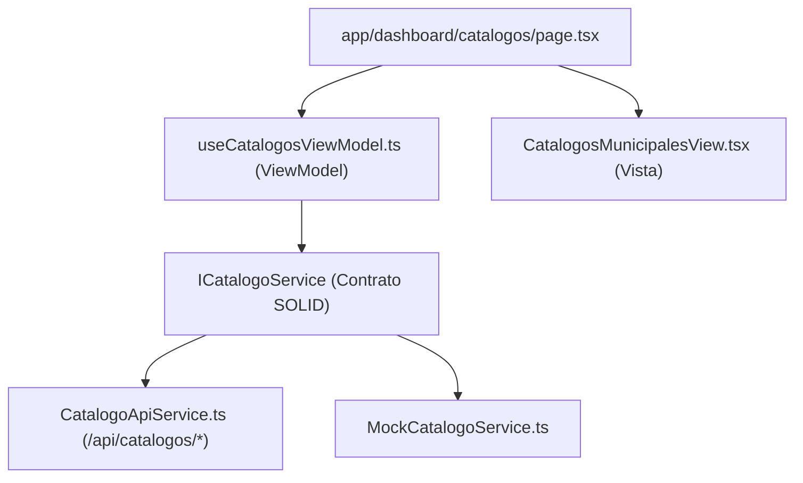

# Documentación Técnica: Historia de Usuario US-027
**Módulo:** Front-End Web Administrativo (`mejora-sjr-admin/`)  
**Desarrollador a Cargo:** Oscar Abraham Granados  
**Rama de Entrega:** `sP5`  
**Estado:** ✅ Completado y Verificado

---

## 1. Resumen y Valor de Negocio (US-027)
* **Identificador:** US-027
* **Título:** Administración de Catálogos Municipales
* **Objetivo:** Implementar la vista `/dashboard/catalogos` para visualizar y gestionar las **dependencias municipales (Secretarías)** y las **categorías de reportes ciudadanos**, sincronizada con los endpoints oficiales de `/api/catalogos/departamentos` y `/api/catalogos/categorias`.

---

## 2. Diagrama de Arquitectura MVVM (US-027)

---

## 3. Archivos Implementados y Principios SOLID

| Archivo | Extensión | Capa | Responsabilidad |
|---|---|---|---|
| `mejora-sjr-admin/src/models/catalogo.types.ts` | `.ts` | Modelo | Contratos de `Departamento`, `CategoriaReporte`, payloads de guardado y métricas de catálogo. |
| `mejora-sjr-admin/src/services/contracts/ICatalogoService.ts` | `.ts` | Contrato SOLID | Interfaz abstracta (**DIP**) para consulta y administración de dependencias y categorías. |
| `mejora-sjr-admin/src/services/api/CatalogoApiService.ts` | `.ts` | Servicio API | Sincroniza `GET /api/catalogos/departamentos` y `GET /api/catalogos/categorias` con operaciones de gestión. |
| `mejora-sjr-admin/src/services/mocks/MockCatalogoService.ts` | `.ts` | Servicio Mock | Catálogo semilla oficial de San Juan del Río (`JAPAM` y `Servicios Públicos`) con operaciones CRUD en memoria (**LSP**). |
| `mejora-sjr-admin/src/viewModels/useCatalogosViewModel.ts` | `.ts` | ViewModel | Gestiona filtrado por dependencia/estado, contadores KPI, modales de alta/edición y activación lógica de categorías. |
| `mejora-sjr-admin/src/views/catalogos/CatalogosMunicipalesView.tsx` | `.tsx` | Vista | Tarjetas de dependencias municipales, DataGrid de categorías de reportes y formulario modal institucional. |
| `mejora-sjr-admin/src/app/dashboard/catalogos/page.tsx` | `.tsx` | Página | Ruta `/dashboard/catalogos` ensamblada mediante inversión de dependencias. |

