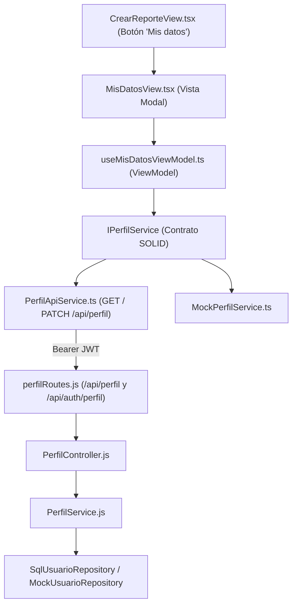

# Documentación Técnica: Historia de Usuario US-032
**Módulos:** App Móvil (`mejora-sjr-mobile/`) y Backend API (`mejora-sjr-backend/`)  
**Desarrollador a Cargo:** Oscar Abraham Granados  
**Rama de Entrega:** `sP5`  
**Estado:** ✅ Completado y Verificado

---

## 1. Resumen y Valor de Negocio (US-032)
* **Identificador:** US-032
* **Título:** Apartado "Mis Datos" / Perfil Ciudadano en App Móvil
* **Objetivo:** Implementar en la aplicación móvil (`mejora-sjr-mobile`) y en el backend (`mejora-sjr-backend`) el apartado **"Mis Datos" / Perfil Ciudadano**, permitiendo al ciudadano autenticado consultar su identidad, su resumen de participación municipal (total de reportes, recibidos, en atención y resueltos), actualizar su información personal (nombre completo y correo electrónico) y cambiar opcionalmente su contraseña de acceso.

---

## 2. Diagrama de Arquitectura (Móvil MVVM + Backend N-Capas SOLID)

---

## 3. Archivos Implementados y Principios SOLID

| Archivo | Módulo / Capa | Principio SOLID | Responsabilidad |
|---|---|---|---|
| `mejora-sjr-backend/src/services/PerfilService.js` | Backend - Servicio | **SRP** / **DIP** | Consulta datos del ciudadano, calcula resumen de reportes y valida actualización de nombre, correo y contraseña opcional. |
| `mejora-sjr-backend/src/controllers/PerfilController.js` | Backend - Controlador | **SRP** | Expone los handlers `obtener` (`GET`) y `actualizar` (`PUT` / `PATCH`). |
| `mejora-sjr-backend/src/routes/perfilRoutes.js` | Backend - Rutas | **DIP** / **IoC** | Protege `/api/perfil` (y `/api/auth/perfil`) con autenticación JWT. |
| `mejora-sjr-backend/src/repositories/SqlUsuarioRepository.js` | Backend - Repositorio | **LSP** | Implementa `actualizarPerfilUsuario` en Azure SQL con parámetros tipados. |
| `mejora-sjr-mobile/src/models/perfil.types.ts` | Móvil - Modelo | **ISP** | Contratos `PerfilCiudadano`, `ResumenReportesPerfil` y `ActualizarPerfilDTO`. |
| `mejora-sjr-mobile/src/services/contracts/IPerfilService.ts` | Móvil - Contrato | **DIP** | Interfaz abstracta para lectura y actualización del perfil ciudadano. |
| `mejora-sjr-mobile/src/services/api/PerfilApiService.ts` | Móvil - Servicio API | **LSP** | Consume `GET /api/perfil` y `PATCH /api/perfil` y sincroniza `@mejora_sjr_mobile_user`. |
| `mejora-sjr-mobile/src/services/mocks/MockPerfilService.ts` | Móvil - Servicio Mock | **LSP** | Implementación en memoria para desarrollo autónomo y pruebas unitarias. |
| `mejora-sjr-mobile/src/viewModels/useMisDatosViewModel.ts` | Móvil - ViewModel | **MVVM** / **SRP** | Gestiona estado del formulario "Mis Datos", validaciones y sincronización en vivo con `AuthProvider`. |
| `mejora-sjr-mobile/src/views/MisDatosView.tsx` | Móvil - Vista | **SRP** | Interfaz móvil institucional con tarjeta de identidad, métricas de participación y edición de datos. |
