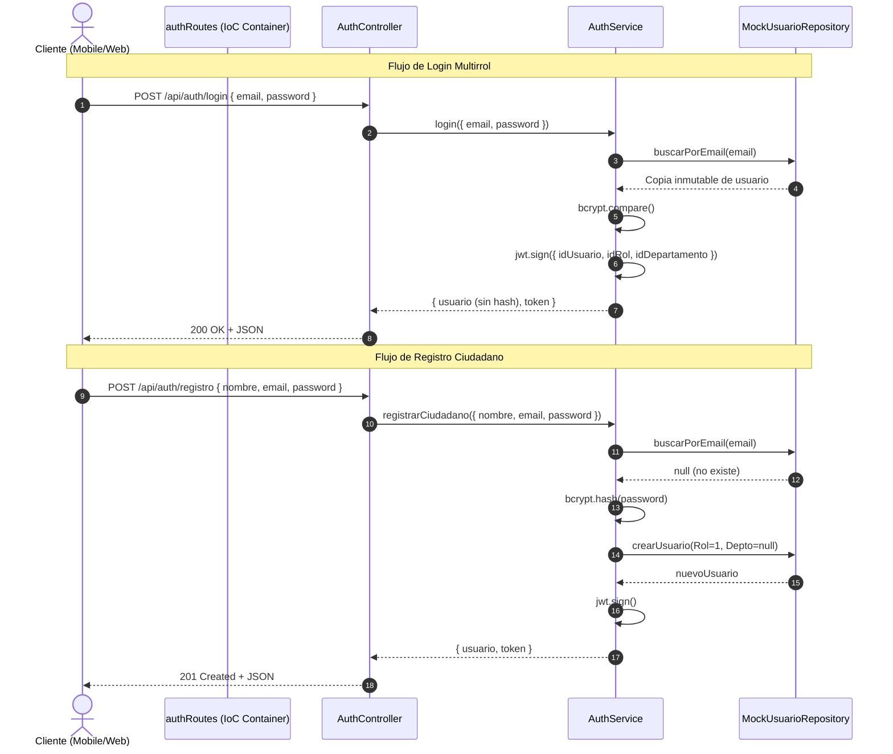

# Documentación Técnica: Historia de Usuario US-001
**Módulo:** Backend (Autenticación y Mocks Multirrol)  
**Desarrollador a Cargo:** Isaac Ochoa Bocanegra  
**Fecha de Implementación:** 2026-10-22  
**Estado:** Completado y Verificado (9/9 Tests Pasados)

---

## 1. Resumen de la Historia de Usuario y Valor de Negocio
- **Identificador:** US-001
- **Objetivo:** Implementar la API de autenticación y persistencia simulada multirrol para soportar el registro público de ciudadanos y la emisión de tokens JWT para los 4 perfiles del sistema ("Mejora SJR").
- **Valor de Negocio:** 
  1. Habilita el canal de entrada digital seguro para los ciudadanos de San Juan del Río.
  2. Implementa un repositorio en memoria (`MockUsuarioRepository`) que permite al equipo de Frontend (React Native y Next.js) realizar pruebas e integraciones sin depender de la conectividad en vivo con Azure SQL.
  3. Previene escalamiento de privilegios y ataques de enumeración de cuentas.

---

## 2. Reglas de Negocio Implementadas

1. **Registro Exclusivo de Ciudadano:**
   - La API pública de registro fuerza `idRol = 1` e `idDepartamento = null`.
   - Cualquier parámetro de rol enviado por el cliente es ignorado o bloqueado en el Backend (Cero Confianza).
2. **Estructura Multirrol en Mock:**
   - Se configuraron 4 cuentas semilla con contraseña predeterminada `Password123!` hasheada con `bcrypt`:
     - `ciudadano@test.com` $\rightarrow$ Rol 1, Departamento `null`.
     - `trabajador@test.com` $\rightarrow$ Rol 2, Departamento 1 (JAPAM).
     - `admin@test.com` $\rightarrow$ Rol 3, Departamento 2 (Servicios Públicos).
     - `superadmin@test.com` $\rightarrow$ Rol 4, Departamento `null`.
3. **Seguridad y Cero Confianza:**
   - Hash con sal (10 rounds) vía `bcryptjs`.
   - Prevención de Enumeración de Usuarios: El endpoint de login retorna `401 Credenciales inválidas.` tanto si el correo no existe como si la contraseña es errónea.
   - Generación de JWT firmado con claims esenciales: `idUsuario`, `email`, `idRol`, `idDepartamento`.

---

## 3. Mapeo Arquitectónico y Cumplimiento SOLID

| Capa / Archivo | Principio SOLID | Responsabilidad Arquitectónica |
| :--- | :--- | :--- |
| `src/repositories/IUsuarioRepository.js` | **ISP** (Segregación de Interfaces) / **DIP** (Inversión de Dependencias) | Contrato abstracto que define las operaciones de persistencia sin atarse a SQL ni Mocks. |
| `src/repositories/MockUsuarioRepository.js` | **LSP** (Sustitución de Liskov) / **OCP** (Abierto/Cerrado) | Implementación en memoria que retorna copias inmutables (`{ ...usuario }`) para evitar *test pollution* y mutaciones de estado. |
| `src/repositories/SqlUsuarioRepository.js` | **LSP** (Sustitución de Liskov) / **DIP** | Implementación para Azure SQL utilizando queries 100% parametrizadas (anti SQL Injection) y la cláusula atómica `OUTPUT INSERTED` de T-SQL. |
| `src/services/AuthService.js` | **SRP** (Responsabilidad Única) / **DIP** | Lógica de negocio pura (hashing, comparación, emisión JWT, validaciones de unicidad). Validación Fail-Fast de `JWT_SECRET`. |
| `src/controllers/AuthController.js` | **SRP** | Controlador delgado (*Skinny Controller*). Sin `try/catch` ni lógica de negocio; delega la captura de errores a Express 5. |
| `src/middlewares/errorHandler.js` | **SRP** / **Zero-Trust** | Middleware central de captura de errores con validación estricta de códigos HTTP (`[400, 599]`) y ocultación de trazas en producción. |
| `src/config/envValidator.js` | **Fail-Fast** | Valida configuración crítica antes de iniciar el servidor. Prohíbe mocks en producción. |
| `src/routes/authRoutes.js` | **DIP** / **IoC** (Inversión de Control) | Contenedor de ensamblado (Factory) que inyecta dependencias sin acoplamiento a variables globales. |

---

## 4. Evolución y Refactorizaciones Arquitectónicas (¿Por qué se modificó?)

Durante el ciclo de desarrollo se aplicaron tres mejoras de ingeniería fundamentales:

1. **Eliminación de `try/catch` en Controladores (Controladores Delgados):**
   - *Motivo:* Tener bloques `try/catch` locales en cada controlador violaba el Principio de Responsabilidad Única (SRP), mezclando el flujo HTTP con el formateo de errores y duplicando código.
   - *Solución:* Se aprovechó el soporte nativo de promesas asíncronas de **Express 5**, delegando todas las excepciones al middleware centralizado `errorHandler.js`.
2. **Blindaje Fail-Fast de `JWT_SECRET` (OWASP):**
   - *Motivo:* El código anterior contaba con un secreto de respaldo (*fallback*) escrito directamente en código. Si la variable de entorno no existía, el sistema firmaba tokens con una clave pública insegura.
   - *Solución:* Se eliminó el fallback. Se implementó una validación estricta que aborta la inicialización de forma controlada si `JWT_SECRET` no está presente, es vacío o contiene solo espacios en blanco.
3. **Desacoplamiento de `app.js` y `server.js`:**
   - *Motivo:* Anteriormente `app.js` intentaba conectarse forzosamente a Azure SQL en su evaluación, impidiendo correr pruebas unitarias en entornos desconectados.
   - *Solución:* Se separó `app.js` (fábrica pura `createApp`) de `server.js` (proceso físico de red), permitiendo pruebas ultrarrápidas y aislando la conexión a Azure SQL.
4. **Implementación de `SqlUsuarioRepository`:**
   - *Motivo:* Dar persistencia física en la base de datos de Azure SQL sin romper los contratos del frontend.
   - *Solución:* Se construyó `SqlUsuarioRepository` utilizando `OUTPUT INSERTED`, reduciendo latencia a la mitad y garantizando atomicidad frente a condiciones de carrera.

---

## 4. Diagrama de Interacción de Capas

---

## 5. Pruebas Automatizadas (Evidencia)
Se implementaron pruebas con **Jest** y **Supertest** en `tests/auth.test.js`:
- ✅ Registro exitoso de ciudadano (IdRol=1, IdDepartamento=null, token emitido).
- ✅ Rechazo de duplicados (409 Conflict).
- ✅ Rechazo de campos faltantes (400 Bad Request).
- ✅ Login exitoso para los 4 roles (Ciudadano, Trabajador, Admin, Superadmin).
- ✅ Verificación de claims en el payload del JWT.
- ✅ Rechazo de contraseña inválida (401 Unauthorized).
- ✅ Rechazo de usuario inexistente con mensaje idéntico para evitar enumeración.
