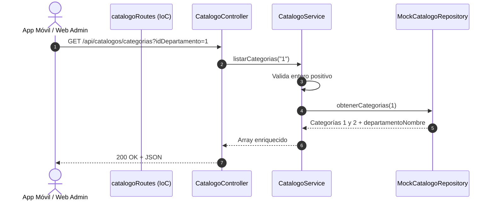

# Documentación Técnica: Historia de Usuario US-002
**Módulo:** Backend (API de Catálogos - Departamentos y Categorías)  
**Desarrollador a Cargo:** Isaac Ochoa Bocanegra  
**Fecha de Implementación:** 2026-10-22  
**Estado:** Completado y Verificado (14/14 Tests Pasados)

---

## 1. Resumen de la Historia de Usuario y Valor de Negocio
- **Identificador:** US-002
- **Objetivo:** Exponer los endpoints RESTful para la consulta de catálogos oficiales del municipio de San Juan del Río (Departamentos y Categorías), resolviendo de forma canónica la relación de llave foránea.
- **Valor de Negocio:**
  1. Brinda a las aplicaciones Frontend (Móvil en React Native y Web Admin en Next.js) el catálogo oficial para el levantamiento y categorización de incidencias.
  2. Enriquecimiento del contrato de respuesta: entrega el nombre del departamento padre (`departamentoNombre`) junto a cada categoría, eliminando *round-trips* de red adicionales en redes móviles inestables.
  3. Soporta filtrado opcional por departamento (`?idDepartamento=X`) para dashboards segregados.

---

## 2. Diccionario de Datos y Reglas de Negocio Implementadas

### Departamentos Oficiales
| IdDepartamento | Nombre |
| :---: | :--- |
| **1** | JAPAM |
| **2** | Servicios Públicos |

### Categorías y Mapeo de Llave Foránea (FK)
| IdCategoria | Nombre | IdDepartamento | Departamento Padre |
| :---: | :--- | :---: | :--- |
| **1** | Fugas de agua | 1 | JAPAM |
| **2** | Alcantarillado | 1 | JAPAM |
| **3** | Alumbrado | 2 | Servicios Públicos |
| **4** | Bacheo | 2 | Servicios Públicos |

---

## 3. Mapeo Arquitectónico y Cumplimiento SOLID

| Capa / Archivo | Principio SOLID | Responsabilidad Arquitectónica |
| :--- | :--- | :--- |
| `src/repositories/ICatalogoRepository.js` | **ISP** (Segregación de Interfaces) / **DIP** (Inversión de Dependencias) | Contrato específico que declara las operaciones de catálogos (`obtenerDepartamentos`, `obtenerCategorias`). No contamina otros repositorios. |
| `src/repositories/MockCatalogoRepository.js` | **LSP** (Sustitución de Liskov) / **OCP** (Abierto/Cerrado) | Implementación en memoria que simula la base de datos relacional y devuelve copias inmutables con resolución de llave foránea. |
| `src/services/CatalogoService.js` | **SRP** (Responsabilidad Única) / **DIP** | Validación de parámetros (`idDepartamento` entero positivo) y orquestación de reglas de negocio. |
| `src/controllers/CatalogoController.js` | **SRP** | Adaptador HTTP: extrae `req.query`, invoca al servicio y serializa respuestas estándar JSON (`200`, `400`, `500`). |
| `src/routes/catalogoRoutes.js` | **DIP** / **IoC** (Inversión de Control) | Factory para el cableado manual de dependencias y registro de rutas (`GET /departamentos`, `GET /categorias`). |

---

## 4. Evolución y Refactorización Arquitectónica (¿Por qué se modificó?)

1. **Controlador Delgado (*Skinny Controller*) en `CatalogoController.js`:**
   - Se removieron los bloques `try/catch` locales en `obtenerDepartamentos` y `obtenerCategorias`.
   - Se delegó el manejo de excepciones al middleware centralizado `errorHandler.js` aprovechando la intercepción nativa de promesas en Express 5.
   - Con esto se garantiza que si `idDepartamento` viene malformado (`abc`), la excepción lanzada por `CatalogoService` con `error.statusCode = 400` sea formateada con los mismos estándares de seguridad que el resto de la aplicación.
2. **Desacoplamiento Total de la Infraestructura:**
   - La suite de pruebas de catálogos corre de forma 100% aislada e independiente en memoria, sin abrir sockets TCP ni requerir una conexión activa a Azure SQL.

---

## 5. Endpoints y Contratos de Entrada/Salida

### A. `GET /api/catalogos/departamentos`
- **Respuesta 200 OK:**
```json
{
  "success": true,
  "data": [
    { "idDepartamento": 1, "nombre": "JAPAM" },
    { "idDepartamento": 2, "nombre": "Servicios Públicos" }
  ]
}
```

### B. `GET /api/catalogos/categorias` (y opcional `?idDepartamento=1`)
- **Query Params:** `idDepartamento` (opcional, entero positivo).
- **Respuesta 200 OK:**
```json
{
  "success": true,
  "data": [
    {
      "idCategoria": 1,
      "nombre": "Fugas de agua",
      "idDepartamento": 1,
      "departamentoNombre": "JAPAM"
    },
    {
      "idCategoria": 2,
      "nombre": "Alcantarillado",
      "idDepartamento": 1,
      "departamentoNombre": "JAPAM"
    }
  ]
}
```
- **Respuesta 400 Bad Request:**
```json
{
  "success": false,
  "message": "El parámetro idDepartamento debe ser un número entero válido."
}
```

---

## 5. Diagrama de Secuencia



---

## 6. Pruebas Automatizadas (Evidencia)
En `tests/catalogos.test.js`:
- ✅ Retorno exacto de departamentos oficiales (JAPAM y Servicios Públicos).
- ✅ Retorno global de las 4 categorías con relación de llave foránea resuelta.
- ✅ Filtrado estricto por JAPAM (`idDepartamento=1`).
- ✅ Filtrado estricto por Servicios Públicos (`idDepartamento=2`).
- ✅ Validación y rechazo (400 Bad Request) ante parámetros malformados.
