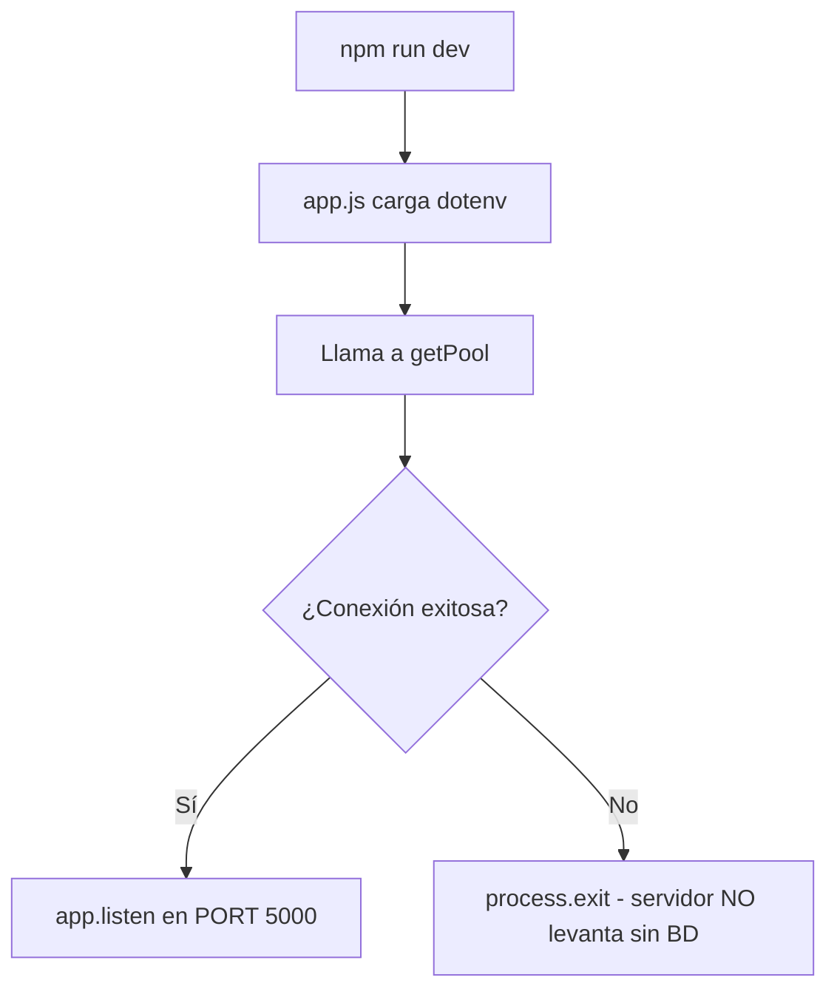

# Historia de Usuario: Conexión a Base de Datos (Azure SQL)
**Desarrollador:** Isaac

## Resumen
Se configuró la capa de infraestructura del backend para conectarse a Azure SQL usando el patrón **Singleton Pool**. Se instalaron `mssql`, `dotenv` y `express` sobre Node.js v22 LTS.

## Archivos Creados

| Archivo | Responsabilidad |
|---|---|
| `.env.example` | Plantilla pública de variables (sin credenciales reales) |
| `.gitignore` | Excluye `.env` y `node_modules` del repositorio |
| `src/config/dbPool.js` | Pool de conexión Singleton a Azure SQL |
| `app.js` | Punto de entrada del servidor Express |

## Flujo de Arranque (Bootstrap Pattern)



## Principio SOLID Aplicado
- **SRP:** `dbPool.js` solo gestiona conexiones. `app.js` solo ensambla el servidor.
- **DIP:** Los repositorios recibirán el pool inyectado; nunca instanciarán su propia conexión.

## Comandos
```bash
npm run dev    # Servidor con hot-reload (Node 22 --watch)
npm start      # Servidor producción
```
