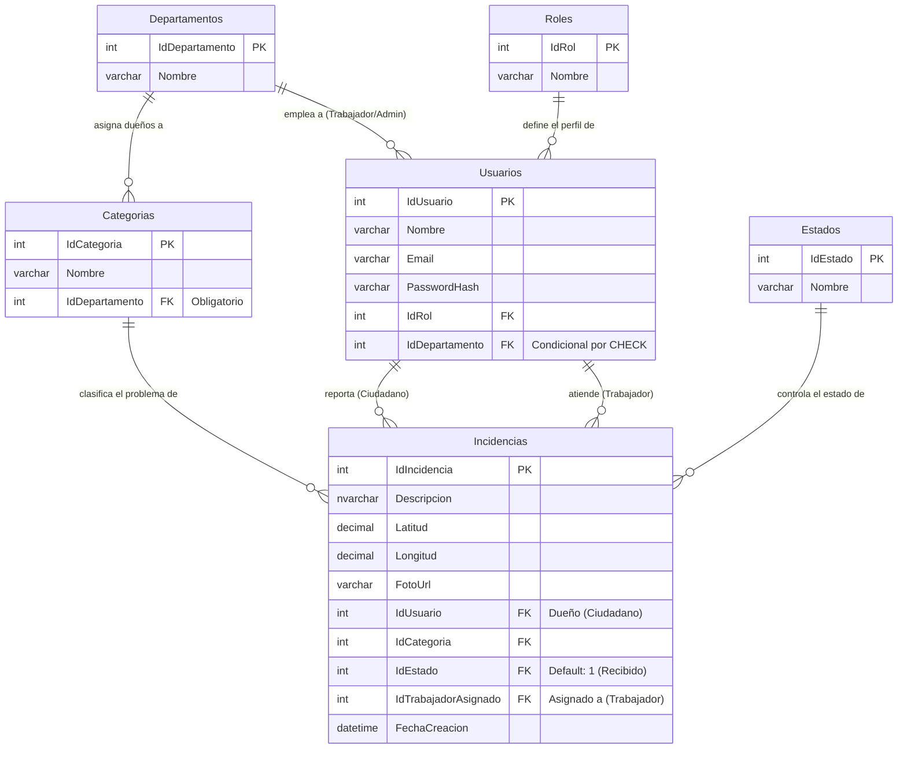

# Historia de Usuario: Diseño de Esquema de Base de Datos (Azure SQL)
**Desarrollador:** Isaac

## Resumen
Se generó el DDL maestro para la plataforma "Mejora SJR" (`schema.sql`), estableciendo las restricciones estructurales a nivel de base de datos para garantizar la integridad referencial y aislar operativamente los departamentos.

## Arquitectura y Principios Aplicados
* **Tercera Forma Normal (3NF) y SSOT:** Se evitó la redundancia al no incluir `IdDepartamento` en la tabla `Incidencias`. El departamento al que pertenece un reporte se infiere estrictamente a través de su `IdCategoria`, previniendo anomalías de actualización.
* **Integridad a nivel de Motor (Defensa en Profundidad):** Se implementó un `CONSTRAINT CHK_Usuario_Depto` en la tabla de `Usuarios` para que la propia base de datos rechace transacciones que intenten crear Trabajadores/Admins sin departamento, o Ciudadanos con un departamento asignado.

## Diagrama de Entidad-Relación (Mermaid)

## Estructura de Inyección y Flujo de Consultas (Backend)
Cuando se construyan los repositorios (`ReporteRepository`), la regla arquitectónica establecida para filtrar datos en el Dashboard Web es:
* El Controlador extraerá el `IdDepartamento` del JWT del Administrador logueado.
* El Repositorio ejecutará un `INNER JOIN` entre `Incidencias`, `Categorias` y `Departamentos`, filtrando por el departamento inyectado.
* Prohibido hacer consultas múltiples; el motor relacional debe resolverlo en un solo plan de ejecución.
