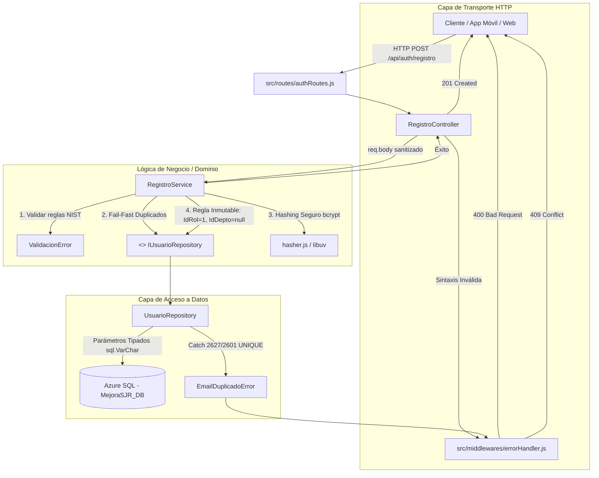

# Historia de Usuario: API de Registro y Ruteo IAM (US-001)
**Desarrollador:** Isaac Ochoa Bocanegra  
**Rama:** `sP1`  
**Estado:** Completado (56 pruebas en verde)

## 1. Resumen y Valor de Negocio
Permitir que los ciudadanos de San Juan del Río se registren de forma autónoma y segura en la plataforma Mejora SJR mediante un endpoint REST (`POST /api/auth/registro`), implementando una arquitectura estricta de N-Capas y separación de responsabilidades.

---

## 2. Diagrama de Arquitectura de Capas (N-Capas)



---

## 3. Componentes y Responsabilidades

| Componente | Capa | Responsabilidad |
|---|---|---|
| `authRoutes.js` | Red | Define el enrutador HTTP y mapea la ruta con el controlador. |
| `RegistroController.js` | Transporte HTTP | Valida sintácticamente la presencia del payload y delega al servicio o a `next(error)`. |
| `RegistroService.js` | Negocio / Dominio | Custodio de reglas: normalización de correo y nombre, validación de contraseñas, cortocircuito contra DoS de CPU, e inmutabilidad (`IdRol: 1`, `IdDepartamento: null`). |
| `IUsuarioRepository.js` | Contrato / DIP | Abstracción que desacopla la lógica de negocio de la tecnología de base de datos. |
| `UsuarioRepository.js` | Persistencia | Implementación con consultas parametrizadas para Azure SQL, cláusula `OUTPUT` segura y captura de errores `2627`/`2601`. |
| `hasher.js` | Criptografía | Hashing asíncrono en thread pool mediante `bcrypt` y variable de entorno `HASH_COST`. |
| `errorHandler.js` | Middleware | Traducción centralizada: `ValidacionError` $\rightarrow$ 400, `EmailDuplicadoError` $\rightarrow$ 409, no previstos $\rightarrow$ 500 seguro. |
| `container.js` | Inyección de Dependencias | Composition Root donde se ensamblan e inyectan todas las dependencias. |

---

## 4. Principios SOLID Aplicados
- **SRP (Single Responsibility Principle):** El controlador solo atiende HTTP; el servicio solo conoce negocio; el repositorio solo dialoga con Azure SQL; el errorHandler solo mapea códigos de estado.
- **DIP (Dependency Inversion Principle):** `RegistroService` no depende de `mssql` ni de Azure SQL; depende de la abstracción `IUsuarioRepository`.

---

## 5. Medidas de Seguridad Implementadas
1. **Prevención de DoS Asimétrico de CPU:** Se verifica la existencia del correo antes de ejecutar `bcrypt.hash`, evitando saturar el thread pool de `libuv` con peticiones duplicadas.
2. **Mitigación de Mass Assignment:** Construcción explícita y congelada (`Object.freeze`) del objeto de persistencia forzando `IdRol = 1` (Ciudadano).
3. **Plan Cache Optimization & Anti-SQL Injection:** Uso estricto de parámetros tipados (`sql.VarChar(150)`, `sql.Int`) en consultas a Azure SQL.
4. **Zero-Trust de Credenciales:** Cláusula `OUTPUT INSERTED.IdUsuario, INSERTED.Email, INSERTED.IdRol` en el `INSERT` para que el hash de la contraseña nunca retorne hacia arriba.
5. **Ofuscación de Errores Internos:** Cualquier excepción inesperada (500) responde con un mensaje genérico sin filtrar nombres de servidor, usuarios ni trazas.

---

## 6. Aseguramiento de Calidad (TDD)
- **56 pruebas pasando (100% de éxito):**
  - Pruebas unitarias de Servicio, Repositorio, Controlador, Hasher y Middleware.
  - Pruebas de integración E2E con Supertest (`POST /api/auth/registro`).
  - Validación con Mutation Testing manual en operadores de frontera.

```bash
npm test
```
