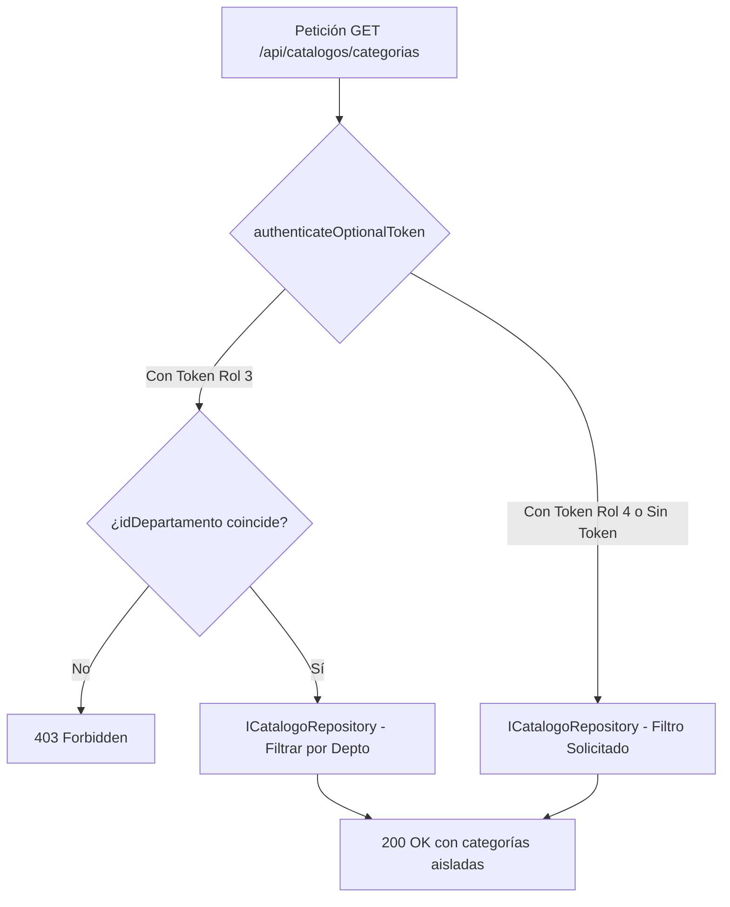

# US-030 · Aislamiento Departamental en Catálogos Municipales (JAPAM vs. Servicios Públicos)

**Módulo:** Web Administrativa (`mejora-sjr-admin`) y Backend (`mejora-sjr-backend`)  
**Alcance:** Aislamiento estricto multi-tenant por dependencia para funcionarios de área (Rol 3) y supervisión global para Superadministrador (Rol 4).

---

## 1. Reglas de Negocio Implementadas

1. **Aislamiento para Administrador de Departamento (Rol 3):**
   - Un Administrador de **JAPAM** (Rol 3, Depto 1) única y exclusivamente puede consultar y gestionar las dependencias y categorías asociadas a JAPAM (*Fugas de agua*, *Alcantarillado*).
   - Un Administrador de **Servicios Públicos** (Rol 3, Depto 2) única y exclusivamente puede consultar y gestionar las dependencias y categorías asociadas a Servicios Públicos (*Alumbrado*, *Bacheo*).
   - Queda estrictamente prohibida la visualización cruzada de categorías, métricas o tarjetas de dependencias ajenas.
   - Si un usuario Rol 3 intenta consultar mediante query params una dependencia distinta (`?idDepartamento=X`), el Backend rechaza la petición con **HTTP 403 Forbidden**.

2. **Supervisión Global para Superadministrador (Rol 4):**
   - Mantiene la capacidad omnisciente para consultar todas las dependencias y categorías municipales, alternar el filtro a *"Todas las dependencias"*, agregar dependencias y dar de alta categorías en cualquier área.

3. **Compatibilidad Pública / Ciudadana:**
   - Si la petición a la API proviene de un cliente sin token JWT (ej. la aplicación móvil en modo ciudadano o pruebas públicas), la API permite la consulta general de catálogos para levantar reportes sin fricción.

---

## 2. Arquitectura de Backend (`mejora-sjr-backend`)

- **`CatalogoService.js`:** Implementa la validación de identidad inyectando `usuarioAutenticado`. Si `idRol === 3`, valida que el departamento coincida con el reclamo del token; en caso de discrepancia, arroja error con código 403.
- **`CatalogoController.js`:** Pasa `req.usuario || req.user` de forma desacoplada al servicio.
- **`authMiddleware.js`:** Añade el middleware `authenticateOptionalToken` para decodificar credenciales Bearer sin romper rutas abiertas a la ciudadanía.
- **`catalogoRoutes.js` y `app.js`:** Conectan el middleware de autenticación opcional con inyección de dependencias `jwtSecret`.

---

## 3. Arquitectura de Frontend (`mejora-sjr-admin`)

- **`useCatalogosViewModel.ts`:**
  - `puedeCambiarFiltroDepartamento`: Verdadero solo para Superadmin (Rol 4).
  - `departamentosVisibles`: Filtra reactivamente para devolver únicamente la dependencia del funcionario cuando `idRolActor === 3`.
  - `categoriasFiltradas`: Bloquea estrictamente cualquier categoría cuyo `idDepartamento` no coincida con el del Administrador.
  - `setFiltroDepartamento`: Sanitiza la entrada e ignora intentos de cambiar el filtro hacia dependencias ajenas si el actor es Rol 3.
  - `limpiarFiltros`: Al limpiar, mantiene anclado el departamento correspondiente al actor Rol 3.
- **`CatalogosMunicipalesView.tsx`:**
  - **Tarjetas Superiores (KPIs):** Si el usuario es Rol 3, oculta la tarjeta de la secretaría ajena y muestra únicamente las métricas de su área.
  - **Tarjetas de Dependencias:** Renderiza solo la tarjeta perteneciente al departamento del actor (oculta totalmente la de la otra secretaría).
  - **Filtro de Dependencias:** Si el usuario es Rol 3, reemplaza el dropdown interactivo por un badge institucional fijo: `🏛️ Dependencia: <Nombre>`.
  - **Formulario Modal de Categoría:** El campo de selección de dependencia permanece bloqueado (`disabled`) en su departamento asignado.
