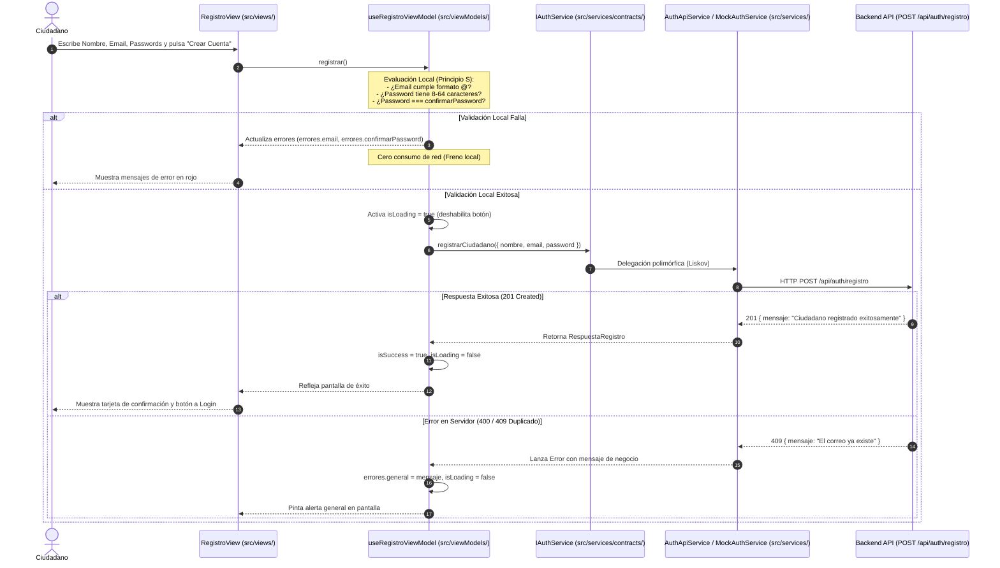

# Documentación Técnica: US-003 — UI de Registro Ciudadano (Móvil)

**Desarrollador Responsable:** Diana Margarita Hernández  
**Módulo:** `mejora-sjr-mobile`  
**Rama Git:** `sP1`  
**Patrón de Arquitectura:** MVVM (Model-View-ViewModel) + Capa de Servicios Desacoplados  
**Principios de Diseño:** SOLID y Protocolo de Cero Confianza (*Zero Trust*)

---

## 1. Resumen y Valor de Negocio

### Objetivo
Permitir a los ciudadanos del Municipio de San Juan del Río crear una cuenta desde la aplicación móvil de manera ágil y segura, recibiendo retroalimentación visual inmediata ante cualquier error de captura (correo mal estructurado o contraseñas no coincidentes).

### Valor de Negocio
1. **Experiencia de Usuario Instantánea (UX):** El ciudadano no tiene que esperar la latencia de internet ni recibir errores crípticos del servidor para enterarse de que cometió un error tipográfico en su contraseña.
2. **Eficiencia de Recursos y Ancho de Banda:** Al validar localmente en el móvil antes de enviar la petición HTTP, se evita saturar el backend con peticiones basura o incompletas, reduciendo costos operativos y consumo de datos móviles de la ciudadanía.

---

## 2. Mapa Arquitectónico y Cumplimiento SOLID

Cada archivo del flujo cumple con una responsabilidad única y estricta:

| Capa / Archivo | Principio SOLID | Responsabilidad Arquitectónica |
| :--- | :--- | :--- |
| `src/models/Registro.ts` | **S** (Single Responsibility) / **I** (Interface Segregation) | Define exclusivamente los tipos de datos del formulario y del payload de red. Separa `confirmarPassword` (que solo vive localmente) de `DatosRegistroCiudadano`. |
| `src/services/contracts/IAuthService.ts` | **I** (Interface Segregation) / **D** (Dependency Inversion) | Contrato abstracto mínimo con el método `registrarCiudadano()`. Desacopla la lógica de presentación de la librería de red (`fetch`/`axios`). |
| `src/services/mocks/MockAuthService.ts` | **L** (Liskov Substitution) | Implementación de pruebas que simula latencia y respuestas exitosas o de error sin requerir conexión a internet ni servidor encendido. |
| `src/services/api/AuthApiService.ts` | **S** (Single Responsibility) / **L** (Liskov Substitution) | Implementación real de producción. Se conecta al endpoint `POST /api/auth/registro` del backend mediante la API nativa `fetch`. |
| `src/viewModels/useRegistroViewModel.ts` | **S** (Single Responsibility) / **O** (Open/Closed) / **D** (Dependency Inversion) | El cerebro de la pantalla. Mantiene el estado (`formulario`, `errores`, `isLoading`, `isSuccess`), evalúa las reglas de validación en el cliente y gestiona el ciclo de vida del envío sin pintar interfaz. |
| `src/views/RegistroView.tsx` | **S** (Single Responsibility) | Componente puramente visual ("tonto"). Renderiza cajas de texto, mensajes de error condicionales y botones. No contiene expresiones regulares ni lógica de negocio. |

---

## 3. Protocolo de Seguridad (Regla de "Cero Confianza")

* **En el Front-End (Móvil):** Las validaciones locales se implementan con propósitos de **usabilidad y optimización**, jamás como sustituto de la seguridad.
* **En el Back-End (Node.js):** El endpoint `POST /api/auth/registro` y la clase `RegistroService.js` aplican el principio *"El cliente siempre miente"*. El backend re-valida longitud, formato de email y caracteres de la contraseña antes de guardar en la base de datos.

---

## 4. Diagrama de Secuencia e Interacción



---

## 5. Guía de Ejecución y Pruebas Locales (Mocks vs API)

### A. Para desarrollo o pruebas unitarias offline (Sin internet):
```tsx
import { RegistroView } from './src/views/RegistroView';
import { MockAuthService } from './src/services/mocks/MockAuthService';

export default function App() {
  // Inyección del Mock: no necesita servidor ni red
  return <RegistroView authService={new MockAuthService(1000, false)} />;
}
```

### B. Para producción (Conectado al servidor de San Juan del Río):
```tsx
import { RegistroView } from './src/views/RegistroView';
import { AuthApiService } from './src/services/api/AuthApiService';

export default function App() {
  // Inyección del servicio real hacia el Backend
  return <RegistroView authService={new AuthApiService('http://10.0.2.2:3000')} />;
}
```
*(Nota: `10.0.2.2` es el alias de localhost en el emulador de Android).*
