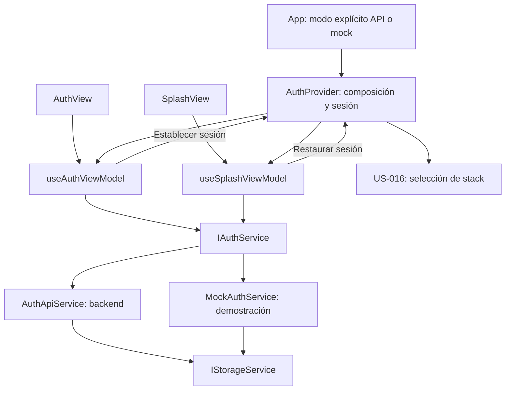

# US-003 — Autenticación móvil

**Responsable:** Miguel Leal.  
**Módulo:** mejora-sjr-mobile.  
**Arquitectura:** MVVM con servicios inyectados mediante contexto.

## 1. Objetivo y alcance

Permitir que el usuario acceda a la aplicación mediante login o registro ciudadano, vea errores de validación en rojo y llegue a la pantalla correspondiente a su perfil. Incluye el splash institucional con fondo `#0A3D62`.

Esta historia establece la autenticación base. La navegación con React Navigation, el almacenamiento nativo en SecureStore y el cierre coordinado se desarrollan en [US-016](README_HU_US016.md). Los selectores de clasificación corresponden a [US-004](README_HU_US004.md) y el diseño posterior de las pantallas a [US-017](README_HU_US017.md).

## 2. Archivos y responsabilidades

Rutas relativas a mejora-sjr-mobile:

| Archivo o carpeta | Responsabilidad |
| --- | --- |
| `App.tsx` | Selecciona el modo API/mock y monta proveedor y navegador. |
| `src/providers/AuthProvider.tsx` | Ensambla servicios, mantiene sesión y avisos y aplica la admisión de roles móviles. |
| `src/views/SplashView.tsx` | Presenta la bienvenida institucional. |
| `src/views/AuthView.tsx` | Muestra login y registro y entrega eventos al ViewModel. |
| `src/viewModels/useSplashViewModel.ts` | Coordina recuperación de token/usuario y comprobación de vigencia. |
| `src/viewModels/useAuthViewModel.ts` | Mantiene campos, valida el formulario y coordina login/registro. |
| `src/services/contracts/IAuthService.ts` | Contrato de credenciales y sesión. |
| `src/services/contracts/IStorageService.ts` | Contrato de almacenamiento de cadenas, independiente de la plataforma. |
| `src/services/api/AuthApiService.ts` | Envía HTTP, procesa la respuesta y guarda la sesión mediante el almacenamiento inyectado. |
| `src/services/mocks/MockAuthService.ts` | Simula autenticación para demostraciones explícitas; sus tokens no autentican contra la API real. |
| `src/services/storage/` | Implementaciones web/nativa descritas en US-016. |
| `src/models/auth.types.ts` | Credenciales, usuario de sesión, claims y respuesta de autenticación. |
| `src/components/CustomInput.tsx` y `CustomButton.tsx` | Controles de presentación, errores visuales y carga. |

El proveedor entrega el mismo almacenamiento seleccionado al construir AuthApiService o MockAuthService. Los ViewModels reciben servicios mediante contexto, no por constructores, y no llaman directamente a fetch o localStorage.

**SOLID:** la vista representa y el ViewModel coordina (S); autenticación consume contratos de servicios y almacenamiento (D); los contratos separados evitan mezclar catálogos con credenciales (I). Las alternativas se seleccionan en composición (O). Compartir una interfaz no demuestra por sí solo equivalencia de comportamiento (L): una autenticación mock sigue siendo simulada.

## 3. Flujo de arranque, login y registro

### Arranque

1. SplashView muestra la bienvenida y utiliza useSplashViewModel.
2. El ViewModel solicita token y usuario a IAuthService y conserva la espera visual de 1.4 segundos.
3. La validación local exige una expiración numérica finita futura. Si los datos permiten restauración, solicita establecer la sesión.
4. El proveedor comprueba la coherencia entre el rol del token y el usuario. La política de navegación de US-016 determina el stack.
5. Sin credenciales se muestra login. Si hay datos previos inválidos, el cierre coordinado los limpia antes de habilitar otro login; un fallo muestra error y reintento, como detalla US-016.

### Login y registro

1. AuthView entrega los eventos a useAuthViewModel.
2. El ViewModel exige correo con `@` y `.`, y contraseña de al menos 6 caracteres. El registro también exige nombre de al menos 3 caracteres y confirmación de contraseña coincidente.
3. Los errores se muestran con borde rojo y mensaje. Al escribir se limpia el error; no se revalida continuamente cada carácter.
4. El servicio API envía las credenciales al backend, que decide si son correctas. La respuesta esperada contiene `data: { usuario, token }`.
5. El servicio guarda los datos con IStorageService. El proveedor admite la sesión o solicita su limpieza si el perfil no corresponde al móvil.
6. El registro crea un ciudadano y conserva el acceso automático. El formulario no permite elegir un rol administrativo.

| Perfil | Resultado móvil |
| --- | --- |
| Rol 1 — Ciudadano | Crear Reporte, dentro de CitizenStack. |
| Rol 2 — Trabajador | Bandeja de Tareas, dentro de WorkerStack. |
| Roles 3 y 4 | Aviso «Accede desde el panel web» y limpieza de la sesión. |
| Rol desconocido, ilegible o diferente entre token y usuario | Aviso «Perfil no admitido» y limpieza de la sesión. |

La política se aplica en login, registro y restauración. Los avisos viven en el proveedor para conservarse al volver al login; no existe modo supervisor móvil.



## 4. Contrato HTTP y seguridad

| Endpoint | Solicitud | Resultado |
| --- | --- | --- |
| `POST /api/auth/login` | email y password. | Usuario y token. |
| `POST /api/auth/registro` | nombre, email y password. | Ciudadano y token. |

Leer claims y comprobar exp no verifica la firma JWT. La API debe verificar la firma y autorizar cada operación protegida. La validación visual no sustituye la del backend. Las comprobaciones de expiración durante el uso y su colaboración con US-018 se explican en US-016; esta historia no incorpora un manejo global de todos los 401.

## 5. Ejecución

```powershell
cd mejora-sjr-mobile
npm ci
$env:EXPO_PUBLIC_USE_MOCK = 'true'
npm start
```

Para navegador puede utilizarse `npm run web -- --clear` desde la misma carpeta. react-native-web está declarado en package.json y fijado en package-lock.json; el equipo debe obtener ambos.

Para API, cambiar EXPO_PUBLIC_USE_MOCK a `'false'` y reiniciar Expo. Si no se define, App selecciona servicios API. El panel de cuentas rápidas rellena credenciales de demostración; no garantiza que esas cuentas existan en SQL.

apiConfig.ts prioriza una EXPO_PUBLIC_API_URL no local; después el host detectado por Expo con puerto 5000 y sufijo /api; después la variable local; finalmente localhost:5000/api. En un teléfono, localhost es el teléfono. No colocar secretos en EXPO_PUBLIC_*.

## 6. Verificación y límites

La entrega inicial registró TypeScript sin errores, exportación web y comprobaciones aisladas de expiración, roles y almacenamiento. Miguel reportó funcionamiento en Expo Go y confirmó la carga web después de instalar su dependencia. Esos antecedentes no certifican todos los escenarios ni la integración SQL.

Para aceptación, comprobar login por rol, registro con acceso automático, errores de credenciales, restauración, expiración y logout. La evidencia técnica posterior de almacenamiento/navegación y las pruebas manuales pendientes están en US-016.

Los mocks no sustituyen pruebas del backend. La persistencia de una sesión no hace persistentes las cuentas creadas en memoria por MockAuthService. El formulario de reportes y la bandeja de demostración se documentan en US-017, no como parte del login.

La instalación inicial de estas HU informó 8 vulnerabilidades; ese dato era del árbol de dependencias de aquella entrega, no una auditoría actual. Las observaciones posteriores de dependencias se conservan en US-016. No se aplicaron actualizaciones forzadas durante esas entregas.
