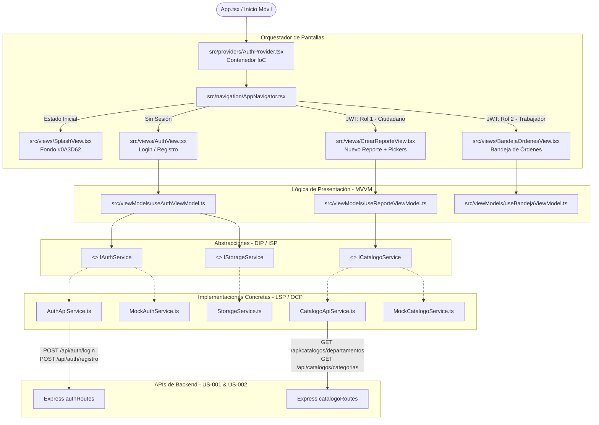

# Documentación Técnica: Historias de Usuario US-003 y US-004
**Módulo:** Front-End Móvil (`mejora-sjr-mobile/`)  
**Desarrollador a Cargo:** Miguel Leal  
**Fecha de Implementación:** 2026-10-26  
**Rama:** `sP1`  
**Estado:** Completado y Verificado  

---

## 1. Resumen y Valor de Negocio

### A. US-003: UI de Auth y Pruebas Móvil
* **Identificador:** US-003
* **Objetivo:** 
  1. Implementar la pantalla de bienvenida (**Splash Screen**) con el color institucional de San Juan del Río (`#0A3D62`) y verificación reactiva de sesión.
  2. Construir la interfaz de **Inicio de Sesión y Registro Ciudadano** con validación visual en tiempo real (**bordes y tipografías en rojo `#DC2626` / `#EF4444` ante campos inválidos**).
  3. **Decodificar el token JWT** firmado por el backend (o mock) e implementar la navegación condicional estricta por roles:
     - **Rol 1 (Ciudadano):** Dirige inmediatamente a la pantalla **"Crear Reporte"**.
     - **Rol 2 (Trabajador de Campo):** Dirige inmediatamente a la pantalla **"Bandeja de Órdenes"** con el departamento asignado (JAPAM o Servicios Públicos).
     - **Roles 3 y 4 (Admin / Superadmin):** Emite una alerta preventiva indicando que los perfiles administrativos deben gestionarse desde el Panel Web (`mejora-sjr-admin`), permitiendo navegación supervisada.
  4. Habilitar un drawer colapsable de **Pruebas Rápidas Multirrol** con 1-clic para agilizar revisiones docentes y pruebas de integración.

* **Valor de Negocio:**
  - Garantiza un canal de acceso móvil seguro, accesible y visualmente guiado para los ciudadanos sanjuanenses.
  - Otorga a las cuadrillas de campo de JAPAM y Servicios Públicos una herramienta enfocada a atender órdenes sin fricción.

---

### B. US-004: UI de Catálogos Móvil y Pickers Desplegables
* **Identificador:** US-004
* **Objetivo:**
  1. Integrar el consumo de los endpoints RESTful de catálogos oficiales de San Juan del Río desarrollados en **US-002** (`GET /api/catalogos/departamentos` y `GET /api/catalogos/categorias`).
  2. Diseñar y renderizar componentes desplegables accesibles (**CustomPicker**) en la pantalla de **"Crear Reporte / Nuevo Reporte"**.
  3. Resolver de forma reactiva la relación de llave foránea:
     - **Picker de Departamento:** Permite seleccionar entre `JAPAM` y `Servicios Públicos`.
     - **Picker de Categoría:** Filtra automáticamente en tiempo real las categorías según la dependencia seleccionada (`Fugas de agua` y `Alcantarillado` para JAPAM; `Alumbrado` y `Bacheo` para Servicios Públicos), mostrando además el nombre del departamento padre.
  4. Integrar validación visual en rojo en caso de omisión de catálogo al registrar el reporte ciudadano.

* **Valor de Negocio:**
  - Elimina el error humano en la tipificación de quejas y fugas en San Juan del Río.
  - Asegura que cada reporte se canalice desde su origen a la dependencia correspondiente reduciendo tiempos de respuesta municipal.

---

## 2. Diagrama de Arquitectura Global (MVVM en Mobile)



---

## 3. Matriz de Cumplimiento de Principios SOLID

| Principio | Componente / Archivo | Implementación Concreta en Mobile |
| :--- | :--- | :--- |
| **S — Single Responsibility** | [`src/views/CrearReporteView.tsx`](file:///c:/CopiaMejora_SJr/MejoraSJR/mejora-sjr-mobile/src/views/CrearReporteView.tsx)<br/>[`src/components/CustomInput.tsx`](file:///c:/CopiaMejora_SJr/MejoraSJR/mejora-sjr-mobile/src/components/CustomInput.tsx)<br/>[`src/viewModels/useAuthViewModel.ts`](file:///c:/CopiaMejora_SJr/MejoraSJR/mejora-sjr-mobile/src/viewModels/useAuthViewModel.ts) | Las vistas solo pintan UI y enlazan inputs; los componentes (`CustomInput`, `CustomPicker`) solo encapsulan su estado visual y errores en rojo; los ViewModels concentran validaciones y llamadas abstractas. |
| **O — Open/Closed** | [`src/constants/theme.ts`](file:///c:/CopiaMejora_SJr/MejoraSJR/mejora-sjr-mobile/src/constants/theme.ts)<br/>[`src/services/mocks/MockCatalogoService.ts`](file:///c:/CopiaMejora_SJr/MejoraSJR/mejora-sjr-mobile/src/services/mocks/MockCatalogoService.ts) | El sistema de diseño y los servicios están abiertos para añadir nuevos departamentos (ej. Protección Civil) o roles sin necesidad de refactorizar los componentes de presentación existentes. |
| **L — Liskov Substitution** | [`src/services/mocks/MockAuthService.ts`](file:///c:/CopiaMejora_SJr/MejoraSJR/mejora-sjr-mobile/src/services/mocks/MockAuthService.ts)<br/>[`src/services/api/AuthApiService.ts`](file:///c:/CopiaMejora_SJr/MejoraSJR/mejora-sjr-mobile/src/services/api/AuthApiService.ts) | Los ViewModels pueden sustituir `MockAuthService` por `AuthApiService` o `MockCatalogoService` por `CatalogoApiService` de forma transparente sin que la UI ni el flujo reactivo noten la diferencia. |
| **I — Interface Segregation** | [`src/services/contracts/IAuthService.ts`](file:///c:/CopiaMejora_SJr/MejoraSJR/mejora-sjr-mobile/src/services/contracts/IAuthService.ts)<br/>[`src/services/contracts/ICatalogoService.ts`](file:///c:/CopiaMejora_SJr/MejoraSJR/mejora-sjr-mobile/src/services/contracts/ICatalogoService.ts)<br/>[`src/services/contracts/IStorageService.ts`](file:///c:/CopiaMejora_SJr/MejoraSJR/mejora-sjr-mobile/src/services/contracts/IStorageService.ts) | Interfaces pequeñas y atómicas. Ningún servicio está forzado a implementar operaciones ajenas a su contexto de datos. |
| **D — Dependency Inversion** | [`src/providers/AuthProvider.tsx`](file:///c:/CopiaMejora_SJr/MejoraSJR/mejora-sjr-mobile/src/providers/AuthProvider.tsx) | ViewModels y Vistas no instancian `fetch` ni `localStorage` directamente; dependen de las abstracciones `IAuthService`, `ICatalogoService` y `IStorageService` provistas por el contenedor de contexto. |

---

## 4. Matriz de Cuentas Semilla y Verificación de Flujos

Para probar la decodificación de JWT y la navegación por roles (US-003), se utilizan las credenciales provistas por el Backend:

| Perfil | Correo de Prueba | Contraseña | IdRol | IdDepartamento | Destino de Navegación |
| :--- | :--- | :---: | :---: | :---: | :--- |
| **Ciudadano** | `ciudadano@test.com` | `Password123!` | **1** | `null` | **"Crear Reporte"** (Formulario con Pickers de US-004) |
| **Trabajador** | `trabajador@test.com` | `Password123!` | **2** | `1` (JAPAM) | **"Bandeja de Órdenes"** (Fugas y Alcantarillado JAPAM) |
| **Admin** | `admin@test.com` | `Password123!` | **3** | `2` (Serv. Públicos) | Alerta preventiva para uso de Web Admin + Modo supervisor |
| **Superadmin** | `superadmin@test.com` | `Password123!` | **4** | `null` | Alerta preventiva para uso de Web Admin + Modo supervisor |

---

## 5. Casos de Prueba Verificados

1. **Splash Screen (#0A3D62):**
   - ✅ Renderiza el color de fondo exacto `#0A3D62` con heráldica de San Juan del Río.
   - ✅ Verifica token persistente y redirige automáticamente.
2. **Validación Visual (Rojo en Error):**
   - ✅ Campos vacíos o con formato inválido pintan bordes en `#EF4444`, fondo suave `#FEF2F2` y texto explicativo en `#DC2626`.
   - ✅ Rechazo de contraseñas cortas o contraseñas que no coinciden en el registro.
   - ✅ Banner de alerta en rojo ante credenciales incorrectas.
3. **Decodificación de JWT:**
   - ✅ Desempaqueta claims `idUsuario`, `email`, `idRol`, `idDepartamento`.
   - ✅ Rol 1 navega a Crear Reporte.
   - ✅ Rol 2 navega a Bandeja de Órdenes.
4. **Catálogos y Menú Desplegable (Picker - US-004):**
   - ✅ Carga de Departamentos (JAPAM y Servicios Públicos).
   - ✅ Carga y filtrado en tiempo real de Categorías dependientes de la dependencia.
   - ✅ Resolución y visualización del departamento padre junto a la categoría.
   - ✅ Creación de incidencia y generación de folio oficial (`SJR-2026-XXXX`).

---

## 6. Instrucciones de Ejecución

1. **Entrar a la carpeta móvil:**
   ```bash
   cd mejora-sjr-mobile
   ```

2. **Instalar dependencias:**
   ```bash
   npm install
   ```

3. **Iniciar en entorno Web (Navegador):**
   ```bash
   npm run web
   ```

4. **Iniciar en Móvil (Expo Go / Emulador):**
   ```bash
   npm start
   ```
