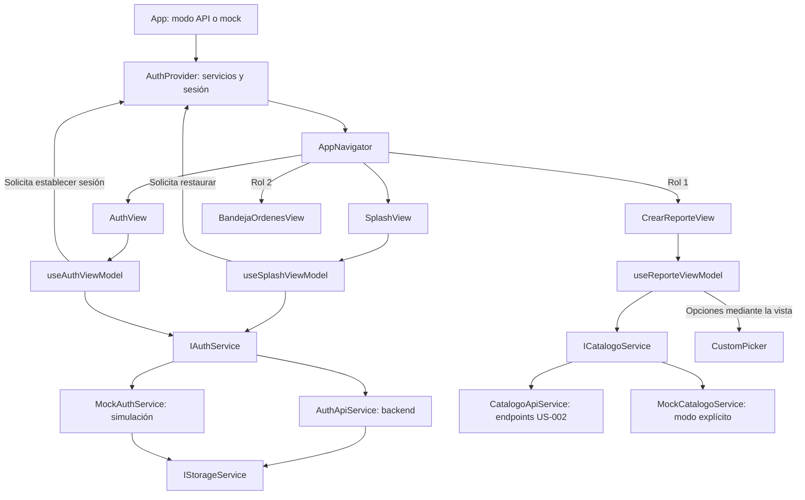

# US-003 y US-004 — Autenticación y catálogos móviles

**Responsable:** Miguel Leal

**Módulo:** `mejora-sjr-mobile`

**Arquitectura:** MVVM con servicios inyectados mediante contexto.

## 1. Qué resuelve cada historia

| Historia | Funcionalidad | Valor para el usuario |
| --- | --- | --- |
| **US-003** | Splash azul `#0A3D62`, login y registro con errores visuales, recuperación de sesión y navegación por rol. | Acceder a la aplicación y llegar a la pantalla correspondiente a su perfil. |
| **US-004** | Consulta de departamentos y categorías de US-002 mediante selectores en Crear Reporte. | Clasificar el reporte y seleccionar la dependencia responsable. |

La aplicación puede usar servicios API o mocks explícitos para demostraciones. En modo API, un error de consulta no se reemplaza por datos simulados.

## 2. Arquitectura y responsabilidades

Todas las rutas siguientes pertenecen a `mejora-sjr-mobile/`.

| Componente | Responsabilidad |
| --- | --- |
| `App.tsx` | Selecciona el modo API/mock y monta el proveedor y el navegador. |
| `src/providers/AuthProvider.tsx` | Ensambla servicios, mantiene sesión y avisos, admite roles móviles y selecciona el destino. |
| `src/navigation/AppNavigator.tsx` | Renderiza la pantalla indicada por el proveedor. |
| `src/views/` y `src/components/` | Presentan datos, colores, mensajes y controles; entregan eventos al ViewModel. |
| `src/viewModels/useSplashViewModel.ts` | Coordina recuperación de sesión, comprobación de expiración y continuación al login. |
| `src/viewModels/useAuthViewModel.ts` | Mantiene campos, valida el formulario y coordina login y registro. |
| `src/viewModels/useReporteViewModel.ts` | Consulta catálogos, prepara opciones y coordina las selecciones del reporte. |
| `src/services/contracts/` | Define `IAuthService`, `ICatalogoService` e `IStorageService`. |
| `src/services/api/` | Implementa las llamadas HTTP y la decodificación del JWT. |
| `src/services/mocks/` | Ofrece datos de demostración sin consultar el backend. |
| `src/services/storage/StorageService.ts` | Guarda y elimina datos de sesión: localStorage en web o memoria cuando no está disponible. |
| `src/models/` | Define tipos de credenciales, sesión, JWT y catálogos. |

**SOLID aplicado:** las vistas presentan y los ViewModels coordinan (S); los contratos permiten incorporar implementaciones alternativas (O y D); catálogos y almacenamiento tienen contratos separados de autenticación (I). API y mock implementan las mismas interfaces, pero esto no demuestra por sí solo equivalencia de comportamiento (L): el mock no autentica contra el servidor y sus tokens son simulados.

El proveedor entrega el mismo almacenamiento seleccionado al construir AuthApiService o MockAuthService. Los ViewModels reciben servicios mediante el contexto, no mediante constructores, y no utilizan fetch ni localStorage directamente.

## 3. US-003: flujo de autenticación

### Arranque y splash

1. `SplashView` muestra el fondo institucional y utiliza `useSplashViewModel`.
2. El ViewModel solicita token y usuario a `IAuthService` y conserva una espera visual de 1.4 segundos.
3. Si hay token, lo decodifica y comprueba que `exp` sea un número finito mayor que la hora actual en segundos.
4. Un token vencido, ilegible o sin expiración válida provoca logout y regreso al login. Logout elimina token y usuario guardados; si el almacenamiento falla, se abre login, pero no se garantiza el borrado.
5. Si el token está vigente y existe el usuario, el proveedor comprueba el rol antes de restaurar la sesión. Sin datos suficientes, se abre login.

### Login y registro

1. `AuthView` entrega los eventos del formulario a `useAuthViewModel`.
2. Al enviar, el ViewModel comprueba correo obligatorio con `@` y `.`, y contraseña de al menos 6 caracteres. En registro también exige nombre de al menos 3 caracteres y confirmación de contraseña coincidente.
3. Los errores se muestran con borde rojo y mensaje. Al escribir se limpia el error; no se revalida continuamente cada carácter.
4. El servicio API envía las credenciales al backend, que decide si son correctas. La respuesta esperada contiene `data: { usuario, token }`.
5. El servicio guarda la respuesta mediante `IStorageService`. El proveedor admite o rechaza la sesión y determina la pantalla; si rechaza, solicita eliminar los datos guardados.

El registro crea un ciudadano y conserva el acceso automático. No permite seleccionar un rol desde el formulario.

| Perfil | Resultado en la aplicación móvil |
| --- | --- |
| Rol 1 — Ciudadano | Crear Reporte. |
| Rol 2 — Trabajador | Bandeja de Órdenes. |
| Roles 3 y 4 | Login con «Accede desde el panel web» y eliminación de la sesión. |
| Rol desconocido, ilegible o diferente entre token y usuario | Login con «Perfil no admitido» y eliminación de la sesión. |

La política se aplica en login, registro y restauración. El aviso vive en el proveedor para conservarse al volver al login; no existe un modo supervisor móvil.

**Seguridad:** leer el JWT y comprobar exp no verifica su firma. El backend debe verificar el token y autorizar cada operación protegida. La comprobación de expiración del splash no añade cierre automático durante el uso ni manejo global de respuestas 401.

## 4. US-004: flujo de catálogos

1. Al montar Crear Reporte, el ViewModel solicita departamentos y categorías en paralelo mediante `ICatalogoService`.
2. Convierte las respuestas en opciones de presentación: `label`, `value` y `extraInfo`.
3. Elegir departamento filtra las categorías y limpia una categoría seleccionada que pertenezca a otro departamento.
4. Sin departamento seleccionado se muestran todas las categorías. Elegir una selecciona automáticamente su departamento padre, aunque el texto del control sugiera elegir departamento primero.
5. `CustomPicker` muestra las opciones en un modal con lista. No consulta servicios; emite el valor seleccionado.
6. Durante la carga se bloquean los selectores. Si falla HTTP, la red o la lectura de JSON, el ViewModel presenta el error recibido; no se activa un fallback a mocks.

Si se intenta enviar sin departamento o categoría, se muestran errores en rojo. El nombre del departamento padre se presenta cuando viene en `departamentoNombre`.

| Endpoint | Uso y datos principales |
| --- | --- |
| `POST /api/auth/login` | Envía email y password; recibe usuario y token. |
| `POST /api/auth/registro` | Envía nombre, email y password; recibe ciudadano y token. |
| `GET /api/catalogos/departamentos` | Recibe `data` con idDepartamento y nombre. |
| `GET /api/catalogos/categorias` | Recibe `data` con idCategoria, nombre, idDepartamento y departamentoNombre opcional. |

El adaptador admite filtrar categorías por query, pero el ViewModel actual obtiene todas y filtra localmente. En el backend actual, los catálogos se sirven mediante MockCatalogoRepository incluso cuando los usuarios provienen de SQL: consumir el endpoint no demuestra persistencia SQL de catálogos.

## 5. Diagrama del flujo



Las alternativas API/mock se eligen en el proveedor, no cuando falla una petición.

## 6. Cómo ejecutar

Desde la raíz del repositorio, instalar las dependencias fijadas para el módulo:

```powershell
cd mejora-sjr-mobile
npm ci
```

`react-native-web` permite representar los componentes en navegador. Está declarado en package.json y fijado en package-lock.json; el equipo debe obtener ambos archivos.

Para demostración con mocks y Expo Go:

```powershell
$env:EXPO_PUBLIC_USE_MOCK = 'true'
npm start
```

Para navegador, desde la misma carpeta:

```powershell
$env:EXPO_PUBLIC_USE_MOCK = 'true'
npm run web -- --clear
```

Para consumir el backend, cambiar la variable a `'false'` y reiniciar Expo. Si no se define, App selecciona los servicios API. El panel de cuentas rápidas rellena credenciales de demostración; no garantiza que esas cuentas existan en SQL.

`apiConfig.ts` resuelve la URL así: variable EXPO_PUBLIC_API_URL no local; después host detectado por Expo con puerto 5000 y sufijo /api; después la variable local configurada; finalmente localhost:5000/api. Por ello, una URL local no siempre tiene prioridad sobre Expo. En un teléfono, localhost se refiere al teléfono. No colocar secretos en variables EXPO_PUBLIC_*.

## 7. Validación y límites actuales

**Comprobado:** TypeScript sin errores, exportación web completada y comprobaciones aisladas de catálogos, expiración, roles y almacenamiento. Miguel reportó funcionamiento en Expo Go y confirmó que la página web cargó después de instalar la dependencia. Esto no certifica por sí solo todos los escenarios ni la integración con SQL.

Para aceptación funcional en Expo Go y navegador, comprobar:

- Roles 1 y 2 llegan a sus pantallas; 3 y 4 permanecen en login con aviso.
- Registro conserva el acceso automático; credenciales incorrectas muestran error.
- Sesión vigente se restaura donde haya persistencia; token vencido vuelve a login.
- Los selectores filtran y mantienen coherencia entre departamento y categoría.
- En modo API, los datos corresponden a respuestas HTTP; al fallar el servidor aparece un error.

**Límites que no deben confundirse con funcionalidades terminadas:**

- En plataformas sin localStorage la sesión se guarda en memoria y se pierde al reiniciar el proceso.
- El envío de reportes y el folio son simulados; no existe un POST de incidencia en este formulario. La ubicación es fija y la fotografía usa imágenes de demostración.
- La bandeja utiliza órdenes locales; sus cambios no se guardan en el servidor.
- Los mocks no sustituyen las pruebas del backend ni la verificación de firma y autorización.
- La instalación informó 8 vulnerabilidades en el árbol de dependencias. Falta evaluar npm audit; no se aplicaron actualizaciones forzadas.
