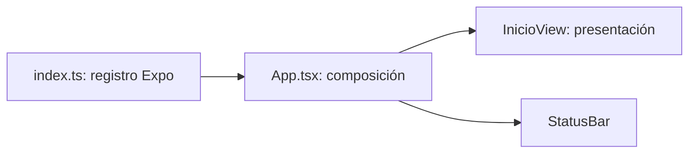

# US-004 — UI de Login y Sesión (App)

**Responsable:** Miguel Angel Leal (Miguel).
**Estado:** en desarrollo, bloque 1: base móvil.

## Objetivo y acuerdos

El ciudadano iniciará sesión con correo y contraseña y accederá a una pantalla inicial con cierre de sesión. La sesión debe conservarse al volver antes de cinco minutos fuera de la app; a partir de cinco minutos fuera, deberá eliminarse localmente y solicitar login. Mientras permanezca usando la app, se desea conservar la sesión.

La expiración fija de un JWT es diferente del tiempo fuera de la app. El cliente no puede extender su validez. Falta acordar con backend cómo renovar la autenticación durante el uso continuo. No existe aún un endpoint de login; no se ha implementado autenticación, renovación ni almacenamiento de tokens. Un rechazo por token vencido sin renovación exige limpiar la sesión; un error de red no demuestra expiración.

## Bloque 1: base Expo con TypeScript

Se utilizó la plantilla oficial `blank-typescript` de create-expo-app. Se conservaron las carpetas MVVM existentes y sus archivos `.gitkeep`. La plantilla se extrajo temporalmente en otra carpeta porque el generador rechaza destinos con una carpeta `src` existente; después se integraron sus archivos y se eliminó la carpeta temporal.

- `package.json`: dependencias y comandos; `package-lock.json` fija el árbol instalado cuando finalice la instalación.
- `app.json`: nombre visible Mejora SJR, identificador de proyecto `mejora-sjr-mobile`, orientación e iconos de plantilla. Los iconos no son identidad visual final.
- `tsconfig.json`: hereda la configuración de Expo y activa `strict` para comprobación estática.
- `index.ts`: registra el componente raíz con Expo.
- `App.tsx`: compone la vista inicial y la barra de estado.
- `src/views/InicioView.tsx`: pantalla provisional con título y mensaje; usa componentes nativos y estilos locales, sin peticiones ni validaciones.
- `.gitignore`: excluye dependencias, cachés de Expo y salidas generadas.



## Responsabilidades y dependencias

Separar composición y presentación aplica responsabilidad única: la vista describe lo que se muestra; el punto de entrada registra la aplicación. No se crean interfaces, servicios ni ViewModels vacíos: todavía no hay estado o comportamiento de negocio que separar o inyectar.

Cuando abordemos login, la vista consumirá el ViewModel; este recibirá servicios a través de contratos específicos. Los adaptadores API, mock y almacenamiento deberán respetar esos contratos. Esta arquitectura futura aún no está implementada.

Versiones de la plantilla descargada: Expo `~57.0.29`, React `19.2.3`, React Native `0.86.3`, TypeScript `~6.0.3` y expo-status-bar `~57.0.1`. Se usó Node `26.8.2` con npm `11.19.1` desde la instalación existente de nvm, sin cambiar la versión global. SecureStore se incorporará en el bloque de persistencia; no está instalado todavía.

## Ejecución para el equipo

Desde `mejora-sjr-mobile`, después de activar Node con nvm:

```powershell
npm ci
npm run typecheck
npm start
```

`npm ci` requiere el archivo de bloqueo generado durante la instalación. Expo muestra las opciones de conexión; para usar un teléfono mediante QR, se necesita Expo Go compatible con el SDK y conectividad con la computadora, normalmente en la misma red. `localhost` en el teléfono no representa la computadora.

Este bloque prepara Android/iOS. No se incorporaron dependencias web ni script web. Para abrir un simulador iOS local se necesita macOS; en Windows se puede usar un dispositivo iOS compatible con Expo Go. El backend no es necesario para esta pantalla estática.

## Validación y pendientes

Validación realizada el 15 de octubre de 2026:

- Instalación completada: 467 paquetes y `package-lock.json` generado.
- `npm run typecheck`: correcto, sin errores de TypeScript.
- `npx expo export --platform android`: correcto; Metro empaquetó 581 módulos y generó el bundle Android en `dist` (ignorado por Git). Esto no genera un APK ni demuestra ejecución en un teléfono.
- npm notificó que la dependencia transitiva `uuid@7.0.3` está obsoleta. No impidió la instalación; no se cambiaron versiones transitivas fuera de la plantilla.

Pendiente: prueba visual con Expo Go en un dispositivo. La comprobación de tipos y el empaquetado no sustituyen esta prueba.

Pendientes: formulario y estados del login, contratos y servicio simulado, integración con API real, SecureStore, restauración y cierre de sesión, tiempo en segundo plano y tratamiento del cierre abrupto del proceso. La US-004 no está terminada. La pantalla provisional no demuestra autenticación.

Referencia: https://docs.expo.dev/more/create-expo/
