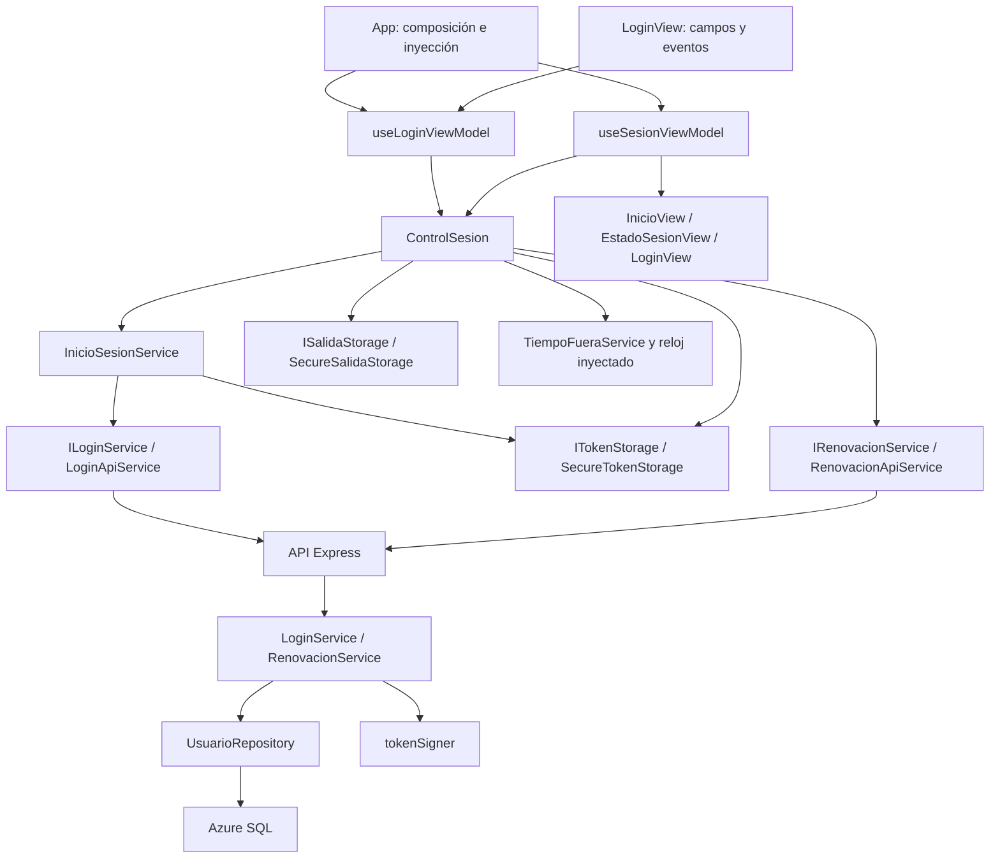

# US-004 — Login y sesión móvil

**Responsable:** Miguel Angel Leal.
**Fecha de actualización:** 15 de octubre de 2026.
**Estado:** implementación integrada y pruebas automatizadas correctas; aceptación pendiente en dispositivo contra backend con acceso a Azure SQL. No marcar la HU como terminada hasta completar esa prueba.

## 1. Comportamiento implementado

- Login con correo y contraseña; el móvil envía `canal: "movil"`.
- Acceso a InicioView solo después de autenticar y guardar el JWT en SecureStore.
- Cierre local: bloquea el acceso, elimina token y marca temporal y muestra login. No revoca copias remotas.
- Al salir de la app, conserva la hora de salida. Regresar con menos de cinco minutos exige además validación del servidor mediante renovación. Desde cinco minutos exactos, borra la sesión local y solicita login.
- Al arrancar, lee token y marca temporal. No muestra InicioView hasta completar las comprobaciones y guardar el token renovado.
- Mientras está activa, guarda un punto de recuperación cada 30 segundos y solicita renovación aproximadamente cada minuto. No renueva periódicamente en segundo plano.
- Un 401 de renovación elimina la sesión. Red, timeout, 403 o 5xx bloquean el acceso con opciones de reintentar o cerrar; no se interpretan automáticamente como token vencido.
- Sin URL de API sigue visible Modo de prueba: MockLoginService simula únicamente rechazo. No permite probar un login exitoso ni entrega tokens falsos al servidor.

La continuidad requiere conexión y un JWT aún válido. Un token ya vencido no se renueva: exige credenciales. No se ha implementado refresh token.

## 2. Arquitectura final



### Responsabilidades por archivo

| Archivo / carpeta móvil | Responsabilidad |
| --- | --- |
| `index.ts` | Registro del componente raíz con Expo. |
| `App.tsx` | Ensambla dependencias concretas una vez; elige API o mock según URL; muestra la vista correspondiente al estado. |
| `src/models/Login.ts` | Credenciales, solicitud móvil, respuesta y errores de formulario. |
| `src/views/LoginView.tsx` | Campos, errores, botón, carga y accesibilidad; no valida ni hace HTTP. |
| `src/views/InicioView.tsx` | Pantalla inicial y acción de cerrar sesión. |
| `src/views/EstadoSesionView.tsx` | Comprobación de sesión y error con reintento/cierre; no decide autorización. |
| `src/viewModels/useLoginViewModel.ts` | Estado del formulario y validación local; depende de IInicioSesionService. |
| `src/viewModels/useSesionViewModel.ts` | Suscribe estado del coordinador, escucha AppState y activa el pulso cada 30 segundos; limpia listeners e intervalo al desmontar. |
| `src/services/InicioSesionService.ts` | Autenticar y guardar, en ese orden; intenta limpiar ante escritura fallida. |
| `src/services/ControlSesion.ts` | Orquesta inicio, recuperación, renovación, tiempo fuera y cierre mediante cola serial. |
| `src/services/TiempoFueraService.ts` | Regla temporal de 300000 ms con reloj inyectado. No verifica el JWT. |
| `src/services/api/LoginApiService.ts` | POST login; selecciona campos, valida respuesta externa como unknown y conserva errores HTTP. |
| `src/services/api/RenovacionApiService.ts` | POST renovar con Bearer; valida el token de respuesta y conserva el estado HTTP de error. |
| `src/services/storage/SecureTokenStorage.ts` | Guardar/leer/eliminar token mediante API nativa inyectada. |
| `src/services/storage/SecureSalidaStorage.ts` | Guardar/leer/eliminar marca temporal, validando entero seguro no negativo. |
| `src/services/mocks/MockLoginService.ts` | Rechazo controlado tras 800 ms para probar formulario/carga sin backend. |

Contratos pequeños: ILoginService autentica; IInicioSesionService completa autenticación y persistencia; ITokenStorage e ISalidaStorage almacenan datos distintos; IRenovacionService renueva; IControlSesion expone estado, suscripción y operaciones del ciclo de sesión. ControlSesion implementa IInicioSesionService a través de IControlSesion, por lo que el formulario no necesita conocer las operaciones de restauración o cierre.

**SOLID:** responsabilidad única separa presentación, HTTP, almacenamiento y coordinación. Las clases reciben dependencias por constructor; los hooks las reciben por parámetro. Los consumidores dependen de contratos; las pruebas reemplazan HTTP, repositorios, almacenamiento y reloj. No se agregaron métodos de login al contrato de registro existente.

## 3. Flujo por bloques

### Inicio de sesión

1. La vista comunica cambios al ViewModel. Se valida presencia/formato de correo y presencia de contraseña. El correo se normaliza; la contraseña se envía sin alterar.
2. El ViewModel invoca IInicioSesionService. En App esta dependencia es ControlSesion, que serializa la operación y delega en InicioSesionService.
3. LoginApiService envía solo email, password y canal móvil. No envía un rol elegido por el usuario.
4. El backend valida credenciales y admite únicamente el rol obtenido de BD que corresponda al canal.
5. El adaptador exige mensaje y token no vacíos. Un 200 incompleto se rechaza.
6. Se espera el guardado en SecureStore. Luego se registra la marca de recuperación. Solo entonces se publica fase activa y se muestra InicioView. El formulario limpia correo y contraseña.
7. Si falla guardar, se intenta eliminar cualquier token previo/parcial y se muestra error. No se declara una sesión persistida si la escritura o limpieza falló.

### Renovación y recuperación

1. Al arrancar o regresar, la UI permanece bloqueada mientras se comprueba la sesión.
2. Si no hay token, se limpian restos locales y se muestra login.
3. Si no hay marca válida, el reloj está antes de la marca o han transcurrido 300000 ms o más, se elimina la sesión y se muestra login.
4. Si cumple el tiempo, se envía el token a `/api/auth/renovar`. La comprobación local no concede acceso por sí sola.
5. El servidor verifica firma HS256 y expiración; exige token de canal móvil e identificador válido, consulta el usuario por ID y comprueba que su rol actual siga siendo 1 o 2.
6. Emite un JWT nuevo a partir de los datos actuales de BD, sin copiar iat/exp del anterior.
7. El cliente espera el guardado del nuevo token y actualiza la marca de actividad antes de mostrar InicioView.

### Tiempo fuera, uso continuo y cierre abrupto

AppState distingue active de inactive/background. Se considera fuera desde que deja de estar active; dos avisos consecutivos fuera no reinician el plazo. En Android, desplegar notificaciones puede generar blur sin cambiar AppState: este flujo utiliza change, no blur.

Al volver dentro del plazo y renovar correctamente se actualiza la marca; la próxima salida registra un intervalo nuevo. El uso continuo no suma tiempo fuera. Cada pulso de 30 segundos mantiene un punto de recuperación; si han transcurrido al menos 60 segundos desde la última renovación se renueva.

La marca también sirve como último punto de actividad ante muerte del proceso sin evento de salida. No se puede garantizar capturar el instante exacto de un cierre forzado. Se usa conservadoramente el último punto guardado: podría pedir login algo antes de cinco minutos desde el cierre real, especialmente si el sistema demoró los temporizadores. No se promete que un temporizador funcione con la app cerrada.

La hora local no es una prueba contra manipulación deliberada del dispositivo. El servidor sigue siendo responsable de validar el JWT; la regla de cinco minutos fuera es una política local de esta aplicación.

### Concurrencia y cierre

ControlSesion serializa operaciones. La generación de sesión cambia inmediatamente al cerrar; una renovación tardía no puede volver a marcar acceso activo. Otra versión de actividad impide que una respuesta recibida tras salir sobrescriba el tiempo fuera como si el usuario siguiera dentro.

Al pulsar Cerrar sesión se bloquea la pantalla inmediatamente y se encola la limpieza. Si una petición estaba en curso, la limpieza espera su finalización (timeout HTTP de 10 segundos) y su resultado no puede reactivar sesión. Un borrado fallido muestra error; reintentar no restaura automáticamente esa sesión mientras haya cierre pendiente. No se afirma que el token desapareció si el almacenamiento falló.

## 4. Contratos HTTP y backend

### POST /api/auth/login

```json
{ "email": "ciudadano@ejemplo.com", "password": "contraseña de prueba", "canal": "movil" }
```

Móvil: 200 con `{ "mensaje": "Login exitoso", "token": "<JWT>" }`, sin cookie.

Web: canal omitido o `web` conserva cookie HttpOnly y JSON solo con mensaje. Admite roles 3 y 4. Móvil admite 1 y 2. Otro canal produce 400. Credenciales o admisión rechazadas producen 401, conservando el comportamiento existente. Ambos transportes usan Cache-Control: no-store en éxito.

### POST /api/auth/renovar

```http
Authorization: Bearer <JWT móvil vigente>
```

Respuesta: 200 con `{ "mensaje": "Sesión renovada", "token": "<nuevo JWT>" }` y Cache-Control: no-store. No necesita reenviar contraseña ni enviar rol. Rechaza con 401 firma inválida, expiración, token web, payload no admitido, usuario eliminado o rol actual no móvil. Un fallo de BD/configuración sigue siendo 500, no se disfraza de credenciales vencidas.

Se agregaron RenovacionController y RenovacionService, ensamblados en container.js y authRoutes.js. UsuarioRepository.buscarPorId consulta IdUsuario, Nombre, IdRol e IdDepartamento con parámetro SQL; no recupera PasswordHash ni requiere migración de tablas.

### Duración y límites de seguridad

Los JWT móviles nuevos duran **15 minutos**. Web conserva JWT_EXPIRES_IN o 8 horas por defecto. La aplicación móvil intenta renovar cada minuto mientras está activa y al regresar/restaurar. Cada nuevo token recibe otra vigencia de 15 minutos. No se renuevan tokens ya vencidos: es necesario iniciar sesión de nuevo.

Esta es renovación mediante JWT vigente, **no un refresh token ni revocación**. Conforme al acuerdo de cierre local, el servidor no mantiene una sesión revocable ni una lista de tokens revocados. Una copia de un JWT sigue aceptándose hasta su expiración y, mientras esté vigente, puede solicitar renovación si el usuario sigue admitido; no podemos garantizar invalidación remota al cerrar. La sesión local no protege por sí sola endpoints administrativos: cada operación protegida debe verificar token y permisos. Este trabajo no implementa todos los middlewares de futuras funcionalidades.

Tokens móviles emitidos antes de incluir el claim canal no se renuevan; requieren un login nuevo. Cambios de rol se reflejan al renovar, no invalidan instantáneamente un token que otro endpoint aún acepte.

## 5. Almacenamiento y dependencias

Claves: `mejora_sjr.auth.token.v1` y `mejora_sjr.auth.salida.v1`. No se almacenan contraseñas ni se registran tokens en consola. Lecturas fallidas no se confunden con ausencia; datos corruptos bloquean recuperación.

SecureStore `~57.0.4` se instaló con `npx expo install expo-secure-store`; su plugin está en app.json. No se añadió ninguna dependencia para esta integración de renovación. SecureStore opera en Android/iOS, sin fallback a almacenamiento web. En iOS el Keychain puede sobrevivir a una reinstalación; por eso siempre se revalida tiempo y token al restaurar.

Base: Expo ~57.0.29, React 19.2.3, React Native 0.86.3 y TypeScript ~6.0.3. Validado desde Node 26.8.2/npm 11.19.1 mediante la instalación existente de nvm, sin cambiar su versión global.

## 6. Preparación del equipo y prueba real

El backend de Miguel no está disponible: el arranque reportó que config.server es obligatorio. dbPool.js obtiene ese campo de DB_SERVER. No se modificaron credenciales ni se demostró una caída de Azure: falta configuración utilizable del servidor SQL en ese proceso. app.js conecta a BD antes de escuchar HTTP.

El responsable con acceso debe:

1. Preparar variables privadas de BD y JWT_SECRET en backend; no copiarlas al móvil ni al repositorio.
2. Ejecutar `npm ci` y `npm start` desde mejora-sjr-backend y comprobar conexión a BD y puerto HTTP.
3. Verificar desde el teléfono `http://IP-DEL-SERVIDOR:PUERTO/health` (5000 por defecto). Teléfono y servidor deben poder comunicarse; localhost en el teléfono no apunta a la laptop.
4. En mejora-sjr-mobile copiar `.env.example` a `.env.local`; configurar EXPO_PUBLIC_API_URL con la URL base, sin `/api/auth/login`. En producción usar HTTPS.
5. Ejecutar `npm ci`, `npm start` y recargar completamente Expo Go. Sin URL se mantiene modo de prueba. Un error de API real no activa el mock.

Las variables EXPO_PUBLIC se incorporan al bundle y no son secretas. Solo poner la URL pública de la API, nunca JWT_SECRET, contraseñas de BD o tokens. `.env.local` está ignorado por Git.

## 7. Validación automatizada

Backend, desde mejora-sjr-backend:

```powershell
npm test -- --runInBand
```

**95 pruebas correctas / 8 suites.** Incluye 22 pruebas de canales y 17 de renovación. Renovación usa firma/verificación JWT reales y repositorio simulado: cubre expiración, algoritmo, firma ajena, nbf, canal, sub, usuario eliminado, rol actual y error de BD. No conecta a Azure SQL.

Móvil, desde mejora-sjr-mobile:

```powershell
npm run typecheck
node --test tests/*.test.mjs
npx expo export --platform android --platform ios
```

**69 pruebas correctas** y comprobación TypeScript correcta. Cubren adaptadores HTTP, timeout de renovación, contrato de respuestas, guardado/borrado, validación del formulario, límites temporales, recuperación, red/401/403/5xx y carreras entre renovación/salida/cierre. El almacenamiento y reloj de pruebas son simulados; no demuestran cifrado nativo ni renderizado de los hooks. Exportar genera bundles, no APK/IPA ni prueba una cuenta real.

Node emite una advertencia de detección de módulos al ejecutar TypeScript directamente; no impide las pruebas. npm reportó previamente 22 vulnerabilidades del árbol (7 moderadas y 15 altas); no se determinó aquí su impacto ni se ejecutó audit fix. Su revisión sigue pendiente del equipo.

## 8. Criterios de aceptación pendientes en dispositivo

- Login real válido guarda token y abre InicioView; contraseña incorrecta mantiene login.
- Salir 2 minutos y volver: pantalla de comprobación y restauración tras validación del servidor.
- Salir 5 minutos o más: token eliminado y login; repetir incluyendo cierre de proceso.
- Usar continuamente más de 15 minutos con conectividad: la renovación mantiene la sesión.
- Cerrar sesión: volver al formulario vacío; reiniciar no debe restaurar el token eliminado.
- Desconectar red al restaurar: mostrar error con reintento/cierre, sin acceso a InicioView. Reconectar y reintentar conforme al plazo.
- Token rechazado con 401: limpieza y login. Error 5xx o red no debe clasificarse como expiración.
- Comprobar teclado, accesibilidad, tamaño de texto grande y pantallas pequeñas.
- Revisar AppState en Android e iOS, incluida transición inactive y cierre abrupto.

La HU queda lista para esa validación integrada; no debe declararse aceptada solo por pasar las pruebas automatizadas.

## Referencias oficiales

- https://docs.expo.dev/versions/latest/sdk/securestore/
- https://docs.expo.dev/guides/environment-variables/
- https://reactnative.dev/docs/appstate
- https://github.com/auth0/node-jsonwebtoken