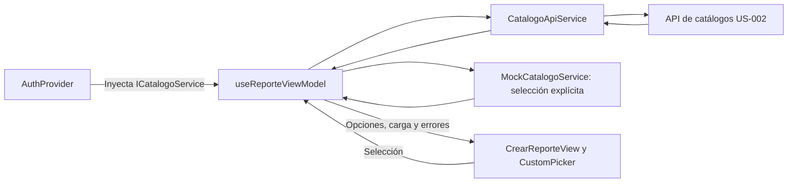

# US-004 — Catálogos en el formulario móvil

**Responsable:** Miguel Leal.  
**Módulo:** mejora-sjr-mobile.  
**Arquitectura:** MVVM con servicio de catálogos inyectado.

## 1. Objetivo y alcance

Consumir los departamentos y categorías de US-002 para clasificar un reporte mediante selectores. La selección mantiene la relación entre categoría y departamento responsable.

Esta HU depende de los endpoints de catálogos de Isaac. El acceso a la aplicación corresponde a [US-003](README_HU_US003.md), la navegación a [US-016](README_HU_US016.md) y el diseño posterior del formulario a [US-017](README_HU_US017.md). Consumir catálogos no implica que el reporte ya pueda persistirse.

## 2. Archivos y responsabilidades

Rutas relativas a mejora-sjr-mobile:

| Archivo | Responsabilidad |
| --- | --- |
| `src/providers/AuthProvider.tsx` | Construye e inyecta CatalogoApiService o MockCatalogoService según el modo explícito. |
| `src/views/CrearReporteView.tsx` | Presenta selectores, carga y errores y entrega los valores elegidos. |
| `src/components/CustomPicker.tsx` | Muestra opciones en un modal con lista y emite la selección; no consulta servicios. |
| `src/viewModels/useReporteViewModel.ts` | Consulta catálogos, prepara opciones, filtra categorías y coordina selecciones. |
| `src/services/contracts/ICatalogoService.ts` | Define obtenerDepartamentos y obtenerCategorias. |
| `src/services/api/CatalogoApiService.ts` | Implementa consultas HTTP y propaga los errores. |
| `src/services/mocks/MockCatalogoService.ts` | Devuelve datos de demostración cuando el proveedor lo selecciona explícitamente. |
| `src/services/api/apiConfig.ts` | Resuelve la URL base del backend. |
| `src/models/catalogo.types.ts` | Define Departamento, Categoria y PickerItem. |

**SOLID:** el control presenta, el ViewModel coordina y el adaptador comunica HTTP (S). ICatalogoService mantiene las consultas separadas de autenticación (I) y permite inyectar implementaciones sin modificar la vista (D/O). API y mock deben respetar el contrato; implementar los mismos tipos no demuestra por sí solo todos los comportamientos de sustitución (L).

## 3. Flujo y selección relacionada

1. Al montar Crear Reporte, useReporteViewModel solicita departamentos y categorías en paralelo mediante ICatalogoService.
2. Convierte las respuestas en PickerItem con label, value y extraInfo.
3. Elegir un departamento filtra categorías. Si la categoría seleccionada pertenece a otro departamento, se limpia.
4. Sin departamento elegido se muestran todas las categorías. Elegir una selecciona automáticamente su departamento padre.
5. CustomPicker muestra el valor y las opciones, y entrega el valor seleccionado al ViewModel.
6. Durante la carga se bloquean los selectores. Si falla HTTP, la red o la lectura JSON, se representa el error recibido. El diseño actual de US-017 también ofrece reintento usando cargarCatalogos.

Si se intenta simular el envío sin departamento o categoría, el ViewModel muestra errores rojos. El departamento padre se presenta cuando la respuesta incluye departamentoNombre.



API y mock son alternativas de composición. Una falla de API no activa automáticamente el mock.

## 4. Endpoints y datos

| Endpoint | Datos principales de data |
| --- | --- |
| `GET /api/catalogos/departamentos` | idDepartamento y nombre. |
| `GET /api/catalogos/categorias` | idCategoria, nombre, idDepartamento y departamentoNombre opcional. |

El adaptador admite filtrar categorías mediante query, pero este ViewModel obtiene todas y filtra localmente. Los endpoints actuales son públicos.

El backend monta MockCatalogoRepository incluso si los usuarios proceden de SQL. Por ello, una respuesta HTTP real no demuestra persistencia SQL de catálogos.

## 5. Ejecución

```powershell
cd mejora-sjr-mobile
npm ci
$env:EXPO_PUBLIC_USE_MOCK = 'true'
npm start
```

Para web, ejecutar `npm run web -- --clear`. Para consumir US-002, usar EXPO_PUBLIC_USE_MOCK con valor `'false'`, disponer del backend y reiniciar Expo. Sin variable, App utiliza servicios API.

apiConfig.ts prioriza una EXPO_PUBLIC_API_URL no local; después el host detectado por Expo con puerto 5000 y /api; después la variable local; finalmente localhost:5000/api. Una URL local no siempre prevalece sobre Expo. En teléfono, localhost no es el equipo de desarrollo. No guardar secretos en EXPO_PUBLIC_*.

## 6. Validación y límites

La entrega inicial registró TypeScript sin errores, exportación web y comprobaciones aisladas de catálogos. Miguel confirmó el funcionamiento general en Expo Go y la carga web; eso no certifica todos los escenarios ni una fuente SQL.

Para aceptar esta HU, comprobar:

- Carga de ambos selectores y presentación del departamento padre.
- Filtro de categorías al cambiar departamento y limpieza de selecciones incompatibles.
- Selección de categoría antes del departamento con resolución de su padre.
- Errores rojos cuando falta clasificación.
- En modo API, datos procedentes de HTTP y error visible cuando no se puede consultar, sin sustituirlos por mocks.

El envío, la fotografía, la ubicación y el folio siguen siendo simulaciones identificadas en US-017. Los catálogos no constituyen un POST de incidencia ni una confirmación de registro.

## 7. Documentación relacionada

- [US-002 — API de catálogos de Isaac](../Isaac/README_HU_002.md).
- [US-003 — Autenticación móvil](README_HU_US003.md).
- [US-016 — Navegación y sesión segura](README_HU_US016.md).
- [US-017 — Pantallas móviles y simulaciones](README_HU_US017.md).
