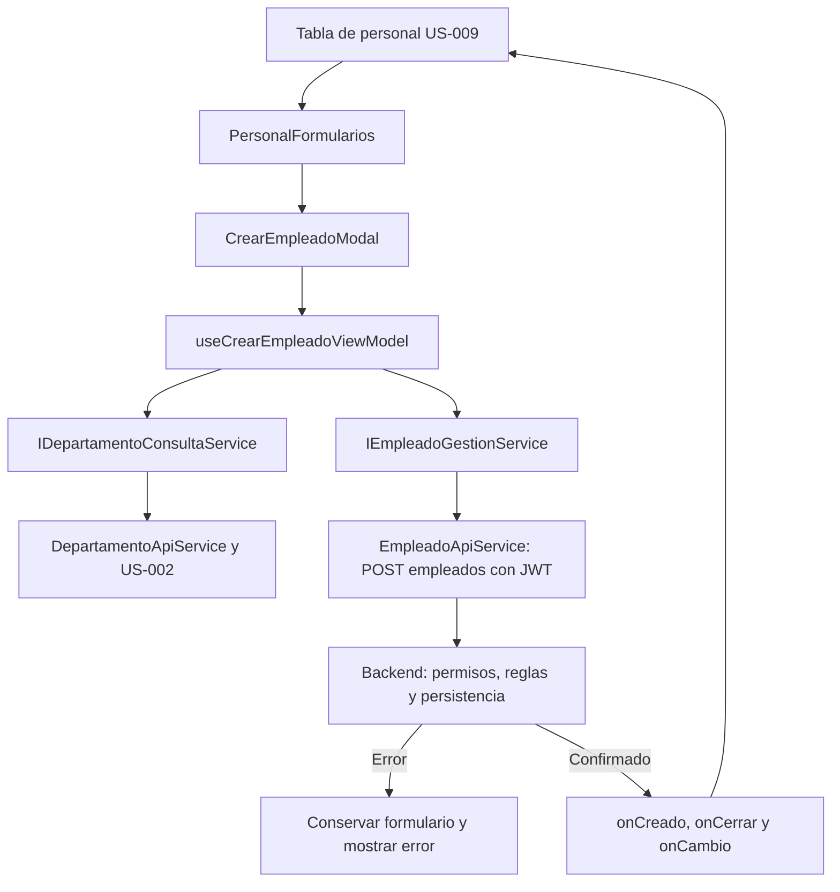

# US-010 — Formulario web de creación de empleados

**Responsable:** Miguel Leal.  
**Módulo:** mejora-sjr-admin.  
**Arquitectura:** MVVM con dependencias inyectadas.  
**Estado:** formulario implementado; funcionamiento local confirmado por Miguel en la entrega inicial. La creación comparte composición y tabla con [US-011](README_HU_US011.md).

## 1. Objetivo y comportamiento

Crear trabajadores y administradores de departamento desde un modal sin abandonar el listado de personal. El formulario solicita nombre, correo, contraseña inicial, rol y departamento. La interfaz permite roles 2 y 3, ambos con departamento obligatorio; su apertura requiere rol 4.

La tabla corresponde a US-009 de Oscar y la API de empleados a US-008 de Isaac. Esta HU incorpora el formulario, su estado y el adaptador necesario; no reemplaza esos módulos.

## 2. Flujo de creación

1. El contenedor establece la acción crear. PersonalFormularios comprueba el acceso visual y ensambla el hook y la vista.
2. CrearEmpleadoModal presenta campos y mensajes; entrega eventos al ViewModel sin llamar fetch ni validar reglas.
3. useCrearEmpleadoViewModel consulta departamentos mediante useDepartamentosViewModel. Mientras cargan, si fallan o no hay opciones, bloquea guardar y permite reintento.
4. El ViewModel valida y llama a IEmpleadoGestionService. EmpleadoApiService agrega el JWT actual y envía el payload.
5. Durante el envío se bloquean campos, confirmación y cierre. Una referencia impide dos envíos antes del siguiente render.
6. Ante error, el modal conserva datos y sigue abierto. No informa éxito ni agrega una fila inventada.
7. Tras confirmación del backend, emite onCreado; la composición solicita cierre y publica onCambio de tipo creado.
8. La tabla aplica el empleado confirmado y recarga la consulta. Si falla el refresco, representa ese error por separado sin repetir el POST.



## 3. Archivos y responsabilidades

Rutas relativas a mejora-sjr-admin/src:

| Archivo o carpeta | Responsabilidad |
| --- | --- |
| `models/empleado.types.ts` | Empleado, roles 2/3 y CrearEmpleadoDTO. La contraseña solo pertenece a creación. |
| `models/catalogo.types.ts` | Tipo Departamento. |
| `models/personalFormulario.types.ts` | Acciones de apertura y cambios confirmados. |
| `services/contracts/` | Contratos separados de consulta de empleados, gestión y departamentos; IPersonalServices permite ensamblarlos. |
| `services/api/EmpleadoApiService.ts` | Envía creación por HTTP y valida/normaliza la respuesta. |
| `services/api/DepartamentoApiService.ts` | Consulta y valida departamentos. |
| `services/api/ApiError.ts` | Conserva mensaje y status; null si no hubo respuesta o el rechazo fue local. |
| `providers/crearPersonalApiServices.ts` | Construye adaptadores con acceso al token y URL inyectados. |
| `providers/PersonalFormularios.tsx` | Selecciona y conecta formulario, hook y eventos. |
| `viewModels/usePersonalFormulariosViewModel.ts` | Admisión visual del rol 4 y notificación al contenedor. |
| `viewModels/useCrearEmpleadoViewModel.ts` | Campos, validación, envío y estado de creación. |
| `viewModels/useDepartamentosViewModel.ts` | Carga, error y reintento del catálogo. |
| `views/personal/CrearEmpleadoModal.tsx` | Presentación del formulario. |
| `components/ui/Modal.tsx` | Diálogo nativo, etiquetas, foco, Escape y bloqueo de cierre. |
| `providers/PersonalPruebas.tsx` y `viewModels/usePersonalPruebasViewModel.ts` | Composición y consulta de la pantalla de desarrollo. |
| `app/dashboard/personal/formularios/page.tsx` | Acceso de desarrollo; devuelve 404 en producción. |

**SOLID:** vista, coordinación y HTTP están separados (S). Los contratos admiten implementaciones alternativas (O/D) y cada consumidor recibe solo consulta/gestión/catálogo según necesita (I). Una alternativa debe respetar datos, errores y comportamiento, no solo tipos (L).

No se añadieron bibliotecas para estos formularios. Modal utiliza dialog/showModal; el navegador controla el foco dentro del diálogo y el componente intenta devolverlo al elemento de apertura.

## 4. Payload, validación y respuestas

| Operación | Endpoint | Resultado del servicio |
| --- | --- | --- |
| Departamentos | `GET /api/catalogos/departamentos` | Departamento[]. El endpoint actual es público. |
| Crear empleado | `POST /api/empleados` | Empleado normalizado. |

CrearEmpleadoDTO contiene nombre, email, password, idRol e idDepartamento. Se exige nombre no vacío, formato básico de correo, contraseña no vacía, rol 2/3 y departamento presente en el catálogo. No se agregó una política de longitud de contraseña sin acordarla con el equipo.

El nombre se recorta y el correo se normaliza. La contraseña se envía como fue ingresada. El backend vuelve a validar, aplica permisos y genera su hash antes de persistir.

El adaptador exige success=true y la forma esperada de data. Normaliza activo desde true/false/0/1, omite campos extra como passwordHash y no inventa nombres opcionales de rol/departamento. Una respuesta inválida no se convierte en éxito ni hay fallback a mocks. Los errores conservan mensaje y status.

## 5. Integración con la tabla

PersonalFormularios recibe accion `{ tipo: 'crear' }`, idRolActor, servicios, onCerrar y onCambio. Solo el número 4 habilita visualmente la composición. onCerrar elimina la acción; cancelar no implica éxito. onCambio de tipo creado solo se emite tras confirmación con Empleado.

crearPersonalApiServices recibe la dependencia obtenerToken y una URL opcional. La tabla usa consulta; el formulario recibe gestión y departamentos. Las instancias se construyen una vez o se memorizan. La integración actual de PersonalDataGrid monta PersonalFormularios; el detalle de la tabla permanece en US-009.

onCambio es una notificación síncrona. El contenedor debe manejar el refresco y sus errores sin dejar promesas sin consumidor ni repetir la creación.

## 6. Ejecución y pruebas registradas

```powershell
cd mejora-sjr-admin
npm ci
$env:NEXT_PUBLIC_USE_MOCK = 'false'
$env:NEXT_PUBLIC_API_URL = 'http://localhost:5000/api'
npm run dev
```

El backend debe estar disponible. Iniciar sesión con una cuenta real de prueba de rol 4. Un token del mock de login no autentica peticiones contra la API real. La pantalla de desarrollo /dashboard/personal/formularios hereda layout/middleware, bloquea rol 3 y no se publica en producción.

La entrega inicial utilizó panel en http://127.0.0.1:3021/dashboard/personal/formularios y API en http://127.0.0.1:5051/api. Esa API se construyó con createApp, repositorios mock, secreto efímero en memoria y sin SQL/Azure. Los datos desaparecen al detenerla. La cuenta semilla superadmin@test.com y su contraseña de demostración están definidas en el mock del backend; no usar credenciales reales en esa prueba.

Evidencias registradas de la entrega conjunta original:

- Instalación de dependencias existentes en admin/backend, sin añadir paquetes ni cambiar lockfiles.
- TypeScript del panel aprobado con tsc --noEmit --incremental false.
- 5 suites y 48 pruebas del backend aprobadas.
- 12 comprobaciones HTTP sobre el flujo completo, que incluyeron login, catálogos, creación, duplicado 409 y rechazo 401; también cubrieron operaciones de US-011.
- Comprobaciones aisladas de ViewModels/modales/composición: conservación de datos, errores, duplicados, callbacks, roles y refresco; el ViewModel de integración pasó 11 escenarios.
- git diff --check aprobado.

Miguel confirmó el funcionamiento local el 28 de octubre de 2026 tras configurar JWT_SECRET e iniciar el backend en memoria. Esa confirmación fue de la pantalla de desarrollo y no certificó Azure ni toda la integración posterior con la tabla. Teclado, foco y Escape quedaron sin comprobación específica por el fallo del entorno de automatización.

## 7. Seguridad y límites

- [US-021](README_HU_US021.md) separa consulta de gestión: el backend admite consultas de roles 3/4 y reserva POST, PUT y PATCH al rol 4. El bloqueo visual no sustituye esa autorización.
- Next middleware cubre /admin y la tabla ya monta los formularios. Los pendientes iniciales de integración no deben confundirse con el estado actual del código.
- La entrega original observó un fallo de next build por useSearchParams en login. El login actual contiene Suspense; esta separación documental no vuelve a certificar el build.
- Leer JWT/exp/rol en cliente no verifica firma. La tabla comprueba vigencia al cargar/actualizar, sin un vigilante continuo de sesión.
- El catálogo backend sigue usando MockCatalogoRepository; una prueba HTTP no demuestra persistencia SQL.
- La entrega inicial informó 2 vulnerabilidades en admin y 12 en backend y una advertencia del rango Node de una dependencia Azure antigua. Son antecedentes, no una auditoría actual; no se aplicaron actualizaciones forzadas ni se probó Azure en esa entrega.

Relacionadas: [US-011 — Edición y baja](README_HU_US011.md), [US-008 — API de empleados](../Isaac/README_HU_008.md) y [US-007/US-009 — Trabajo de Oscar](../Abraham/README_HU_US007_US009.md).
