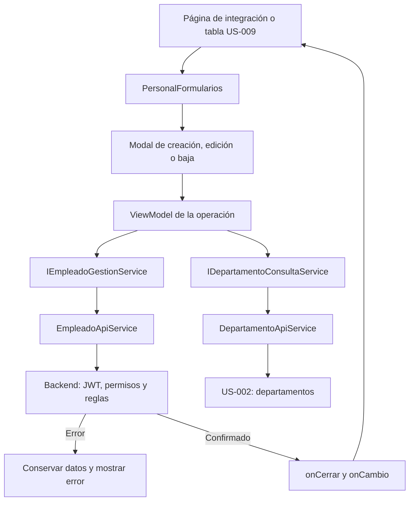

# US-010 y US-011 — Formularios web de personal

**Responsable:** Miguel Leal.

**Módulo:** mejora-sjr-admin. **Arquitectura:** MVVM con dependencias inyectadas.

**Estado:** formularios implementados y funcionamiento local confirmado por Miguel en la pantalla de desarrollo. Los adaptadores también se probaron por HTTP contra el backend en memoria. Quedan integración con US-009 y los pendientes de seguridad/build descritos al final.

## 1. Funcionalidad

| Historia | Comportamiento |
| --- | --- |
| US-010 — creación | Modal con nombre, correo, contraseña inicial, rol y departamento. Permite roles 2 y 3, ambos con departamento obligatorio. |
| US-011 — edición | Modal precargado con una copia del empleado seleccionado. Edita nombre, rol y departamento; muestra correo de solo lectura y no incluye contraseña. |
| US-011 — baja | Muestra «¿Estás seguro de desactivar a este usuario?» con nombre y correo. Solo Desactivar envía la petición; Cancelar cierra sin HTTP. La baja es lógica. |

El objetivo es gestionar trabajadores y administradores de departamento sin abandonar el listado. Los formularios móviles no forman parte de este módulo.

## 2. Cómo fluye una operación

1. El contenedor selecciona crear, editar o desactivar y entrega los servicios al formulario. Solo el rol 4 puede abrirlos desde la nueva composición.
2. La vista muestra campos y mensajes; entrega los eventos al ViewModel. No llama a fetch ni valida reglas.
3. Creación y edición consultan departamentos mediante un hook compartido. Mientras cargan, si fallan o si no hay opciones, se bloquea guardar y se permite reintentar.
4. El ViewModel valida y llama al servicio. Los servicios API agregan el JWT de la sesión actual en operaciones de empleados.
5. Mientras se envía se bloquean campos, confirmación y cierre. Una referencia impide envíos duplicados incluso antes del siguiente render.
6. Ante un error, el modal sigue abierto y conserva los datos o la selección. No se informa un cambio exitoso ni se retira al empleado del listado.
7. Ante confirmación del backend, se solicita cerrar y se emite onCambio. La pantalla aplica el resultado confirmado y recarga el listado. Si falla esa recarga, muestra su error por separado: no repite la escritura.

La edición utiliza una copia para no cambiar anticipadamente la tabla. Cada apertura monta una instancia nueva del ViewModel; al cambiar de empleado, la key está en el contenedor que ejecuta el hook. Cerrar desmonta esa instancia. Un desmontaje no cancela una operación que el servidor ya recibió.



## 3. Archivos y responsabilidades

Rutas relativas a mejora-sjr-admin/src.

| Ubicación | Responsabilidad |
| --- | --- |
| models/empleado.types.ts | Empleado, roles 2/3 y DTO separados de creación/edición. La contraseña solo pertenece a creación. |
| models/catalogo.types.ts | Tipo Departamento. |
| models/personalFormulario.types.ts | Acciones de apertura y eventos de cambios confirmados. |
| services/contracts/ | Contratos separados de consulta de empleados, gestión y departamentos; IPersonalServices los agrupa para ensamblarlos. |
| services/api/EmpleadoApiService.ts | Listar, crear, editar y desactivar por HTTP; validar y normalizar respuestas. |
| services/api/DepartamentoApiService.ts | Consultar y validar el catálogo de departamentos. |
| services/api/ApiError.ts | Mensaje y status HTTP; null si no hubo respuesta o se detuvo localmente. |
| providers/crearPersonalApiServices.ts | Construir adaptadores con acceso al token y URL inyectados. |
| providers/PersonalFormularios.tsx | Seleccionar el formulario y conectar hook, vista y eventos. |
| viewModels/usePersonalFormulariosViewModel.ts | Admisión visual del rol 4 y notificación de éxito al contenedor. |
| viewModels/useCrearEmpleadoViewModel.ts | Campos, validación y envío de creación. |
| viewModels/useEditarEmpleadoViewModel.ts | Copia inicial, validación y envío de actualización. |
| viewModels/useDesactivarEmpleadoViewModel.ts | Baja solo después de confirmar, conservando el ID original. |
| viewModels/useDepartamentosViewModel.ts | Estado compartido de catálogo, carga, error y reintento. |
| components/ui/Modal.tsx | Diálogo nativo, etiquetas accesibles, foco, Escape y bloqueo de cierre. |
| views/personal/ | Interfaz de los tres formularios y pantalla de integración. |
| providers/PersonalPruebas.tsx | Dependencias estables de la pantalla de desarrollo. |
| viewModels/usePersonalPruebasViewModel.ts | Comprobar sesión, consultar el selector y gestionar apertura/refresco. |
| app/dashboard/personal/formularios/page.tsx | Ruta de desarrollo; devuelve 404 en producción. |

**SOLID:** las vistas representan, los ViewModels coordinan y los adaptadores traducen HTTP (S). Los contratos admiten otras implementaciones sin incluirlas en la UI (O/D). La tabla puede recibir consultas y cada formulario el método que usa (I). Una implementación alternativa debe respetar datos, errores y comportamiento del contrato (L); implementar los mismos tipos no basta para demostrarlo.

No se añadieron bibliotecas para estos formularios. Modal utiliza dialog y showModal; el navegador gestiona el foco dentro del diálogo y el componente intenta devolverlo al elemento de apertura. En la baja, el foco inicial apunta a Cancelar.

## 4. Datos, validaciones y HTTP

| Operación | Endpoint | Resultado del servicio cliente |
| --- | --- | --- |
| Consultar empleados | GET /api/empleados | Empleado[] normalizado. |
| Crear | POST /api/empleados | Empleado. |
| Editar | PUT /api/empleados/:id | Empleado. |
| Desactivar | PATCH /api/empleados/:id | Promise<void>; el backend confirma sin devolver data. |
| Departamentos | GET /api/catalogos/departamentos | Departamento[]. El endpoint actual es público. |

Crear envía nombre, email, password, idRol e idDepartamento. Editar envía solo nombre, idRol e idDepartamento. PATCH no envía body. Correo y contraseña no forman parte del contrato de actualización.

La validación local exige nombre no vacío, correo con formato básico, contraseña no vacía en creación, rol 2/3 y departamento presente en el catálogo. No se agregó una política nueva de longitud de contraseña sin acordarla con el equipo. Se recorta el nombre y se normaliza el correo; la contraseña se envía exactamente como fue ingresada. El backend debe volver a validar.

Los adaptadores exigen success=true y la forma esperada de data. Normalizan activo desde true/false/0/1 al boolean del cliente y no propagan campos extra como passwordHash. Los nombres opcionales de rol/departamento no se inventan. Los errores conservan mensaje y status; una respuesta inválida nunca se transforma en éxito o lista vacía. No hay fallback automático a mocks.

Leer el JWT y comprobar exp/rol en el cliente no verifica su firma. La autorización definitiva corresponde al backend. La pantalla comprueba vigencia al cargar/actualizar el listado; no añade un vigilante continuo de sesión.

## 5. Conexión con la tabla de Oscar

PersonalFormularios recibe:

| Propiedad | Uso |
| --- | --- |
| accion | null; { tipo: 'crear' }; { tipo: 'editar', empleado }; { tipo: 'desactivar', empleado }. |
| idRolActor | Rol actual; solo el número 4 habilita los formularios. |
| servicios | gestion y departamentos con instancias estables. |
| onCerrar | Debe poner accion en null; cancelar no implica éxito. |
| onCambio | creado/actualizado con Empleado, o desactivado con idUsuario. Solo se emite tras éxito. |

crearPersonalApiServices(sesion, baseUrl?) recibe una dependencia que expone obtenerToken y devuelve consulta, gestion y departamentos. La tabla usa consulta; los formularios reciben solo gestión/catálogo. Construir estas instancias una vez o memorizarlas según la sesión/configuración.

```tsx
<PersonalFormularios
  accion={vm.accion}
  idRolActor={vm.idRolActor}
  servicios={servicios}
  onCerrar={vm.cerrarFormulario}
  onCambio={vm.procesarCambioConfirmado}
/>
```

Los nombres vm son ilustrativos para la futura tabla. Oscar mantiene /admin/personal y el DataGrid de US-009: esta implementación no los reemplaza. El consumidor debe mantener la selección estable mientras envía y manejar los errores de recarga en su ViewModel. onCambio es una notificación síncrona; no debe dejar una promesa de refresco sin manejar.

## 6. Pantalla ejecutable de desarrollo

La ruta **/dashboard/personal/formularios** permite probar los tres formularios mediante un selector sencillo de empleados del backend. Hereda el layout y middleware de /dashboard, bloquea el rol 3 dentro de esta pantalla y no está disponible en producción.

Para preparar el panel:

```powershell
cd mejora-sjr-admin
npm ci
$env:NEXT_PUBLIC_USE_MOCK = 'false'
$env:NEXT_PUBLIC_API_URL = 'http://localhost:5000/api'
npm run dev
```

El backend debe estar disponible. Iniciar sesión con una cuenta real de prueba de rol 4 y abrir la ruta. Un token generado por el mock del login no autentica operaciones contra la API real.

Durante las comprobaciones automatizadas se utilizaron estos procesos locales independientes:

- Panel: http://127.0.0.1:3021/dashboard/personal/formularios
- API: http://127.0.0.1:5051/api

Esa API utiliza createApp con los repositorios mock existentes, un secreto efímero en memoria y ninguna conexión SQL/Azure. Los cambios desaparecen al detenerla. La cuenta semilla superadmin@test.com del repositorio mock permite acceder; su contraseña de demostración está definida en ese mismo repositorio. No usar credenciales reales en esta prueba.

## 7. Verificación y aceptación

**Ejecutado:**

- npm ci en admin y backend, sin agregar dependencias ni cambiar sus lockfiles.
- TypeScript completo del panel: aprobado con tsc --noEmit --incremental false.
- Backend: 5 suites y 48 pruebas existentes aprobadas.
- 12 comprobaciones HTTP contra la API en memoria: autenticación, catálogos, listado, creación, duplicado 409, edición, baja, exclusión del inactivo, ausencia/token inválido 401, ruta autenticada 200 y redirección anónima al login.
- Comprobaciones aisladas de ViewModels, modales y composición: precarga, conservación de datos, errores, duplicados, callbacks, roles y refresco separado. El nuevo ViewModel de integración pasó 11 escenarios controlados.
- git diff --check: aprobado.

**Validación manual:** el 2026-10-28 Miguel confirmó que el funcionamiento local quedó correcto después de configurar JWT_SECRET, arrancar el backend en modo mock y conectar el panel a su API. Esta confirmación corresponde a la pantalla de desarrollo, no a la futura tabla de US-009 ni a persistencia en Azure.

La navegación completa por teclado, el foco y Escape no se comprobaron por separado. Las herramientas de automatización del navegador no pudieron inicializar sus recursos por un error de ruta del entorno; esas comprobaciones específicas siguen pendientes.

## 8. Pendientes y límites del equipo

- **Build de producción:** el código compiló, pero next build falló al prerenderizar /login por useSearchParams sin el límite requerido. El archivo de login ya existía; no se corrigió dentro de estas HU. Hay que acordar ese cambio antes de certificar el build.
- **US-007:** las rutas backend todavía permiten roles 3 y 4. Se confirmó HTTP 200 para rol 3; falta la autorización exclusiva del rol 4. El bloqueo visual no sustituye este middleware.
- **US-009:** falta conectar los formularios al DataGrid y su ruta oficial. El middleware actual no cubre /admin/personal; Oscar debe contemplarlo en esa integración.
- **Baja y acceso:** desactivar marca activo=0, pero el login actual no comprueba ese dato ni el middleware JWT consulta el estado de cuenta. No se promete revocación de sesiones.
- **Departamentos:** el backend actual usa MockCatalogoRepository para catálogos incluso cuando usuarios provienen de SQL. Las pruebas descritas aquí fueron en memoria, no en Azure.
- **Dependencias existentes:** npm informó 2 vulnerabilidades en admin y 12 en backend. También advirtió que una dependencia Azure antigua declara un rango de Node que no incluye 26. No se aplicaron actualizaciones forzadas ni se probó conexión Azure.

Los mocks de servicios frontend son opcionales y no se necesitan para el flujo API implementado. La implementación de los formularios está validada localmente; la aceptación integrada requiere completar US-007, la conexión con US-009 y las verificaciones pendientes.
