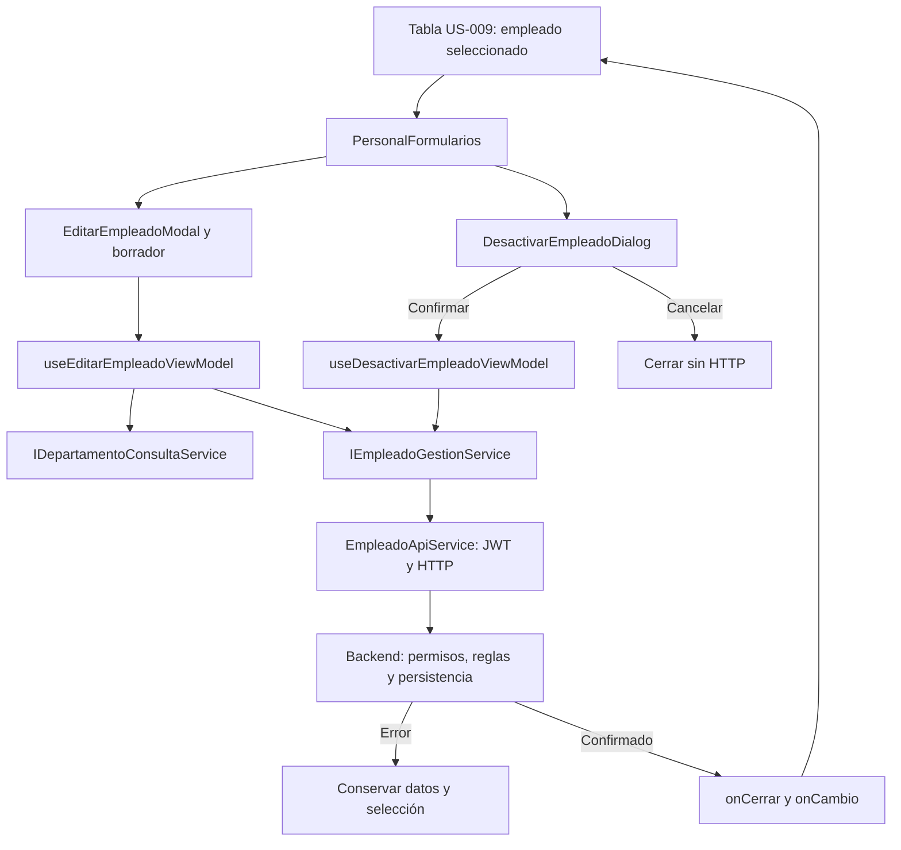

# US-011 — Formularios web de edición y baja de empleados

**Responsable:** Miguel Leal.  
**Módulo:** mejora-sjr-admin.  
**Arquitectura:** MVVM con dependencias inyectadas.  
**Estado:** edición y baja implementadas; funcionamiento local confirmado por Miguel en la entrega inicial. La composición y servicios se comparten con [US-010](README_HU_US010.md).

## 1. Objetivo y comportamiento

Permitir actualizar datos permitidos de un empleado o confirmar su desactivación desde el listado, conservando el formulario y los datos ante un error.

- **Edición:** modal precargado con una copia del empleado. Cambia nombre, rol y departamento; el correo es de solo lectura y la contraseña no forma parte de la edición.
- **Baja:** diálogo «¿Estás seguro de desactivar a este usuario?» con nombre y correo. Solo Desactivar envía la solicitud; Cancelar cierra sin HTTP. La baja es lógica.

La tabla es US-009 de Oscar y las operaciones backend son US-008 de Isaac. El acceso visual de estos formularios requiere rol 4.

## 2. Flujo de edición

1. La tabla entrega la acción editar y una copia del empleado a PersonalFormularios.
2. La composición monta useEditarEmpleadoViewModel y EditarEmpleadoModal. Cada apertura tiene una instancia nueva; su key cambia con el empleado en el contenedor que ejecuta el hook.
3. El ViewModel mantiene el borrador y consulta departamentos mediante useDepartamentosViewModel.
4. Mientras cargan, fallan o no hay departamentos, se bloquea guardar y se permite reintentar.
5. Al guardar, valida nombre, rol 2/3 y departamento existente, y envía solo los campos admitidos mediante IEmpleadoGestionService.
6. Mientras espera, bloquea campos, confirmación y cierre. Una referencia evita envíos duplicados antes del siguiente render.
7. Si falla, el modal sigue abierto con el borrador. Si confirma, publica onActualizado; la composición cierra y emite onCambio actualizado.
8. La tabla aplica el resultado confirmado y vuelve a consultar. Un fallo de refresco se muestra por separado y no repite el PUT.

La copia impide que escribir o cancelar altere anticipadamente la fila original. Cerrar desmonta el ViewModel; desmontarlo no cancela una petición que el servidor ya recibió.

## 3. Flujo de baja

1. La tabla entrega la acción desactivar con el empleado seleccionado.
2. DesactivarEmpleadoDialog presenta identidad y confirmación. El foco inicial apunta a Cancelar.
3. Cancelar cierra sin petición; confirmar llama al ViewModel conservando el ID original.
4. El ViewModel solicita la baja por servicio y bloquea confirmación/cierre mientras espera.
5. Un error conserva el diálogo y la selección; no retira la fila ni informa éxito.
6. La confirmación emite onDesactivado con el ID; la composición cierra y publica onCambio desactivado. El listado se actualiza después de ese resultado.



## 4. Archivos y responsabilidades

Rutas relativas a mejora-sjr-admin/src:

| Archivo o carpeta | Responsabilidad |
| --- | --- |
| `models/empleado.types.ts` | Empleado, roles 2/3 y ActualizarEmpleadoDTO separado de creación. |
| `models/catalogo.types.ts` | Tipo Departamento. |
| `models/personalFormulario.types.ts` | Acciones de apertura y cambios confirmados. |
| `services/contracts/` | Contratos de gestión y consulta de departamentos separados. |
| `services/api/EmpleadoApiService.ts` | PUT/PATCH con JWT y validación/normalización de respuestas. |
| `services/api/DepartamentoApiService.ts` | Catálogo para edición. |
| `services/api/ApiError.ts` | Mensaje y status del error; null cuando no hubo respuesta HTTP o fue rechazo local. |
| `providers/crearPersonalApiServices.ts` | Construcción estable de adaptadores con token y URL inyectados. |
| `providers/PersonalFormularios.tsx` | Selección de formulario, instancia por empleado y conexión de callbacks. |
| `viewModels/usePersonalFormulariosViewModel.ts` | Admisión visual del rol 4 y notificación de cambios. |
| `viewModels/useEditarEmpleadoViewModel.ts` | Borrador, validación y actualización. |
| `viewModels/useDesactivarEmpleadoViewModel.ts` | Confirmación de baja sobre el ID original. |
| `viewModels/useDepartamentosViewModel.ts` | Carga/error/reintento compartidos de departamentos. |
| `views/personal/EditarEmpleadoModal.tsx` y `DesactivarEmpleadoDialog.tsx` | Presentación, estados y eventos de cada operación. |
| `components/ui/Modal.tsx` | dialog/showModal, etiquetas, foco, Escape y cierre bloqueado durante envío. |
| `providers/PersonalPruebas.tsx` y `viewModels/usePersonalPruebasViewModel.ts` | Pantalla de desarrollo y refresco del selector. |

**SOLID:** la vista representa, el ViewModel coordina y el adaptador traduce HTTP (S). Los contratos permiten alternativas y consumidores específicos (O/I/D). Compartir tipos no basta para demostrar sustitución (L): datos, errores y efectos deben respetar el contrato.

No se añadieron bibliotecas para estos formularios. El navegador gestiona el foco dentro del diálogo; Modal intenta devolverlo al elemento que lo abrió.

## 5. Datos y HTTP

| Operación | Endpoint | Resultado del servicio |
| --- | --- | --- |
| Listado de apoyo | `GET /api/empleados` | Empleado[] normalizado. |
| Departamentos de edición | `GET /api/catalogos/departamentos` | Departamento[]. |
| Editar | `PUT /api/empleados/:id` | Empleado normalizado. |
| Desactivar | `PATCH /api/empleados/:id` | Promise<void>; confirmación sin data. |

ActualizarEmpleadoDTO solo contiene nombre, idRol e idDepartamento. PATCH no envía body. Correo y contraseña quedan fuera del contrato de actualización; el ID se conserva desde la selección original.

Se exige nombre no vacío, rol 2/3 y departamento del catálogo. El backend vuelve a validar y autorizar. Los adaptadores exigen success y datos con forma válida, normalizan activo desde true/false/0/1 y no propagan passwordHash. No inventan nombres opcionales ni convierten una respuesta inválida en éxito o lista vacía. No hay fallback automático a mocks.

## 6. Composición y tabla

PersonalFormularios recibe accion `{ tipo: 'editar', empleado }` o `{ tipo: 'desactivar', empleado }`, idRolActor, servicios, onCerrar y onCambio. Solo el número 4 habilita la interfaz. onCerrar elimina la acción; onCambio se emite tras éxito con Empleado actualizado o ID desactivado.

crearPersonalApiServices recibe obtenerToken y una URL opcional. La tabla utiliza consulta; edición recibe gestión/catálogo y baja solo gestión. Las instancias permanecen estables. PersonalDataGrid ya monta PersonalFormularios; onCambio es una notificación síncrona y el contenedor debe manejar el refresco y sus errores.

## 7. Ejecución y evidencias registradas

```powershell
cd mejora-sjr-admin
npm ci
$env:NEXT_PUBLIC_USE_MOCK = 'false'
$env:NEXT_PUBLIC_API_URL = 'http://localhost:5000/api'
npm run dev
```

El backend debe estar disponible. Utilizar una cuenta de prueba rol 4 autenticada por esa API, no un JWT inventado por el mock frontend. /dashboard/personal/formularios permite probar mediante un selector, hereda layout/middleware y devuelve 404 en producción.

La entrega inicial probó panel en http://127.0.0.1:3021/dashboard/personal/formularios y API en http://127.0.0.1:5051/api. La API usó createApp con repositorios mock y secreto efímero, sin Azure; sus cambios desaparecen al detenerla. La cuenta semilla superadmin@test.com y la contraseña demo están en el mock del backend. No usar credenciales reales.

La entrega conjunta con US-010 registró TypeScript del panel aprobado, 5 suites/48 pruebas backend, 12 comprobaciones HTTP que incluyeron edición/baja/exclusión del inactivo, comprobaciones aisladas de precarga, errores, duplicados, callbacks y refresco, y 11 escenarios del ViewModel de integración. También se registró git diff --check aprobado. Esas cifras son evidencia de aquella entrega, no una nueva ejecución durante la separación documental.

Miguel confirmó funcionamiento local el 28 de octubre de 2026 tras configurar JWT_SECRET. La validación correspondió a la pantalla de desarrollo, no certificó Azure ni toda la integración posterior. Teclado, foco y Escape quedaron pendientes de comprobación específica por el error del entorno de automatización.

Para aceptar esta HU: comprobar precarga, cambio/cancelación sin alterar la fila, campos permitidos, persistencia confirmada antes de éxito, confirmación/cancelación de baja, conservación ante errores y refresco fallido sin repetir escrituras.

## 8. Seguridad y límites

- [US-021](README_HU_US021.md) conserva la consulta departamental para rol 3 y restringe las escrituras de empleados al rol 4 en el backend. El bloqueo visual no reemplaza esa autorización.
- La tabla ya integra los formularios y el middleware web cubre /admin. Los pendientes iniciales de esa integración no describen el estado actual.
- US-012 de Isaac incorporó rechazo de futuros logins de usuarios inactivos. Una baja no debe presentarse como revocación automática de todos los JWT ya emitidos.
- La entrega original observó un fallo de build del login por useSearchParams. El login actual contiene Suspense; no se certificó nuevamente el build al separar estos documentos.
- Los catálogos del backend proceden de MockCatalogoRepository incluso si usuarios usan SQL. Las pruebas iniciales fueron en memoria, sin certificar Azure.
- La entrega inicial informó 2 vulnerabilidades en admin, 12 en backend y un rango Node antiguo de una dependencia Azure. Son antecedentes sin auditoría nueva ni actualizaciones forzadas.

Relacionadas: [US-010 — Creación de empleados](README_HU_US010.md), [US-008 — API de empleados](../Isaac/README_HU_008.md), [US-012 — Integración y usuario inactivo](../Isaac/README_HU_012.md) y [US-007/US-009 — Trabajo de Oscar](../Abraham/README_HU_US007_US009.md).
