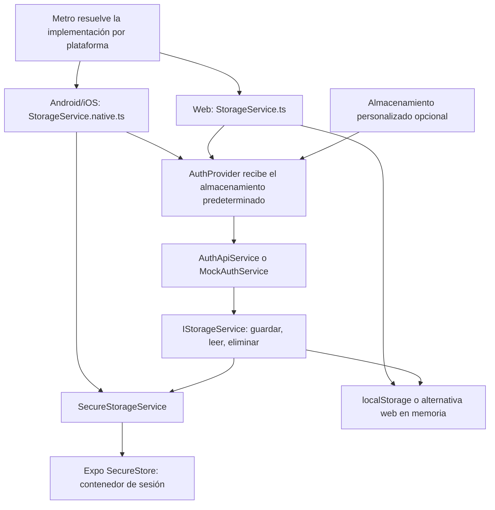
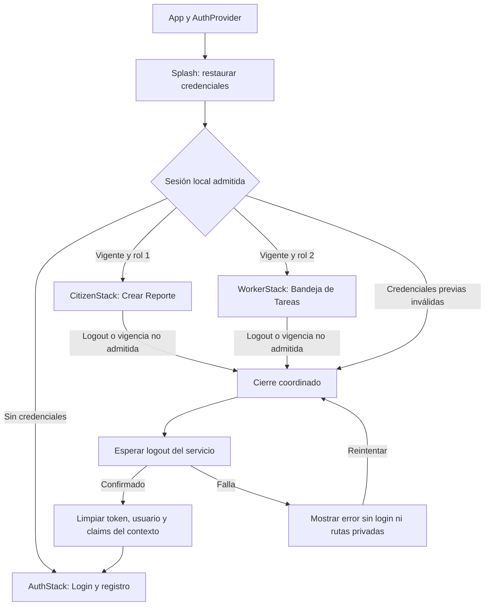

# US-016 — Navegación y protección de rutas móviles

**Responsable:** Miguel Leal.  
**Proyecto:** mejora-sjr-mobile.  
**Arquitectura:** MVVM con React Navigation y servicios inyectados.  
**Rama de entrega:** sP3.  
**Verificación técnica registrada:** 8 de noviembre de 2026.  
**Estado:** almacenamiento, stacks y cierre coordinado implementados; pendiente aceptación manual en dispositivo/navegador.

## 1. Objetivo y alcance

Restaurar la sesión desde el almacenamiento de la plataforma y montar exclusivamente el árbol permitido: AuthStack sin sesión, CitizenStack para rol 1 y WorkerStack para rol 2. Android/iOS utilizan SecureStore; web conserva su implementación de almacenamiento.

La sesión determina qué rutas existen en el navegador montado. Ocultar botones no impediría acceder a rutas de otro rol si siguieran registradas. Los roles 3/4 se remiten al panel web; los desconocidos o incoherentes se rechazan y se limpian antes de permitir otro login.

La autenticación base corresponde a [US-003](README_HU_US003.md). Se conserva la colaboración de [US-018 de Isaac](../Isaac/README_HU_018.md), que comprueba expiración al establecer la sesión y al regresar al primer plano. Las pantallas y simulaciones de ciudadano/trabajador se explican en [US-017](README_HU_US017.md).

El guard local lee claims y comprueba vigencia/coherencia; no verifica la firma del JWT ni sustituye la autorización del backend.

## 2. Dependencias instaladas

Miguel autorizó expresamente las siguientes cinco dependencias. Se utilizó el instalador de Expo para seleccionar las versiones nativas compatibles con SDK 58.

| Paquete | Versión instalada | Propósito |
| --- | --- | --- |
| `@react-navigation/native` | 7.5.1 | Contenedor y estado de navegación. |
| `@react-navigation/native-stack` | 7.21.0 | Stack raíz y stacks públicos/por rol. |
| `react-native-screens` | 4.30.1 | Componentes de pantalla utilizados por el stack nativo. |
| `react-native-safe-area-context` | 5.11.1 | SafeAreaProvider en la raíz de la aplicación. |
| `expo-secure-store` | 58.0.2 | Persistencia cifrada local en Android/iOS. |

`app.json` incluye ahora el plugin `expo-secure-store`. No se habilitó autenticación biométrica ni se añadieron librerías de cámara o ubicación.

Para reproducir las dependencias fijadas, el equipo puede ejecutar `npm ci` dentro de `mejora-sjr-mobile`, usando una versión de Node compatible con Expo SDK 58.

**Antecedente del entorno de instalación:** el instalador terminó correctamente, pero el proceso npm hijo informó Node 16.20.2/npm 8.19.4 y emitió advertencias de engines, aunque Expo se lanzó con Node 26.8.2. Las comprobaciones de este bloque se ejecutaron explícitamente con Node 26.8.2. No se cambió la configuración global de nvm ni se ejecutó `npm audit fix`; la salida de instalación informó 10 vulnerabilidades del árbol completo, sin determinar en este bloque cuáles ya existían.

## 3. Almacenamiento de sesión

### Archivos y responsabilidades

Rutas relativas a `mejora-sjr-mobile`:

| Archivo | Responsabilidad |
| --- | --- |
| `src/services/contracts/IStorageService.ts` | Contrato existente: `setItem`, `getItem`, `removeItem` y `clear`. No depende de Expo. |
| `src/services/storage/SecureStorageService.ts` | Adaptador nativo: conserva las entradas lógicas en SecureStore y propaga errores. |
| `src/services/storage/StorageService.native.ts` | Entrada que Metro selecciona en Android/iOS; exporta el adaptador y la instancia predeterminada. |
| `src/services/storage/StorageService.ts` | Implementación web existente con localStorage y su alternativa en memoria cuando no está disponible; se actualizó su comentario para distinguir plataformas. |
| `src/providers/AuthProvider.tsx` | Recibe almacenamiento personalizado o predeterminado y lo pasa a autenticación API o mock. Administra el ciclo de restauración y cierre coordinado descrito en la siguiente sección. |
| `src/services/api/AuthApiService.ts` | Consumidor existente del contrato para guardar, leer y eliminar token/usuario. |
| `src/services/mocks/MockAuthService.ts` | Mismo contrato de almacenamiento en modo demostración. |
| `tests/secure-storage.test.cjs` | Pruebas del adaptador TypeScript real con un driver nativo sustituido, sin añadir un framework. |

### Flujo de dependencias



La aplicación conserva los imports sin sufijo de plataforma. Metro selecciona `.native.ts` para Android/iOS y el archivo general para web. Si el proveedor recibe `storageService` personalizado, esa dependencia mantiene prioridad sobre la instancia predeterminada.

### Cómo guarda y recupera los datos

1. Autenticación solicita guardar una cadena con una clave lógica, por ejemplo `@mejora_sjr_mobile_token`.
2. El adaptador espera que terminen las operaciones anteriores y lee su contenedor de SecureStore.
3. Comprueba que el contenido sea un objeto JSON con valores de tipo cadena. Un contenido inválido produce un error, no una sesión vacía inventada.
4. Modifica únicamente la entrada solicitada y guarda el contenedor actualizado.
5. Las lecturas posteriores consultan el almacenamiento nativo; no mantienen una copia en memoria como si estuviera persistida.
6. `removeItem` elimina una entrada conservando las demás. Si era la última, elimina el contenedor.
7. `clear` elimina directamente el contenedor administrado por el adaptador, incluso si su JSON estaba corrupto. No borra credenciales de otros módulos del dispositivo.

### Por qué se utiliza un contenedor

Las claves existentes comienzan por `@`, carácter que no admite una clave nativa de SecureStore. El adaptador usa una clave nativa válida y versionada, `mejora_sjr_mobile_storage_v1`, y conserva las claves lógicas dentro del JSON. Así no cambian los consumidores de `IStorageService`.

La misma organización permite implementar `clear` sin depender de una operación de enumeración que SecureStore no expone. La cola se comparte entre instancias y ordena lecturas, escrituras y borrados. Si una operación falla, su consumidor recibe el error y las siguientes pueden ejecutarse.

### Principios de diseño

- **Responsabilidad única:** el adaptador solo administra persistencia; no interpreta roles, navega ni llama al backend.
- **Inversión de dependencias:** autenticación consume `IStorageService`; SecureStore queda encapsulado en una implementación concreta.
- **Sustitución:** el adaptador conserva las operaciones, tipos de resultado y rechazos esperados por el contrato. No presenta una escritura fallida como exitosa.
- **Extensión:** la entrada nativa incorpora otra implementación sin añadir comprobaciones de plataforma a las vistas o ViewModels.

### Límites del almacenamiento

- El contenedor es para datos pequeños de sesión. No se deben guardar aquí fotografías, reportes completos ni cachés crecientes. La plataforma puede rechazar valores grandes.
- Las dos llamadas actuales para guardar token y usuario no se convierten en una transacción. La cola evita pérdida de actualizaciones entre operaciones, pero no garantiza que un login con una escritura fallida guarde ambas entradas.
- Los errores nativos se propagan. El cierre coordinado representa esos errores y bloquea nuevas sesiones mientras no termine la limpieza.
- La selección de almacenamiento no verifica firmas JWT ni sustituye los permisos del backend.
- La persistencia del token no hace persistentes las cuentas de prueba creadas dentro de la memoria de `MockAuthService`.

## 4. Navegación exclusiva y cierre coordinado

### Responsabilidades

Rutas relativas a `mejora-sjr-mobile`:

| Archivo | Responsabilidad |
| --- | --- |
| `App.tsx` | Envuelve la aplicación en SafeAreaProvider y AuthProvider. Conserva la selección explícita de modo API/mock. |
| `src/models/navigation.types.ts` | Nombres de rutas, tipos de parámetros, entradas y resultado de la decisión. |
| `src/models/auth.types.ts` | Incorpora el tipo SessionCloseStatus: idle, pending o failed. |
| `src/providers/AuthProvider.tsx` | Mantiene token/usuario/claims, restauración y cierre; inyecta servicios. Ya no almacena currentScreen. |
| `src/viewModels/useSplashViewModel.ts` | Lee credenciales guardadas, comprueba vigencia y restaura o solicita limpieza. Finaliza la hidratación en finally. |
| `src/viewModels/navigationPolicy.ts` | Función pura que determina splash, closing, auth, citizen o worker. No verifica firmas ni hace HTTP. |
| `src/viewModels/useNavigationViewModel.ts` | Aplica la política, conserva el guard de US-018 por cambios de sesión y AppState, y coordina el reintento de cierre. |
| `src/navigation/AppNavigator.tsx` | Presenta Splash/cierre o monta el único stack permitido dentro de NavigationContainer. |
| `src/navigation/AuthStack.tsx` | Registra Login, que conserva los modos de login/registro de AuthView. |
| `src/navigation/CitizenStack.tsx` | Registra exclusivamente CrearReporte. |
| `src/navigation/WorkerStack.tsx` | Registra exclusivamente BandejaTareas, que utiliza la vista de órdenes existente. |
| `src/views/SplashView.tsx` | Mantiene el diseño institucional y espera restauración. Se retiró el botón que permitía saltarla. |
| `src/views/SessionClosingView.tsx` | Muestra espera, error y reintento. No contiene autenticación ni restaura datos. |
| `src/viewModels/useReporteViewModel.ts` y `useBandejaViewModel.ts` | Sus handlers de logout esperan el cierre y dejan que el proveedor represente un eventual error. El diseño y las simulaciones se documentan por separado en US-017. |
| `tests/navigation.test.cjs` | Política real de navegación y StackRouter instalado: matriz de estados, roles, rutas cruzadas e historial. |
| `tests/session-close.test.cjs` | Cuerpo real del proveedor y hook de Splash con hooks/infraestructura controlados: logout pendiente, fallo, reintento y admisión concurrente. |
| `tests/navigation-view.test.cjs` | Composición TSX con React/SSR y dobles de las dependencias nativas: espera/error sin login y selección exclusiva de cada stack. |

### Decisión de acceso

| Situación | Pantalla/árbol montado |
| --- | --- |
| Restauración pendiente | Splash. Tiene prioridad hasta que su coordinador termine. |
| Cierre pending | Vista de cierre; no existe un login interactivo. |
| Cierre failed | Vista de cierre con error y Reintentar; no se montan rutas privadas ni login. |
| Sin token, usuario ni claims, con cierre idle | AuthStack. |
| Token presente, exp numérico finito futuro y rol coherente 1 | CitizenStack. |
| Token presente, exp numérico finito futuro y rol coherente 2 | WorkerStack. |
| Credenciales incompletas, vencidas, ilegibles o rol no admitido en el contexto | Vista de cierre hasta limpiar los datos previos; después AuthStack. |

Los roles 3/4 conservan el aviso para acceder desde el panel web; los perfiles desconocidos/incoherentes se rechazan. Los árboles que no corresponden no están registrados en el navegador montado. No se utiliza navigate(Login) sobre un historial privado conservado.



### Por qué se espera el cierre

Un logout pendiente podría borrar las credenciales de un login nuevo si ambos se permitieran al mismo tiempo. Para impedir esa condición de carrera, no se muestra un login interactivo hasta que termine la destrucción del estado anterior.

El proveedor aplica esa coordinación:

1. Marca pending antes de solicitar el borrado y comparte la misma promesa si llegan dos solicitudes simultáneas.
2. Mientras está pending o failed, la política muestra cierre. La admisión de sesiones también lo comprueba mediante referencias sincrónicas, por si llega una respuesta de un formulario anterior.
3. Espera authService.logout, que elimina las claves de token y usuario mediante el almacenamiento inyectado.
4. Solo tras confirmarse el borrado limpia el contexto y vuelve a idle. Entonces puede montarse AuthStack.
5. Si falla, conserva failed y un error. No convierte el fallo en éxito; un reintento explícito inicia otra operación.

Durante la hidratación, Splash mantiene prioridad y su efecto permanece montado hasta finalizar. La vista de cierre es otra vista: no ejecuta useSplashViewModel ni vuelve a leer/restaurar la sesión.

El guard no relanza logout automáticamente durante pending/failed. Conserva la comprobación al establecer una sesión y al volver al primer plano. No se añadió un temporizador que detecte el instante exacto de expiración mientras la pantalla permanece inactiva en primer plano.

Cada árbol protegido utiliza una clave por rol/usuario. Cambiar de identidad desmonta el árbol anterior y sus borradores. Token y contraseña no se pasan como parámetros de navegación.

### Arquitectura y alcance

- El proveedor administra el ciclo de vida de la sesión; no selecciona pantallas mediante un segundo estado mutable de navegación.
- El ViewModel determina el destino y coordina servicios; las vistas presentan estado y emiten eventos.
- Los stacks solo describen rutas. Agregar una pantalla futura al stack ciudadano no requiere añadir pantallas del trabajador.
- Autenticación, catálogos y almacenamiento conservan sus contratos inyectados. No se añadieron dependencias para esta corrección.
- La comprobación local de exp/rol no demuestra firma válida, revocación o estado actual de la cuenta. La API sigue siendo responsable de verificar permisos y JWT.
- Un JSON de almacenamiento corrupto puede hacer fallar removeItem; la vista de cierre representa el error, pero no se incorpora una recuperación automática que borre datos corruptos con clear.

## 5. Verificación registrada y ejecución

Las siguientes evidencias pertenecen a la implementación de la HU. No se volvieron a ejecutar al separar los README.

| Comprobación | Resultado registrado |
| --- | --- |
| Adaptador de almacenamiento | 10 pruebas aprobadas con Node 26.8.2. |
| Política, router, exclusión por rol e historial | 44 pruebas aprobadas. |
| Cierre lento, fallo, reintento y admisión concurrente | 15 pruebas aprobadas. |
| Composición de vistas y selección de stacks | 7 pruebas aprobadas. |
| TypeScript | Aprobado con tsc --noEmit. |
| Exportaciones web, Android e iOS | Aprobadas, también tras integrar las pantallas de US-017. El contenedor nativo aparece en Android/iOS y no en el bundle web. |
| Persistencia tras reinicio real, navegación interactiva y botón Atrás nativo | Pendientes de validación manual. |

Las 76 pruebas de esta HU forman parte de la suite conjunta de 94: las otras 18 corresponden a la bandeja de US-017.

Las pruebas de almacenamiento cubren reconstrucción del adaptador, concurrencia entre instancias, orden de lectura/escritura, borrado individual, clear con operaciones pendientes, errores, JSON inválido y claves especiales. Sustituyen el driver nativo; no demuestran por sí solas persistencia tras reiniciar un teléfono.

Las pruebas de cierre ejecutan el cuerpo real del proveedor y el hook de restauración con hooks controlados. Comprueban que un cierre pendiente impide nuevas admisiones y que el finally termina tanto en éxito como en error. Ese arnés no reproduce un montaje React real.

Las pruebas de composición usan React/SSR con dobles explícitos de RN, navegador y ViewModel. Verifican el árbol representado, no clics reales, AppState físico, foco ni botón Atrás. La automatización web no pudo confirmar con suficiente confianza la URL actual de Chrome en Windows; no se acredita esa interacción.

Desde mejora-sjr-mobile, con Node compatible con SDK 58:

```powershell
npm ci
npm run test:storage
npm run test:navigation
npm test
node node_modules/typescript/bin/tsc --noEmit
```

npm test ejecuta todas las pruebas móviles, incluidas las de US-017. No se añadió un framework de pruebas. La exportación solo verifica resolución/compilación y no genera una app nativa instalada; --no-bytecode se utilizó para esa comprobación.

## 6. Pendientes para aceptación

1. Iniciar sesión y reiniciar la app en dispositivo: comprobar restauración desde SecureStore.
2. Probar ausencia de token, sesión vencida, perfiles 1/2 y rechazo de roles 3/4/desconocidos.
3. Comprobar logout lento, fallo y reintento: login debe permanecer bloqueado hasta confirmar la limpieza.
4. Cambiar de identidad y verificar que no quedan borradores ni historial del usuario anterior; probar Atrás después de logout.
5. Registrar los resultados manuales y la aceptación de Miguel.

La implementación acordada está disponible para estas pruebas. El acceso nativo a cámara/GPS y las APIs de reportes/tareas no pertenecen al guard y se detallan como límites de US-017.

## 7. Referencias

- [US-003 — Autenticación móvil](README_HU_US003.md).
- [US-017 — Pantallas móviles y simulaciones](README_HU_US017.md).
- [US-018 de Isaac — Logout y expiración](../Isaac/README_HU_018.md).
- [SecureStore: plataformas, límites, claves y API](https://docs.expo.dev/versions/latest/sdk/securestore/).
- [React Native: resolución de módulos por plataforma](https://reactnative.dev/docs/platform-specific-code).
- [React Navigation: flujo de autenticación](https://reactnavigation.org/docs/auth-flow/).
