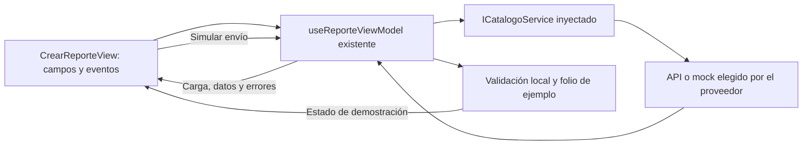
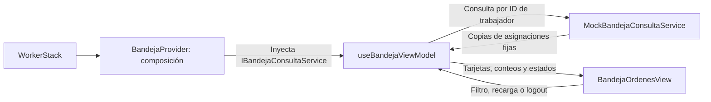

# US-017 — Diseño de pantallas móviles de ciudadano y trabajador

**Responsable:** Miguel Leal.  
**Proyecto:** mejora-sjr-mobile.  
**Arquitectura:** MVVM con servicios inyectados.  
**Rama de entrega:** sP3.  
**Verificación técnica registrada:** 8 de noviembre de 2026.  
**Estado:** formulario y bandeja implementados para el alcance de diseño con simulaciones; pendiente aceptación visual en dispositivo/navegador.

## 1. Objetivo y alcance acordado

La evolución del formulario ciudadano con envío real y entradas de ejemplo se documenta en [US-024](README_HU_US024.md). Este documento conserva el alcance original de diseño/simulaciones de US-017.

Ofrecer un formulario ciudadano claro y una bandeja de tareas legible, usando la paleta Mejora SJR y componentes adecuados para móvil. La bandeja es de solo consulta y filtros por decisión expresa de Miguel.

La redacción original incluía acceso nativo a cámara/GPS. Miguel acordó entregar primero diseño con simulaciones: foto, coordenadas, envío, folio y tareas se identifican como ejemplos. No se guarda ni se turna una incidencia real. Cámara/GPS nativos, APIs de incidencias y atención de tareas quedan para otra etapa.

### Qué estaba disponible del equipo

Al analizar la rama sP3, con commit de referencia 78a36db, app.js del backend montaba /api/auth, /api/catalogos y /api/empleados. No había endpoints de creación de incidencias, subida de evidencia ni consulta de tareas asignadas. Las tablas de schema.sql no sustituyen esos endpoints.

useReporteViewModel conserva coordenadas fijas, imágenes de ejemplo y un folio local sin POST. La bandeja anterior filtraba ejemplos por departamento; esta HU usa asignaciones fijas y selección estricta por trabajador.

La autenticación se documenta en [US-003](README_HU_US003.md), los catálogos en [US-004](README_HU_US004.md) y el montaje exclusivo de las pantallas por rol en [US-016](README_HU_US016.md). Se reutilizan SafeAreaProvider y los paquetes incorporados para US-016; esta HU no añade dependencias.

## 2. Ciudadano: formulario y demostración explícita

### Alcance y responsabilidad

Se rediseñó `src/views/CrearReporteView.tsx`. Este bloque conserva las reglas y handlers existentes de `useReporteViewModel`: no añade endpoints, servicios de envío, permisos, cámara ni GPS. Las modificaciones previas del handler de logout pertenecen a US-016.

La vista organiza la información en tres secciones: descripción/clasificación, ubicación y evidencia. `ReportSection`, definido en el mismo archivo, es un componente de presentación que agrupa título, explicación y contenido; no consulta servicios ni valida.

| Parte de la pantalla | Comportamiento |
| --- | --- |
| Encabezado y perfil | Marca Mejora SJR, nombre de usuario, rol existente y evento Salir conectado al ViewModel. |
| Aviso de demostración | Explica antes del formulario que foto, ubicación y envío son ejemplos y que no se guardan reportes reales. |
| Clasificación y descripción | Reutiliza CustomPicker y CustomInput, selecciones y mensajes rojos del ViewModel. No exige una secuencia nueva de selección: el comportamiento existente admite elegir categoría y resolver su departamento. |
| Error de catálogos | Representa errorCatalogos y conecta Reintentar con cargarCatalogos, ya disponible en el ViewModel. Los Pickers conservan su carga existente. |
| Error general | Representa errors.general, sin convertir el error en éxito. |
| Ubicación | Muestra coordenadas recibidas, con signo numérico y etiqueta SIMULADA. No afirma precisión ni lee el GPS. |
| Fotografía | Añadir/quitar foto de ejemplo utiliza los handlers existentes. La vista previa indica que no fue capturada por la cámara ni enviada. |
| Envío | El botón se llama Simular envío; conserva la validación y el estado isSubmitting del ViewModel. No se añadió una nueva condición de bloqueo o regla de negocio en la vista. |
| Confirmación | Muestra Simulación completada y Folio de demostración; aclara que el ejemplo no se guardó ni se turnó a una dependencia. |

### Flujo



El contador de caracteres y la selección de estilos son presentación. La validación, las selecciones relacionadas, el ejemplo de foto y la generación del folio siguen en el ViewModel. El formulario no incorpora fetch/axios ni lógica para autorizar usuarios.

### Diseño móvil

- Paleta existente: azul institucional `#0A3D62`, superficies claras y dorado usado como acento decorativo/fondo. Las instrucciones principales usan texto oscuro o blanco con fondo azul.
- Contenido de una columna, centrado hasta 640 de ancho en web, con relleno interior menor que el formulario anterior.
- Nombre de usuario, perfil y coordenadas admiten salto de línea para anchos estrechos. La foto se presenta en una disposición vertical.
- SafeAreaView utiliza el paquete ya instalado y el SafeAreaProvider de la raíz. KeyboardAvoidingView conserva configuración específica de iOS; el scroll permite tocar controles con el teclado abierto.
- Las acciones propias Salir y Quitar foto tienen una altura mínima de 48. Se reutiliza CustomButton para las demás acciones.
- Los campos y acciones nuevos incorporan etiquetas accesibles; los errores generales se anuncian como alertas. La cámara ilustrativa se dibuja con Views decorativas y no representa un acceso nativo real.
- El modal de resultado tiene scroll y safe area para permitir contenido largo. Se conservan la escala de texto del sistema y el cierre mediante onRequestClose.

Estas decisiones se apoyan en las referencias de accesibilidad de Android/Apple y en los componentes nativos de React Native. No equivalen a una certificación de accesibilidad ni a un uso de componentes Cupertino específicos.

### Límites

- El acceso nativo a cámara/GPS de la redacción original se postergó por decisión de Miguel. La etapa actual es diseño con simulaciones. No se instalaron paquetes nuevos.
- La fotografía sigue usando las URLs de ejemplo que devuelve el ViewModel; su carga depende de la red. No se garantiza una fotografía disponible sin conexión.
- El folio local no es un folio oficial y no tiene persistencia de backend.
- No se modificaron los componentes compartidos de otras pantallas. Sus selectores, mensajes largos, tamaño de texto ampliado y foco del modal requieren verificación manual.
- La bandeja del trabajador utiliza su propio servicio de consulta de demostración, explicado a continuación.

## 3. Trabajador: consulta y filtros

Miguel eligió expresamente una bandeja de solo lectura. Se retiraron los botones Iniciar/Concluir y las actualizaciones locales de estado; no se inventaron reglas de atención ni endpoints de escritura.

### Archivos y colaboración

| Archivo de mejora-sjr-mobile/src | Responsabilidad |
| --- | --- |
| `services/contracts/IBandejaConsultaService.ts` | Contrato pequeño de consulta: listarAsignadas(idTrabajador). No obliga a implementar actualizaciones. |
| `services/mocks/MockBandejaConsultaService.ts` | Ejemplos con asignaciones fijas, filtro estricto por trabajador y copias de resultados. No utiliza HTTP. |
| `models/bandeja.types.ts` | Tipos de filtros, estados semánticos y datos que necesita cada tarjeta. |
| `providers/BandejaProvider.tsx` | Construye una instancia estable del mock o recibe una consulta personalizada, la inyecta al ViewModel y entrega su resultado a la vista. |
| `viewModels/useBandejaViewModel.ts` | Coordina carga/error/reintento, perfil válido, filtro por trabajador, conteos y filtro por estado. No instancia servicios ni actualiza tareas. |
| `views/BandejaOrdenesView.tsx` | Presenta las tarjetas mediante FlatList, métricas, filtros y estados de carga/error/vacío. Recibe el ViewModel por propiedades; no selecciona asignaciones ni llama servicios. |
| `navigation/WorkerStack.tsx` | Monta BandejaProvider como pantalla BandejaTareas. |
| `../tests/bandeja.test.cjs` | Prueba el mock y el cuerpo real del hook con dependencias/efectos controlados. |



### Asignaciones y estados de consulta

- El trabajador de ejemplo con ID 2 recibe cinco tareas, una por estado. El ID 8 tiene otro ejemplo del mismo departamento. Una tarea sin asignación no aparece en ninguna de esas consultas.
- Un trabajador sin coincidencias recibe una lista vacía. No se reasignan ejemplos al usuario que inicia sesión ni se utiliza un ID de respaldo.
- Tanto el servicio como el ViewModel filtran por igualdad de idTrabajadorAsignado. Compartir departamento no basta para mostrar la tarea.
- Los conteos se calculan sobre las asignadas: cinco en total para ID 2, dos por atender y una en curso. El filtro cambia la lista visible sin alterar el total asignado.
- Se distinguen carga, error de consulta, ausencia de asignaciones y ausencia de coincidencias del filtro. El error no se presenta como una lista vacía exitosa.
- Actualizar ejemplos y Reintentar utilizan la misma consulta inyectada. El filtro elegido se conserva; no hay escrituras ni cambios de estado.
- Una respuesta o error de una consulta anterior se ignora después de cambiar identidad, sustituir la consulta o desmontar. La lista también aplica la identidad actual antes de representar tarjetas.

### Diseño y límites

La bandeja conserva la paleta y el encabezado del formulario ciudadano. Los filtros admiten varias líneas, las tarjetas presentan estado con texto y color, y la lista tiene estados vacíos diferenciados. El aviso Demostración / Solo lectura permanece visible. Los controles propios tienen áreas de toque de al menos 48 y se utiliza SafeAreaView del paquete existente.

Se separan responsabilidades: el servicio entrega datos, el ViewModel selecciona/prepara y la vista pinta. El proveedor mantiene la inversión de dependencias; el contrato solo contiene lo que la consulta necesita. Los estados visuales son semánticos y la vista decide su color.

La bandeja es de demostración incluso si autenticación y catálogos están en modo API. Esto es una selección explícita de composición, no un fallback tras una falla HTTP. Una implementación API futura deberá autorizar las asignaciones con el JWT en el servidor; el filtro por un ID controlado por cliente no proporciona esa autorización.

No se añadieron paquetes ni se modificaron backend o reglas reales de atención. Siguen pendientes las comprobaciones visuales de ancho, texto ampliado y lector de pantalla; la exportación y los tests no sustituyen esas pruebas.

## 4. Verificación registrada y ejecución

Las siguientes evidencias pertenecen a la implementación. No se repitieron al separar los README.

| Comprobación | Resultado registrado |
| --- | --- |
| Bandeja de demostración | 18 pruebas aprobadas: asignaciones, copias, perfil válido, conteos, filtros, error/reintento y respuestas tardías. |
| TypeScript | Aprobado. |
| Formulario ciudadano | Compilación y revisión estática realizadas; regresión de sesión/navegación aprobada. |
| Suite móvil conjunta | 94 pruebas aprobadas: 76 de almacenamiento/navegación/cierre/composición y 18 de bandeja. |
| Exportación final con formulario y bandeja | Aprobada para web, Android e iOS. |
| Formulario a 320/430 px, teclado, zoom, selectores y modal | Pendiente de comprobación visual real. |
| Bandeja: ancho, texto ampliado, filtros y lector de pantalla | Pendiente de comprobación visual real. |

Las pruebas de bandeja ejecutan el servicio mock y el hook reales con hooks/efectos controlados. Cubren aislamiento frente a otras tareas del mismo departamento, perfiles inválidos sin consulta, error frente a vacío, reintento, identidad y respuestas después del desmontaje. No montan React ni acreditan autorización backend.

Las pruebas de sesión/navegación comprueban la regresión de US-016; no sustituyen una revisión visual del formulario. La exportación acredita compilación, no interacción ni instalación nativa. --no-bytecode se usó solo para esa comprobación.

Desde mejora-sjr-mobile, con Node compatible con SDK 58:

```powershell
npm ci
node --test tests/bandeja.test.cjs
npm test
node node_modules/typescript/bin/tsc --noEmit
npm start
```

Autenticación y catálogos siguen el modo API/mock explícito de App. La bandeja conserva su servicio de demostración por composición en ambos modos, con aviso visible; nunca se activa como sustitución silenciosa de un fallo HTTP.

## 5. Prueba manual y límites de entrega

1. Entrar como ciudadano y comprobar formulario, errores de clasificación, reintento de catálogos, foto de ejemplo y coordenadas simuladas.
2. Simular un envío válido: el resultado debe indicar folio de demostración sin afirmar persistencia o atención real.
3. Entrar con el trabajador de ejemplo ID 2: comprobar sus cinco tareas y los filtros; verificar también un trabajador sin asignaciones.
4. Comprobar recarga/reintento, carga, errores y vacíos diferenciados, sin botones que cambien estados.
5. Revisar teléfono y web: 320/430 px, teclado, texto ampliado, foco, scroll, áreas táctiles y lector de pantalla. Registrar la aceptación de Miguel.

La implementación acordada no espera código de otro compañero. Para una etapa real se necesitan contratos backend de envío/evidencia/asignaciones y las decisiones de permisos de cámara/GPS. El servidor deberá autorizar por JWT; filtrar por un ID enviado por el cliente no basta.

## 6. Referencias

- [US-003 — Autenticación móvil](README_HU_US003.md).
- [US-004 — Catálogos móviles](README_HU_US004.md).
- [US-016 — Navegación y sesión](README_HU_US016.md).
- [Android: recomendaciones de áreas táctiles](https://support.google.com/accessibility/android/answer/7101858?hl=es).
- [Apple: diseño de interfaces y áreas táctiles](https://developer.apple.com/design/tips/).
- [React Native: KeyboardAvoidingView](https://reactnative.dev/docs/keyboardavoidingview).
- [React Native: ScrollView](https://reactnative.dev/docs/scrollview).
