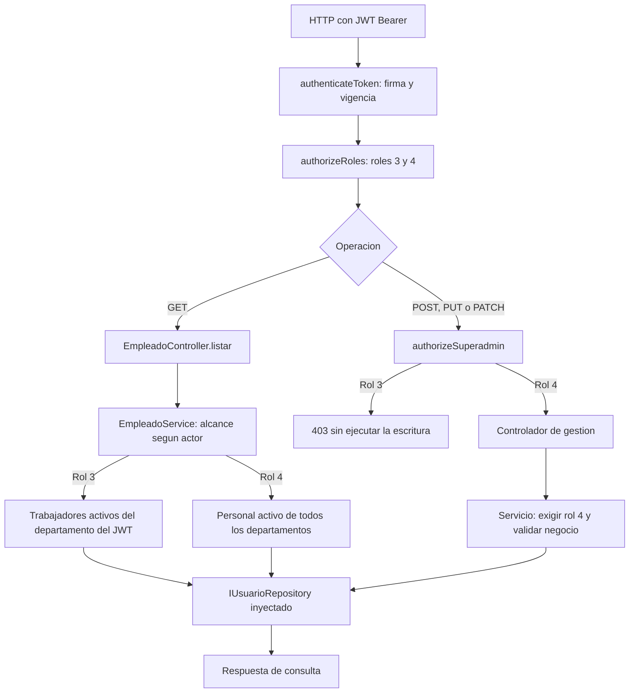
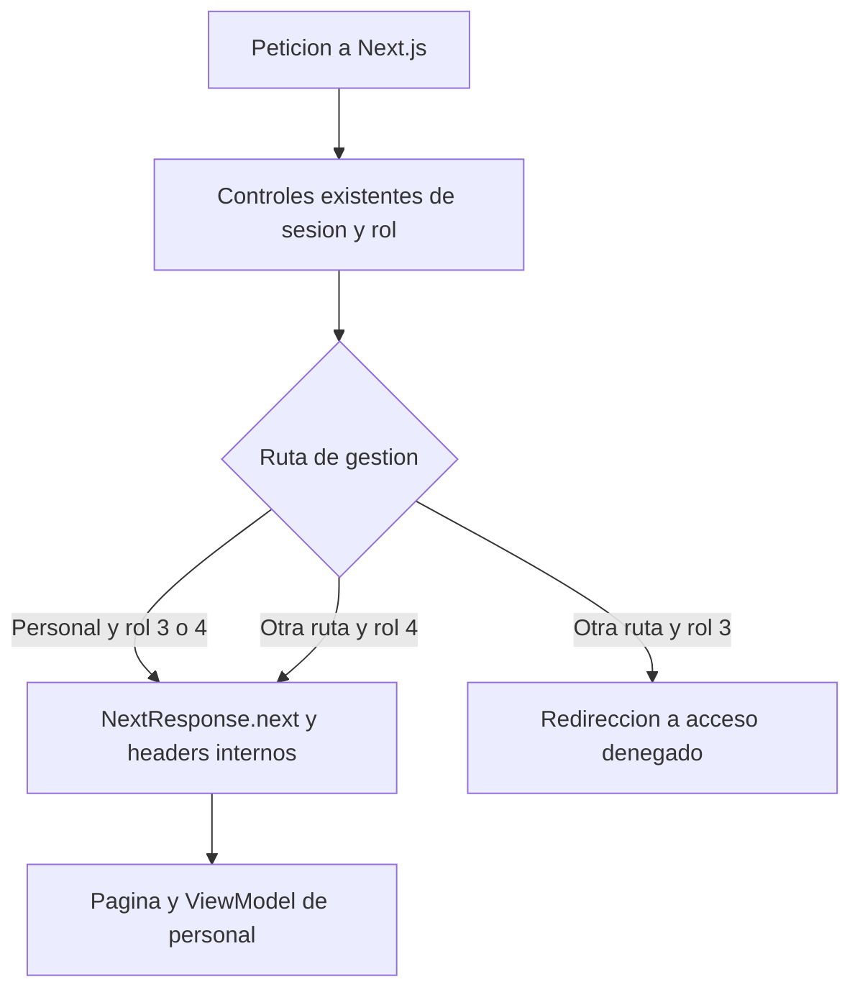
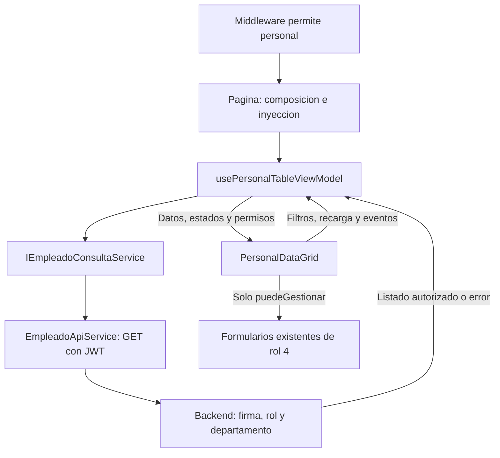

# US-021 — Acceso departamental y renderizado condicional de personal

**Responsable:** Miguel Leal.

**Proyectos:** mejora-sjr-admin y mejora-sjr-backend.

**Arquitectura:** MVVM en web y capas en backend, con dependencias inyectadas.

**Estado:** API, middleware, ViewModel y renderizado condicional implementados. Pruebas automáticas, TypeScript y build de producción aprobados; pendiente aceptación de interacción en navegador.

## 1. Objetivo y reglas acordadas

Permitir al administrador de departamento entrar a /admin/personal para consultar y filtrar sus trabajadores. Reservar la creación, edición y desactivación de empleados al Superadmin.

| Actor | Consulta de personal | Crear, editar o desactivar |
| --- | --- | --- |
| Sin JWT válido | Rechazo 401. | Rechazo 401. |
| Rol 1, rol 2 o desconocido | Rechazo 403. | Rechazo 403. |
| Rol 3 — Administrador de departamento | Solo trabajadores activos, rol 2, del departamento del JWT. | Rechazo 403. |
| Rol 4 — Superadmin | Trabajadores y administradores activos de todos los departamentos. | Permitido, sujeto a las validaciones existentes. |

Esta matriz es la regla vigente de personal para US-021. El middleware admite al rol 3 en /admin/personal y el ViewModel habilita su consulta. La vista muestra el listado y los filtros, sin acciones de creación, edición o baja. El alcance departamental lo aplica el backend, no un filtro de seguridad en el navegador.

La futura asignación de reportes a trabajadores es el contexto de negocio indicado por Miguel. Esta entrega no crea endpoints, formularios ni reglas de asignación de incidencias.

## 2. Primer bloque: autorización del backend

### Archivos y responsabilidades

| Archivo | Responsabilidad |
| --- | --- |
| `mejora-sjr-backend/src/routes/empleadoRoutes.js` | Ensambla las dependencias y aplica autenticación/roles a cada operación HTTP. Reutiliza authorizeSuperadmin para las escrituras. |
| `mejora-sjr-backend/src/middlewares/authMiddleware.js` | Middleware existente: verifica firma y vigencia del JWT, establece req.user y aplica permisos. No fue necesario cambiar su implementación. |
| `mejora-sjr-backend/src/controllers/EmpleadoController.js` | Adaptador HTTP existente: entrega payload, ID y req.user al servicio y construye la respuesta. No decide el departamento ni consulta SQL. |
| `mejora-sjr-backend/src/services/EmpleadoService.js` | Exige rol 4 para mutaciones y define el alcance de lectura por actor. Elimina las reglas anteriores que permitían escrituras de rol 3. |
| `mejora-sjr-backend/src/repositories/IUsuarioRepository.js` | Contrato existente: listarEmpleadosActivos admite filtros de roles/departamento. No cambia. |
| `mejora-sjr-backend/src/repositories/SqlUsuarioRepository.js` | Implementación existente: aplica los filtros recibidos y parametriza el departamento en SQL. No cambia. |
| `mejora-sjr-backend/src/repositories/MockUsuarioRepository.js` | Implementación en memoria del mismo contrato, utilizada en las pruebas. No cambia. |
| `mejora-sjr-backend/tests/empleadosRbac.test.js` | Regresión de permisos, aislamiento departamental, ausencia de escrituras y llamadas directas al servicio. |
| `mejora-sjr-backend/tests/auth.test.js` | Prueba existente de login de usuario inactivo. Se corrigió la referencia para modificar mockRepo, la misma instancia entregada al router de autenticación. |

### Flujo de consulta

1. Llega GET /api/empleados con un JWT Bearer.
2. authenticateToken verifica la firma y vigencia. El actor procede del JWT verificado, no de un parámetro enviado por el cliente.
3. authorizeRoles admite únicamente roles 3 y 4.
4. El controlador entrega req.user a listarEmpleados del servicio.
5. Para rol 3, el servicio exige un departamento numérico entero positivo y establece los filtros roles=[2] e idDepartamento del JWT. Si falta ese dato o tiene formato inválido, devuelve 403 antes de consultar el repositorio.
6. Para rol 4, establece roles=[2,3] y conserva la consulta de todos los departamentos.
7. El repositorio inyectado devuelve los empleados activos que corresponden. El controlador responde con success y data.

La consulta no utiliza idDepartamento, idRol ni roles enviados como query para ampliar el alcance. Una lista sin trabajadores propios es un resultado vacío válido; no activa una consulta global ni datos de otro departamento.

### Flujo de escritura

1. POST, PUT y PATCH pasan primero por la autenticación y el filtro general de roles.
2. authorizeSuperadmin rechaza al rol 3 con 403 antes de ejecutar el controlador.
3. El servicio también exige rol 4 al crear, actualizar o desactivar. Así otra composición interna no puede omitir el middleware y reutilizar esas funciones para escribir como rol 3.
4. Con rol 4 se conservan las validaciones, el hash de contraseña, los conflictos de correo y la baja lógica existentes. El repositorio solo escribe después de superar esas comprobaciones.



### Por qué se organiza así

- **Responsabilidad única:** middleware autentica/autoriza HTTP; controlador adapta la petición; servicio define reglas y alcance; repositorio administra persistencia.
- **Inversión de dependencias:** EmpleadoService conserva IUsuarioRepository inyectado. No se añadieron conexiones SQL ni mocks dentro del servicio.
- **Sustitución:** SQL y mock reciben los mismos filtros mediante el contrato existente. Las pruebas en memoria no certifican por sí solas la ejecución de SQL en Azure.
- **Reutilización:** la ruta utiliza el middleware Superadmin ya disponible. La comprobación en el servicio protege la regla de negocio también ante llamadas internas.

## 3. Verificación del primer bloque

Las pruebas usan createApp con repositorios mock, un secreto de JWT generado para la ejecución y sin conexión a Azure. No se instalaron dependencias nuevas.

La suite específica cubre:

- POST, PUT y PATCH directos de rol 3: 403, sin acceso al repositorio ni modificación de datos.
- Lectura de cada departamento: solo trabajadores propios activos; excluye administradores, inactivos y otros departamentos.
- Query que intenta ampliar departamentos/roles: no cambia el alcance autorizado.
- Departamento ausente o con tipo/formato inválido: 403 antes de consultar.
- Departamento sin trabajadores: lista vacía.
- Superadmin: listado global conservado.
- Roles no admitidos y JWT con firma ajena o expirado: rechazo antes de consultar.
- Llamadas directas al servicio como rol 3: creación, edición y baja rechazadas.

**Resultados registrados el 10 de noviembre de 2026, con Node 26.8.2:**

| Comprobación | Resultado |
| --- | --- |
| Suite específica de US-021 | 21 pruebas aprobadas. |
| Suite completa del backend | 76 pruebas aprobadas; 7 suites aprobadas, sin fallos. |
| git diff --check | Aprobado. |

La prueba del usuario inactivo utiliza mockRepo, la instancia ya creada e inyectada al router. Modifica sus datos simulados y comprueba el rechazo 401 del login. No crea un segundo repositorio ni se elimina la prueba. La corrección de esa referencia fue acordada con Miguel.

Desde mejora-sjr-backend, usando Node compatible con las dependencias instaladas:

```powershell
node node_modules/jest/bin/jest.js --runInBand
```

## 4. Segundo bloque: acceso de ruta en Next.js

### Archivos y responsabilidades

| Archivo de mejora-sjr-admin | Responsabilidad |
| --- | --- |
| `src/middleware.ts` | Aplica una excepción de consulta para rol 3 en /admin/personal, también con barra final. Las demás rutas administrativas de gestión siguen reservadas al rol 4. |
| `src/app/admin/acceso-denegado/page.tsx` | Conserva la vista 403 existente; se actualizó su comentario para describir las rutas que siguen restringidas. |
| `tests/middleware.test.cjs` | Ejecuta el middleware TypeScript real con NextRequest y NextResponse instalados, sin sustituir esos componentes. |

### Flujo y límites de la excepción

1. Next.js aplica el middleware a las rutas de su matcher existente: /dashboard, /admin y /login.
2. El middleware conserva la lectura de cookie y los controles existentes de sesión/rol.
3. Un rol 3 puede continuar hacia /admin/personal o /admin/personal/. Una query no cambia el pathname ni amplía sus permisos.
4. Rutas como /admin/configuracion, /admin/personal/nuevo y /admin/personales siguen restringidas al Superadmin. La excepción no usa un prefijo que abra todas esas direcciones.
5. Los roles admitidos continúan recibiendo los headers internos de identidad/rol/departamento construidos desde los claims. La página informativa /admin/acceso-denegado conserva el acceso de roles 3 y 4.
6. La página inyecta sesión y consulta al ViewModel. La tabla presenta los datos y los permisos recibidos, como se detalla en el siguiente bloque.



**Responsabilidad única:** el middleware controla la entrada a la ruta; no carga empleados ni controla los botones de la vista. El backend sigue autorizando cada operación de datos.

### Verificación del middleware

El 10 de noviembre de 2026, con Node 26.8.2, aprobaron 22 pruebas y la comprobación TypeScript del panel.

Las pruebas cubren acceso de roles 3/4, barra final, query, rutas administrativas vecinas y subrutas, roles no admitidos, ausencia de cookie, token ilegible/expirado, headers internos y redirección de login. Compilan el middleware en memoria con TypeScript y usan las implementaciones reales de NextRequest/NextResponse. No instalan paquetes ni ejecutan un servidor Next; no acreditan interacción de la tabla en navegador ni ejecución dentro del runtime Edge.

Desde mejora-sjr-admin:

```powershell
node --test tests/middleware.test.cjs
node node_modules/typescript/bin/tsc --noEmit --incremental false
```

## 5. Tercer bloque: consulta y gestión separadas en MVVM

### Archivos y dependencias

| Archivo de mejora-sjr-admin | Responsabilidad |
| --- | --- |
| `src/viewModels/usePersonalTableViewModel.ts` | Comprueba sesión/rol, consulta por contrato y expone puedeConsultar y puedeGestionar. Coordina filtros, recarga, errores y acciones de tabla. |
| `src/views/personal/PersonalDataGrid.tsx` | Presenta listado, carga, filtros y errores. Renderiza las acciones y los formularios únicamente cuando el ViewModel entrega puedeGestionar. |
| `src/services/contracts/IAuthService.ts` | Contrato existente; el hook recibe solo obtenerToken y decodificarToken mediante Pick. |
| `src/services/contracts/IEmpleadoConsultaService.ts` | Contrato existente que necesita la tabla: listarEmpleados. No obliga al ViewModel a depender de métodos de escritura. |
| `src/services/api/EmpleadoApiService.ts` | Adaptador existente: agrega el JWT actual a GET /api/empleados y valida/normaliza su respuesta. No fue necesario modificarlo. |
| `src/app/admin/personal/page.tsx` | Composición existente: construye los servicios y entrega el ViewModel a PersonalDataGrid. |
| `src/providers/PersonalFormularios.tsx` | Composición existente de crear, editar y desactivar. Su restricción de rol 4 se conserva. |
| `tests/personal-table.test.cjs` | Regresión de permisos, consulta/recarga, filtros, errores, cambio de sesión, respuestas tardías y renderizado condicional. |

La página /dashboard/personal reutiliza el mismo ViewModel y la misma vista; recibe el comportamiento de consulta/gestión sin duplicar la implementación. La pantalla de desarrollo /dashboard/personal/formularios conserva su restricción de gestión para rol 4.

### Permisos que recibe la vista

| Estado | puedeConsultar | puedeGestionar |
| --- | --- | --- |
| Rol 3 con sesión local admitida | true | false |
| Rol 4 con sesión local admitida | true | true |
| Sin sesión vigente o rol no admitido | false | false |
| La API rechaza con 401 o 403 | false | false |

El permiso de consulta controla el acceso a la tabla y la recarga. El permiso de gestión controla abrir los formularios y procesar sus cambios confirmados. Los handlers conservan esa comprobación aunque se intenten llamar directamente desde el cliente.

### Flujo completo de la tabla

1. El middleware permite continuar a /admin/personal para roles 3 y 4.
2. La página inyecta sesión y consulta en usePersonalTableViewModel.
3. El ViewModel comprueba token, expiración numérica finita futura y rol. Si son admitidos, consulta mediante IEmpleadoConsultaService.
4. EmpleadoApiService envía GET con el JWT actual. El backend verifica su firma y determina el conjunto autorizado: trabajadores propios para rol 3 o personal global para rol 4.
5. El ViewModel recibe el listado y aplica filtros locales de texto, rol y estado sobre ese conjunto. No envía un departamento elegido por el usuario para ampliar la consulta.
6. PersonalDataGrid representa los datos. Rol 3 puede filtrar, actualizar y reintentar; no se renderizan Nuevo Empleado, editar, desactivar, la columna de acciones ni el compositor de formularios. Los estados de carga/vacío mantienen cinco columnas; rol 4 conserva seis.
7. Rol 4 mantiene los formularios y los eventos de éxito existentes. Tras un cambio confirmado se actualiza la fila y se recarga la consulta, sin repetir la petición de escritura.
8. Un fallo de consulta representa el error y permite reintentar si la sesión sigue admitida. Un 401/403 retira ambos permisos. No se sustituyen errores por mocks.

Cuando cambia el token observado al cargar/refrescar, se limpian listado, modal y feedback antes de consultar el nuevo alcance. Así no aparecen datos de una sesión anterior mientras carga la siguiente. La cancelación del efecto evita que una respuesta antigua reemplace el listado actual. No se añadió un vigilante continuo ni se modificó el almacenamiento de sesión.



### Principios de diseño

- **Responsabilidad única:** el ViewModel coordina estado y permisos; la vista presenta. El JSX no consulta el rol para decidir autorizaciones ni llama a HTTP.
- **Inversión de dependencias:** el hook conserva sesión y consulta inyectadas. No instancia AuthApiService, fetch ni un repositorio.
- **Segregación de interfaces:** la tabla utiliza IEmpleadoConsultaService; los formularios conservan sus contratos separados de gestión y departamentos.
- **Seguridad:** el permiso visual no autoriza escrituras. La API aplica la prohibición de rol 3 incluso ante una petición directa.

## 6. Verificación del panel

El 10 de noviembre de 2026, con Node 26.8.2:

| Comprobación | Resultado |
| --- | --- |
| Middleware | 22 pruebas aprobadas. |
| ViewModel y vista de personal | 21 pruebas aprobadas. |
| Suite conjunta del panel | 43 pruebas aprobadas, sin fallos. |
| TypeScript | Aprobado con tsc --noEmit --incremental false. |
| Build de producción Next.js 14.2.35 | Aprobado, incluyendo /admin/personal y el middleware. |
| Interacción real en navegador y persistencia SQL | Pendientes de aceptación; las pruebas en memoria no certifican Azure. |

Las pruebas del ViewModel ejecutan el cuerpo TypeScript real con hooks controlados; no reproducen un montaje React ni sus efectos reales. Las pruebas de vista usan React/SSR y PersonalDataGrid reales, aislando el compositor de formularios y la vista de error de otras HU. Comprueban datos/controles representados, no clics, foco, hidratación ni peticiones de un navegador real.

Se comprueban roles 3/4 y no admitidos, vigencia, bloqueo de handlers de gestión, edición por copia, cambios confirmados, recarga, errores 401/403, reintento, cambio de sesión, respuestas tardías y las cinco/seis columnas. No se añadieron librerías ni se cambiaron package.json o lockfiles.

Desde mejora-sjr-admin:

```powershell
node --test tests/middleware.test.cjs tests/personal-table.test.cjs
node node_modules/typescript/bin/tsc --noEmit --incremental false
node node_modules/next/dist/bin/next build
```

## 7. Comprobación de aceptación en navegador

Utilizar un entorno de prueba y cuentas autenticadas por la API configurada. Un token del mock de autenticación frontend no demuestra acceso a la API real. Para comprobar aislamiento, preparar trabajadores activos en dos departamentos dentro de ese entorno.

1. Entrar como rol 3 y abrir /admin/personal: visualizar únicamente trabajadores de su departamento.
2. Comprobar búsqueda, filtros y Actualizar; verificar que Nuevo Empleado, editar y desactivar no aparecen.
3. Entrar como rol 4: comprobar listado global, Nuevo Empleado y los formularios existentes de edición/baja.
4. Comprobar error de consulta/reintento y rechazo de sesión, sin datos inventados. La API ya tiene pruebas de rechazo de escrituras directas de rol 3 y de intentos de ampliar el departamento mediante query.
5. Registrar la aceptación de Miguel. La asignación de reportes requiere su etapa y sus endpoints; no está implementada por esta HU.

Ocultar controles mejora la experiencia, pero la prohibición efectiva de escrituras corresponde al backend. El middleware de Next.js actual decodifica claims; la verificación criptográfica de estas peticiones sigue realizándose en la API.

## 8. Documentación relacionada

- [US-010 — Creación de empleados](README_HU_US010.md).
- [US-011 — Edición y baja](README_HU_US011.md).
- [US-008 de Isaac — API de empleados](../Isaac/README_HU_008.md).
- [US-007 y US-009 — RBAC y tabla de personal](../Abraham/README_HU_US007_US009.md).
