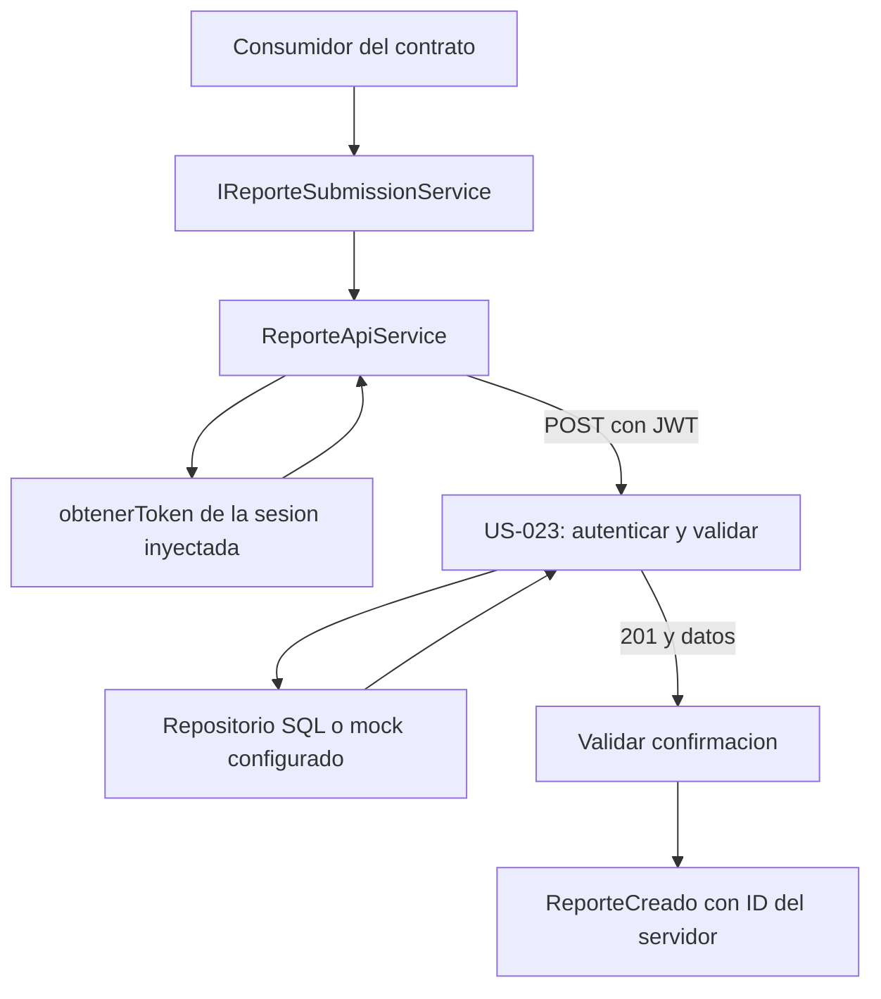
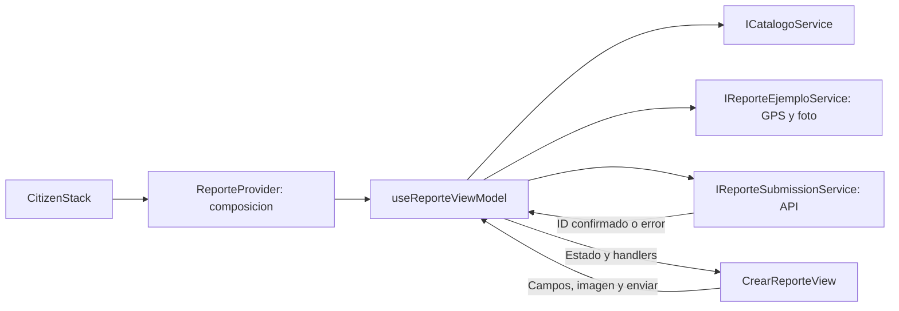
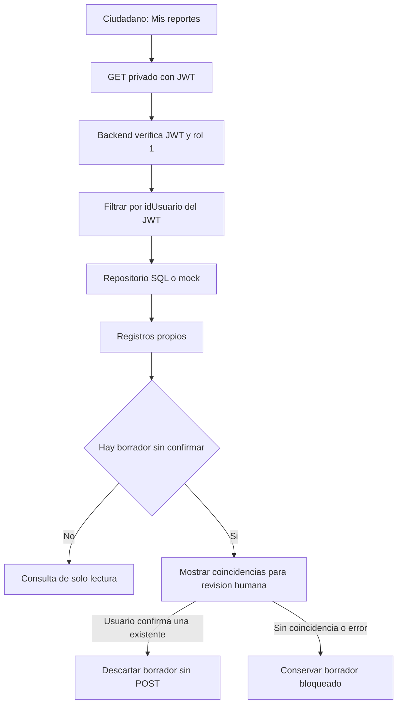

# US-024 — Levantamiento de reportes ciudadanos

**Responsable:** Miguel Leal.

**Proyecto:** mejora-sjr-mobile, integrado con US-023 del backend.

**Rama:** sP5.

**Estado:** implementación terminada para el alcance acordado: foto/GPS emulados, envío real y Mis reportes con consulta privada. Pruebas, TypeScript y exportaciones aprobados. Pendiente aceptación visual en Expo/navegador y verificación directa de persistencia en Azure.

## 1. Alcance acordado

- GPS simulado con coordenadas de ejemplo del municipio.
- Fotografía simulada acorde con la categoría: un ejemplo de bache para Bacheo, y ejemplos correspondientes para las demás categorías.
- Catálogos municipales existentes.
- Guardado mediante POST /api/incidencias, sin generar un folio local como si fuera una confirmación real.
- Consulta posterior en Mis reportes del ciudadano, limitada en el backend al usuario del JWT.
- Sin instalar expo-location, expo-image-picker ni otras dependencias nativas: Miguel indicó que ubicación y fotografía seguirán emuladas.

Las imágenes y coordenadas de ejemplo deben identificarse en la interfaz. Su simulación es independiente del envío: el reporte se crea en la fuente configurada del backend. DATA_SOURCE=azure_sql utiliza SQL; mock conserva datos únicamente en memoria y los pierde al reiniciar el servidor. Las pruebas de este bloque no acceden a Azure.

## 2. Primer bloque: contrato de creación

### Archivos y responsabilidades

Rutas relativas a mejora-sjr-mobile:

| Archivo | Responsabilidad |
| --- | --- |
| `src/models/incidencia.types.ts` | Alinea NuevaIncidenciaDTO con US-023 y define ReporteCreado/EvidenciaInicialReporte. Conserva el modelo enriquecido Incidencia usado para listados. |
| `src/services/contracts/IReporteSubmissionService.ts` | Contrato pequeño: crearReporte recibe el payload y devuelve una confirmación validada. No incluye listado, asignación ni administración. |
| `src/services/api/ReporteApiService.ts` | Agrega el JWT actual, ejecuta un POST, interpreta HTTP y comprueba la respuesta. Recibe sesión y transporte por constructor. |
| `src/services/api/ReporteApiError.ts` | Conserva mensaje, status y resultadoDesconocido para no confundir un rechazo con una escritura que no pudo confirmarse. |
| `tests/reporte-api.test.cjs` | Pruebas del adaptador TypeScript real con transporte inyectado y objetos Response estándar. |

### Payload que acepta US-023

| Campo | Uso |
| --- | --- |
| descripcion | Texto de la problemática; el backend exige al menos 10 caracteres y elimina espacios exteriores. |
| idCategoria | Identificador del catálogo existente. |
| latitud y longitud | Números; el backend comprueba límites geográficos y el perímetro aproximado de SJR. En esta HU serán valores de ejemplo. |
| fotoUrl | URL HTTP(S) opcional según US-023. Se utilizará una imagen de ejemplo correspondiente a la categoría. |

El adaptador envía exclusivamente esos campos. No envía idUsuario, rol ni departamento: la API obtiene al ciudadano del JWT y relaciona la categoría con su departamento.

Una URI local como file:///foto.jpg no es una URL de evidencia accesible desde otros dispositivos. Al usar ejemplos HTTP(S) no se necesita capturar ni subir archivos nativos en esta etapa.

El contrato anterior del móvil incluía fotoUri, idDepartamento y direccionReferencia. Esos campos no pertenecen al payload de creación de US-023. El formulario ahora muestra una referencia simulada informativa; ya no solicita una dirección editable que la API no guardaría.

### Respuesta y confirmación

ReporteApiService requiere HTTP 201, success=true y data con forma válida. Devuelve el ID del servidor, descripción, coordenadas, usuario, categoría, estado inicial Recibido, fecha y evidencias iniciales.

El modelo ReporteCreado se separa del modelo de listado porque la creación SQL no devuelve nombres enriquecidos de ciudadano, categoría, estado o departamento. No se inventan esos datos para satisfacer un tipo más amplio.

Se comprueban IDs positivos, coordenadas finitas, fecha interpretable, estado inicial 1 y evidencias asociadas al mismo reporte. La categoría confirmada debe coincidir con la enviada. Si se solicitó una foto, su URL debe aparecer en las evidencias devueltas. Se omiten propiedades adicionales ajenas al contrato.

## 3. Flujo de creación por el adaptador

La siguiente secuencia corresponde al servicio que ahora invoca el ViewModel mediante el contrato inyectado.

1. El consumidor entrega NuevaIncidenciaDTO a IReporteSubmissionService.
2. ReporteApiService solicita el token actual a la dependencia de sesión. No conserva una credencial capturada al construirlo.
3. Sin token rechaza antes de hacer HTTP. Si falla el almacenamiento de sesión, propaga ese fallo y tampoco envía.
4. Envía un POST con Authorization Bearer y el JSON de los campos admitidos.
5. La API de US-023 verifica el JWT y el rol ciudadano, valida datos y utiliza el repositorio inyectado.
6. El adaptador comprueba HTTP, success y data. Solo entonces devuelve ReporteCreado.
7. El ViewModel muestra confirmación y limpia el formulario después de recibir ese resultado; no antes.



### Principios de diseño

- **Responsabilidad única:** el adaptador traduce HTTP y verifica el contrato externo. No controla campos de pantalla, imágenes de ejemplo ni navegación.
- **Inversión de dependencias:** recibe obtenerToken y fetch por constructor; el consumidor dependerá de IReporteSubmissionService.
- **Segregación de interfaces:** crearReporte no obliga al formulario a depender de consulta de incidencias o asignación de trabajadores.
- **Separación de contratos:** crear un reporte y consultar un listado no requieren necesariamente la misma forma de respuesta.

## 4. Manejo de errores y límites

- Un error HTTP conserva status y el mensaje válido del backend, sin convertirlo en un resultado de éxito.
- Un 401/403 permite al ViewModel distinguir problemas de sesión/autorización de un error de validación.
- La falta de respuesta de red, un 408/5xx o una respuesta de éxito inconsistente pueden dejar el resultado de la escritura desconocido. No se afirma que el servidor no guardó el reporte.
- El servicio no reintenta POST automáticamente, no guarda en un mock como alternativa y no genera IDs o folios aleatorios.
- No existe todavía un contrato de idempotencia en US-023. La interfaz conserva el borrador y permite revisar los reportes propios; no repite automáticamente una creación incierta. Para garantizar idempotencia entre reinicios o dispositivos se requiere un contrato adicional del backend.
- El borrador es estado de la pantalla. Se conserva mientras se abre/cierra Mis reportes, pero no se persiste al reiniciar la aplicación. Un cierre de sesión desmonta la rama privada.

## 5. Segundo bloque: formulario y composición MVVM

### Archivos y responsabilidades

| Archivo de mejora-sjr-mobile/src | Responsabilidad |
| --- | --- |
| `models/reporteEjemplo.types.ts` | Datos de ubicación/foto de ejemplo y crédito de imagen. |
| `services/contracts/IReporteEjemploService.ts` | Fuente pequeña de ejemplos; no guarda incidencias ni produce respuestas de éxito. |
| `services/mocks/MockReporteEjemploService.ts` | Coordenadas fijas dentro de SJR y mapa de fotografías para las categorías 1–4 actuales. Categorías desconocidas no reciben una imagen aleatoria. |
| `providers/ReporteProvider.tsx` | Construye envío, consulta propia y ejemplos; inyecta catálogo/sesión y conecta el coordinador con ambas vistas. Acepta implementaciones personalizadas para pruebas. |
| `viewModels/useReporteViewModel.ts` | Coordina catálogos, selecciones relacionadas, foto, validación, envío, bloqueo y confirmación. No utiliza fetch ni instancia servicios. |
| `views/CrearReporteView.tsx` | Presenta el estado recibido por propiedades y entrega eventos de campos, imagen y botones. No contiene reglas de guardado. |
| `navigation/CitizenStack.tsx` | Monta ReporteProvider como pantalla CrearReporte. No pasa JWT por parámetros de navegación. |

AuthProvider conserva sus responsabilidades de autenticación/catálogos/almacenamiento; no se amplió para administrar el formulario. El proveedor de reportes utiliza envío API incluso cuando los datos de ubicación/foto proceden del servicio de ejemplos. Un JWT del mock de autenticación no autentica contra la API: para guardar se necesita iniciar sesión mediante autenticación API.

### Flujo del formulario

1. Al entrar, el ViewModel consulta departamentos y categorías mediante ICatalogoService. Una carga fallida o vacía bloquea el envío y permite actualizar catálogos.
2. Elegir categoría resuelve su departamento. Cambiar a una categoría distinta o a un departamento incompatible limpia la fotografía anterior.
3. Añadir foto obtiene el ejemplo de esa categoría. La vista entrega onLoad/onError al ViewModel con un número de intento; eventos de imágenes anteriores no afectan la actual.
4. La foto es opcional y no bloquea el guardado. Solo se incluye fotoUrl cuando la vista previa está lista al enviar. Si todavía carga, falla o se quitó, se omite ese campo. El error de imagen queda visible y permite reintentar; Miguel aclaró que guardar los datos tiene prioridad.
5. Enviar valida categoría/departamento del catálogo, descripción de al menos 10 caracteres y sesión ciudadana. El payload contiene solo los campos de US-023.
6. Antes de esperar la petición, una referencia sincrónica marca pending. Bloquea dobles toques y cambios del borrador incluso antes del siguiente render; isSubmitting refleja ese estado en la vista.
7. La confirmación válida muestra Reporte #ID con el identificador del servidor y limpia los campos. Mantiene bloqueado el formulario hasta cerrar el modal; no genera un folio local.
8. Un rechazo conocido conserva datos y representa el error. Un resultado desconocido conserva y bloquea el borrador, sin repetir el POST. Mis reportes permite consultar y confirmar manualmente una coincidencia existente.
9. El desmontaje descarta actualizaciones tardías de creación, catálogos e imágenes. No cancela ni revierte una escritura que el backend ya recibió.

La dirección editable anterior se reemplazó por una referencia de la ubicación simulada. El aviso distingue los datos de ejemplo del envío real; la evidencia almacenada es una referencia URL, no una copia del archivo alojada en nuestro backend.



La separación cumple responsabilidad única: fuente de ejemplos prepara entradas, ViewModel coordina y vista representa. La composición mantiene inversión de dependencias y contratos separados de catálogo/ejemplos/envío.

## 6. Tercer bloque: Mis reportes y comprobación del guardado

### Backend: consulta privada

| Archivo de mejora-sjr-backend/src | Responsabilidad |
| --- | --- |
| `routes/incidenciaRoutes.js` | Registra GET /api/incidencias/mis-reportes con JWT y rol 1. Conserva los permisos del listado administrativo y de asignación/descarte. |
| `controllers/IncidenciaController.js` | Entrega el actor autenticado al servicio. La consulta no recibe una identidad elegida por query. |
| `services/IncidenciaService.js` | Valida rol ciudadano y un idUsuario entero positivo del JWT; llama al repositorio exclusivamente con ese propietario. |
| `repositories/IIncidenciaRepository.js` | Documenta el filtro interno idUsuario. |
| `repositories/SqlIncidenciaRepository.js` | Consulta vw_IncidenciasDetalle usando IdCiudadano = @IdUsuario con parámetro sql.Int. |
| `repositories/MockIncidenciaRepository.js` | Aplica el mismo filtro de propietario en memoria. |

GET /api/incidencias/mis-reportes no admite cambiar de ciudadano mediante query. No se abrió el GET administrativo de incidencias al rol 1. El backend devuelve una lista vacía válida si ese ciudadano no tiene registros, y rechaza sesiones/roles no admitidos.

### Móvil: contratos, estado y presentación

| Archivo de mejora-sjr-mobile/src | Responsabilidad |
| --- | --- |
| `models/reporteCiudadano.types.ts` | Datos de consulta y comparación con el borrador: descripción, categoría, coordenadas y foto enviada, si hubo una. |
| `services/contracts/IReporteConsultaService.ts` | Solo listarMisReportes, sin aceptar idUsuario ni obligar a depender de escritura/asignación. |
| `services/api/ReporteConsultaApiService.ts` | GET privado con el JWT actual, validación del JSON y normalización de idUsuario/mock o idCiudadano/SQL. No sustituye fallos por listas vacías ni por mocks. |
| `viewModels/useMisReportesViewModel.ts` | Coordina apertura, consulta, recarga, error/vacío y filas visibles. Resuelve nombres de categoría con el catálogo y retira datos/respuestas de otra identidad. |
| `viewModels/useReportesCiudadanoViewModel.ts` | Compone formulario y lista sin desmontar el borrador; coordina la confirmación humana de un registro ya consultado. |
| `views/MisReportesView.tsx` | Modal privado de solo lectura con ID, categoría, descripción, estado, fecha, Actualizar y Volver. |

La lista se abre dentro de la pantalla ciudadana del CitizenStack. Mantener el formulario montado conserva el borrador sin pasar JWT, funciones o datos sensibles por parámetros de navegación.

### Respuesta perdida y revisión manual

1. Si la creación queda sin confirmar, se conserva el payload de ese intento y se bloquea otro POST.
2. El usuario abre Mis reportes y consulta el servidor. Abrir/recargar/cerrar invalida sincrónicamente la respuesta anterior; un callback viejo no puede confirmar una fila obsoleta.
3. La lista marca como confirmables únicamente registros propios que coinciden con los datos retenidos. La descripción/categoría visible se obtiene del registro y del catálogo, sin inventar un ID.
4. El usuario revisa número, fecha y contenido, y pulsa «Este reporte ya está guardado». Consultar una coincidencia no confirma ni limpia el borrador automáticamente.
5. El formulario vuelve a verificar la coincidencia y el propietario, descarta ese borrador y muestra el ID comprobado. No ejecuta POST. Una versión del formulario invalida callbacks de envío anteriores para que no revivan después de esa comprobación.
6. Si no aparece una coincidencia o falla la consulta, se conserva el bloqueo. La ausencia en una consulta no demuestra que la petición anterior no se guardó.

La coincidencia de contenido es una ayuda para revisión humana, no una prueba de qué petición originó el registro. Si hay reportes iguales, el ciudadano debe revisar ID y fecha. Esto no sustituye la idempotencia del servidor ni garantiza deduplicación entre dispositivos/reinicios.



## 7. Verificación

El 11 de noviembre de 2026, con Node 26.8.2:

| Comprobación | Resultado |
| --- | --- |
| Adaptador de creación | 24 pruebas aprobadas. |
| Formulario y ejemplos | 27 pruebas aprobadas. |
| Consulta móvil y comprobación manual | 29 pruebas aprobadas. |
| Suite móvil completa | 174 pruebas aprobadas: 94 existentes y 80 de creación/formulario/consulta. |
| Consulta privada del backend | 23 pruebas aprobadas, incluyendo aislamiento, query manipulada y permisos. |
| Suite completa del backend | 128 pruebas aprobadas, 10 suites. |
| TypeScript | Aprobado con tsc --noEmit. |
| Exportación Expo | Aprobada para web, Android e iOS. |
| HTTP contra Express en memoria | Ambos adaptadores móviles reales: 3 reportes, 1 con foto y 2 sin foto; aislamiento entre 2 ciudadanos. Una respuesta se perdió después de guardar y el GET posterior encontró el registro. 3 POST, 4 GET, sin repetir POST. Servidor efímero cerrado. |

Las pruebas cubren payload explícito, JWT actual, falta/fallo de sesión, foto opcional, errores HTTP/red, JSON inválido, IDs/fechas/coordenadas inválidos, evidencia ausente o ajena, categoría distinta y confirmaciones inconsistentes. Comprueban que no se repite la petición automáticamente.

Las pruebas móviles utilizan transporte/hook controlados con el código TypeScript real. Cubren errores de API, aislamiento de actores, foto opcional no bloqueante, cambios de categoría, doble toque, confirmación, estados inciertos, respuestas tardías, filas obsoletas y callbacks previos. No equivalen a montar React/Expo ni a comprobar clics o imágenes en un teléfono.

La comprobación HTTP aislada sí ejercitó el adaptador contra Express, con persistencia en RAM; no certifica Azure ni el circuito completo de login/formulario en dispositivo. La exportación verifica módulos/compilación, no interacción. Se usó --no-bytecode solamente para esta comprobación, con salida temporal fuera del repositorio.

Las pruebas de almacenamiento/navegación existentes siguen aprobadas. No se modificaron package.json ni lockfiles ni se instalaron dependencias.

Desde mejora-sjr-mobile:

```powershell
node --test tests/reporte-api.test.cjs
node --test tests/reporte-form.test.cjs
node --test tests/mis-reportes.test.cjs
node --test
node node_modules/typescript/bin/tsc --noEmit
```

## 8. Fotografías de ejemplo y atribuciones

Las URLs de imagen están en MockReporteEjemploService y tienen menos de 255 caracteres, compatibles con FotoUrl en SQL. La vista identifica las fotos como ejemplos y muestra su crédito.

| Categoría | Fuente y autor | Licencia |
| --- | --- | --- |
| Fugas de agua | [Tuberías dañadas, NPS / Rocky Mountain National Park](https://www.nps.gov/romo/learn/news/rocky-mountain-national-park-requests-public-input-on-infrastructure-improvements-to-moraine-park-campground-and-nearby-areas.htm) | Foto oficial NPS; [política de uso](https://www.nps.gov/aboutus/disclaimer.htm). |
| Alcantarillado | [Manhole.jpg, Scott Ehardt / SCEhardt](https://commons.wikimedia.org/wiki/File:Manhole.jpg) | Dominio público. |
| Alumbrado | [Street lamp angled mast, Jengelh; recorte Mannivu](https://commons.wikimedia.org/wiki/File:Street_lamp_angled_mast_(close_up).jpg) | CC0 1.0. |
| Bacheo | [Pothole Big.jpg, Uncl3dad](https://commons.wikimedia.org/wiki/File:Pothole_Big.jpg) | Dominio público. |

La foto NPS se descargó con HTTP 200 y se inspeccionó. Las fichas/licencias de Commons se verificaron, pero sus descargas devolvieron 429 en el entorno de revisión; no se acredita su disponibilidad ni vista previa en Expo. La interfaz muestra el fallo y permite guardar sin foto. Las URLs externas pueden dejar de estar disponibles.

## 9. Aceptación y límites pendientes

1. Con el backend activo, iniciar sesión por API como ciudadano y enviar categoría/descripción, con o sin fotografía de ejemplo. Verificar el número real en la confirmación.
2. Abrir Mis reportes y comprobar que el registro aparece, incluso después de cerrar/abrir la consulta. Usar otro ciudadano para comprobar que no ve esos registros.
3. Probar carga fallida de foto: el envío de datos debe seguir habilitado y no incluir fotoUrl si la imagen no estaba lista.
4. Revisar teléfono/navegador: botones, teclado, texto ampliado, imágenes y lista. Registrar la aceptación de Miguel.
5. Verificar directamente Azure con DATA_SOURCE=azure_sql si se requiere certificar durabilidad SQL. Las pruebas realizadas fueron explícitamente en memoria.

Hallazgo previo dejado intacto: el mock del backend etiqueta idCategoria=3 (Alumbrado) como «Bacheo» en su nombre enriquecido. El ID es correcto y la lista móvil resuelve el nombre desde el catálogo canónico. Se informó para revisión; no se autocorrigió ese mapeo ajeno.

## 10. Documentación relacionada

- [US-023 de Isaac — Creación de incidencias](../Isaac/README_HU_023.md).
- [US-025 de Isaac — Consulta y gestión operativa](../Isaac/README_HU_025.md).
- [US-003 — Autenticación móvil](README_HU_US003.md).
- [US-004 — Catálogos móviles](README_HU_US004.md).
- [US-016 — Navegación por sesión y rol](README_HU_US016.md).
- [US-017 — Diseño y simulaciones iniciales](README_HU_US017.md).
