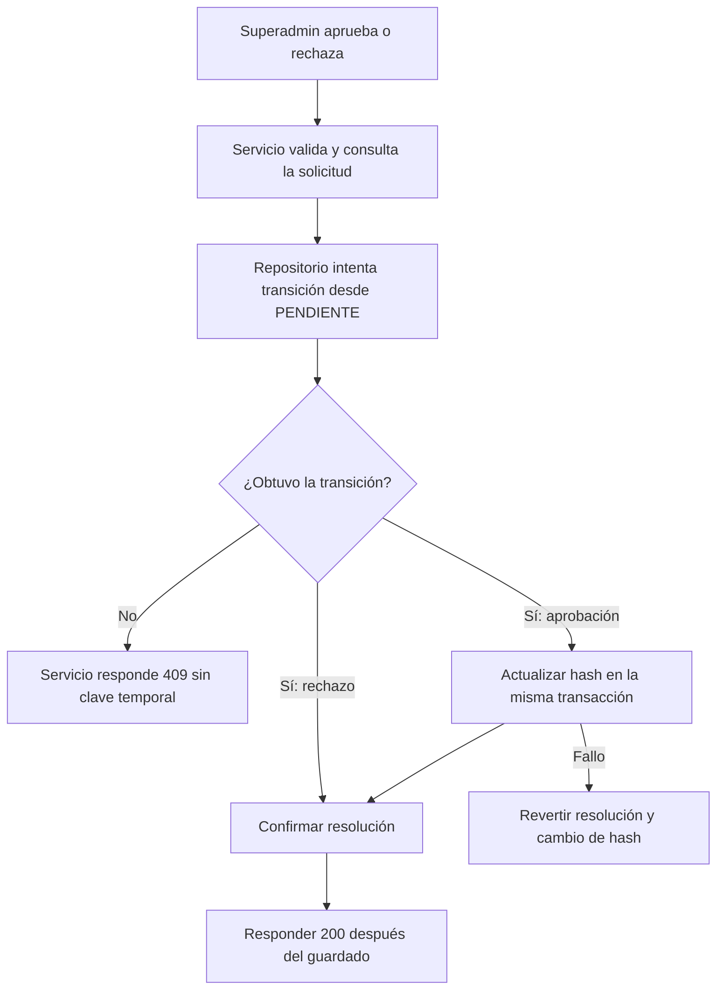
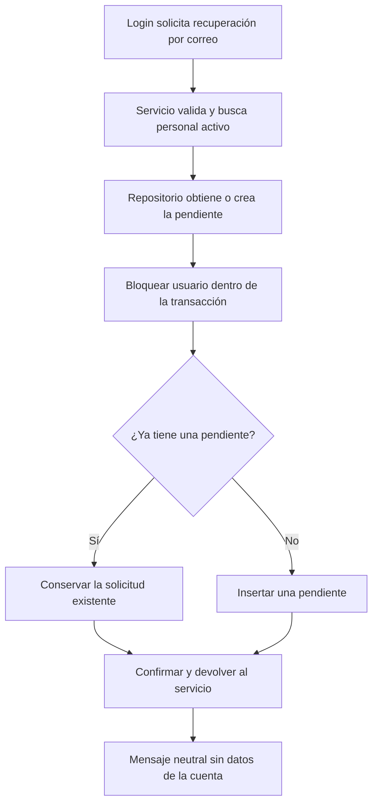
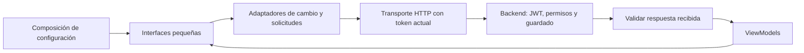
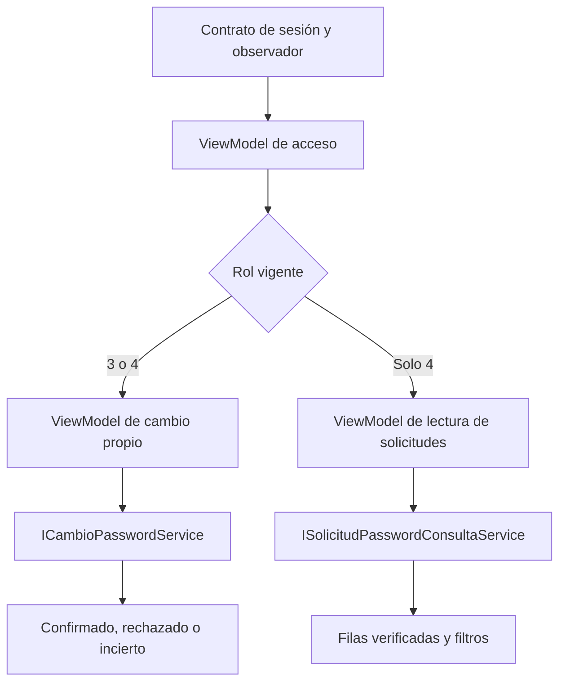
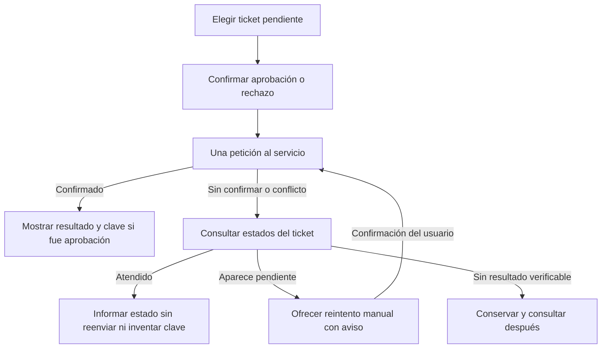
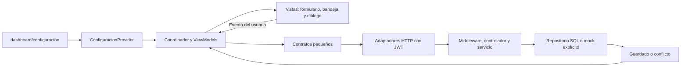

# US-029 · Configuración y bandeja de aprobación de claves

**Responsable:** Miguel Leal. **Proyecto:** Mejora SJR, panel web administrativo.

## Alcance y estado

La historia permite que los administradores de departamento (rol 3) y Superadmins (rol 4)
cambien su propia contraseña desde `/dashboard/configuracion`. Solo el rol 4 puede consultar
y atender las solicitudes de recuperación asistida de US-028.

**Implementación terminada:** ruta, proveedor, vistas, ViewModels, adaptadores HTTP y
extensiones del backend. El login también recibió la corrección del error de conexión.
Pasaron las pruebas automáticas, TypeScript, la compilación de Next y las comprobaciones
HTTP en memoria. Quedan pendientes la aceptación visual/manual y aplicar/verificar el índice
único en Azure; no se ha modificado esa base de datos.

| Usuario | Qué encuentra en Configuración |
| --- | --- |
| Administrador de departamento, rol 3 | Cambio de su propia contraseña. No consulta solicitudes de otros empleados. |
| Superadmin, rol 4 | Cambio propio y bandeja con búsqueda, filtros, aprobación y rechazo. |

Se abre desde **Configuración** en el menú lateral o directamente en
`http://localhost:3000/dashboard/configuracion` al ejecutar el panel en su puerto por defecto.

## Bloque 1 · Cambio de contraseña propia en el backend

`PATCH /api/auth/password`, con `Authorization: Bearer <JWT>` y un cuerpo JSON:

```json
{
  "passwordActual": "clave que utiliza actualmente el usuario",
  "passwordNueva": "nueva clave elegida por el usuario",
  "confirmarPassword": "nueva clave elegida por el usuario"
}
```

La identidad se obtiene del JWT verificado. El cuerpo no puede elegir otra cuenta.
Los campos ajenos al contrato se descartan en el controlador.

| Archivo | Responsabilidad y motivo |
| --- | --- |
| `mejora-sjr-backend/src/routes/authRoutes.js` | Ensambla el servicio y el controlador. Verifica JWT y permite roles 3 y 4. Mantiene la inyección de dependencias en la composición. |
| `mejora-sjr-backend/src/controllers/PasswordChangeController.js` | Extrae los tres campos y el actor, delega y responde. No consulta SQL ni calcula hashes. |
| `mejora-sjr-backend/src/services/contracts/IPasswordChangeService.js` | Contrato del que depende el controlador. Se limita al cambio propio, sin acoplarlo al registro, login o recuperación asistida. |
| `mejora-sjr-backend/src/services/PasswordChangeService.js` | Valida el cambio, verifica la cuenta activa, la contraseña actual y la confirmación; calcula el nuevo hash con bcrypt. Tiene una sola responsabilidad. |
| `mejora-sjr-backend/src/repositories/IUsuarioPasswordRepository.js` | Contrato pequeño con consulta de credenciales y actualización condicional. El servicio depende de estas dos operaciones, no de toda la gestión de empleados (ISP y DIP). |
| `mejora-sjr-backend/src/repositories/SqlUsuarioRepository.js` | Implementa el contrato mediante parámetros SQL. Conserva el hash fuera de la consulta general `buscarPorId`. |
| `mejora-sjr-backend/src/repositories/MockUsuarioRepository.js` | Implementa las mismas condiciones de actualización en memoria para pruebas (LSP). |

En JavaScript estos contratos se expresan mediante clases y JSDoc; `@implements` documenta
la compatibilidad de los repositorios, sin convertirlos en interfaces nativas de TypeScript.

```mermaid
sequenceDiagram
    participant Cliente as Cliente web
    participant Ruta as authRoutes + middleware
    participant Controlador as PasswordChangeController
    participant Servicio as PasswordChangeService
    participant Repo as IUsuarioPasswordRepository
    participant Datos as SQL / memoria
    Cliente->>Ruta: PATCH /api/auth/password + JWT + tres claves
    Ruta->>Ruta: Verificar firma, expiración y rol 3/4
    Ruta->>Controlador: Petición con actor autenticado
    Controlador->>Servicio: Campos permitidos + actor del JWT
    Servicio->>Repo: obtenerCredencialesPorId(actor.idUsuario)
    Repo->>Datos: Consultar credenciales internas
    Datos-->>Servicio: Hash, rol y estado de la cuenta
    Servicio->>Servicio: Validar cuenta, contraseña actual y nueva; calcular hash
    Servicio->>Repo: cambiarPasswordSiCoincide(hash leído, hash nuevo)
    Repo->>Datos: Actualizar si hash, rol y cuenta activa siguen iguales
    Datos-->>Servicio: Una fila actualizada / conflicto
    Servicio-->>Cliente: 200 confirmado o error sin declarar éxito
```

### Reglas y respuestas

- La nueva clave debe tener al menos 8 caracteres, siguiendo el mínimo del flujo asistido
  existente, y no superar 72 bytes UTF-8, límite de bcrypt. Esto no representa una revisión
  global de la política de contraseñas del proyecto.
- La nueva clave y su confirmación deben coincidir exactamente. No se recortan espacios
  de las claves. Una clave compuesta solo por espacios se rechaza.
- La contraseña actual debe ser correcta y la nueva debe ser diferente.
- La cuenta debe existir, permanecer activa y conservar el rol del JWT.
- La escritura compara el hash leído mediante comparación binaria en SQL. Si otra operación
  cambia la clave, desactiva la cuenta o cambia su rol antes de escribir, responde `409`.
- Solo se anuncia éxito cuando el repositorio confirma una actualización.
- `400`: datos inválidos o contraseña actual incorrecta. `401`: sesión/cuenta no disponible.
  `403`: rol no permitido o permisos cambiados. `409`: estado modificado durante la operación.
- La respuesta no contiene contraseñas, hashes ni nuevos JWT, e incluye `Cache-Control: no-store`.
- Se mantiene la política actual de sesiones: cambiar el hash no revoca los JWT emitidos;
  estos permanecen sujetos a la validación y expiración existentes.

## Bloque 2 · Una sola resolución por solicitud

Las rutas existentes de US-028 conservan la protección exclusiva del rol 4:

- `PATCH /api/solicitudes-password/:id/aprobar`.
- `PATCH /api/solicitudes-password/:id/rechazar`.

Dos Superadmins pueden tener abierta la misma solicitud. Deshabilitar un botón o atender
visualmente los tickets uno por uno no impide que otro navegador envíe una petición.
La persistencia debe decidir si la solicitud sigue `PENDIENTE` al escribir.

| Archivo | Responsabilidad del bloque |
| --- | --- |
| `mejora-sjr-backend/src/repositories/ISolicitudPasswordRepository.js` | Define `resolverSolicitud` como transición atómica desde `PENDIENTE`. Devuelve la resolución guardada o `null` si no puede obtener esa transición. |
| `mejora-sjr-backend/src/repositories/SqlSolicitudPasswordRepository.js` | Bloquea primero al usuario de la solicitud y después ejecuta un `UPDATE` condicionado por solicitud, usuario y estado pendiente. Solo si obtiene la fila cambia el hash al aprobar; confirma ambos cambios en una misma transacción. Un fallo revierte la transacción. |
| `mejora-sjr-backend/src/repositories/MockSolicitudPasswordRepository.js` | Comprueba el mismo estado y realiza la resolución sin pausas entre comparación y escritura, conservando el comportamiento del contrato en memoria. |
| `mejora-sjr-backend/src/services/PasswordRecoveryService.js` | Distingue solicitud inexistente (`404`) de solicitud atendida (`409`). También comprueba el resultado del repositorio, porque una lectura previa no garantiza que el estado siga igual. |

La garantía aplica a **la misma solicitud**. El bloque 3 la complementa evitando que se creen
dos pendientes para la misma cuenta. El `idUsuario` usado internamente para bloquear y resolver
procede de la solicitud consultada en el repositorio, no del cuerpo HTTP.



Si dos peticiones alcanzaron a leer `PENDIENTE`, únicamente la que obtiene la transición
puede completar la resolución. La otra recibe `409` y debe actualizar la bandeja. No se le
devuelve una contraseña temporal como si hubiese quedado guardada. Si la solicitud ya estaba
atendida al consultarla, también responde `409`; si no existe, mantiene `404`.

El contrato y la comprobación final permanecen en las capas correspondientes: el repositorio
garantiza la escritura atómica y el servicio traduce el resultado a una regla del flujo. Esto
conserva SRP y permite sustituir SQL por el mock sin que el servicio cambie (DIP y LSP).

## Bloque 3 · Creación sin pendientes duplicadas

`POST /api/solicitudes-password/solicitar` sigue siendo público y responde el mismo mensaje
neutral si el correo corresponde a personal activo, si ya hay una pendiente o si la cuenta
no es elegible. No expone el ID de la solicitud ni confirma que la cuenta exista.

El servicio valida el correo y la elegibilidad de la cuenta. Delega al repositorio obtener
o crear su solicitud pendiente; ya no consulta toda la bandeja para comprobar duplicados.
`ISolicitudPasswordRepository.crearSolicitud` documenta este comportamiento atómico.

En `SqlSolicitudPasswordRepository`, una transacción:

1. Consulta al usuario por su clave primaria con `UPDLOCK, HOLDLOCK`.
2. Busca una solicitud `PENDIENTE` para ese mismo usuario.
3. Devuelve la existente sin modificar ID, correo o fecha; si no existe, inserta una.
4. Confirma la transacción antes de devolver el resultado.

Creación y resolución siguen el mismo orden de bloqueos: **usuario → solicitud**.
Así no invierten entre ellas el orden de adquisición de esos recursos. No se solicita un
bloqueo de tabla completa (`TABLOCK`). El mock realiza su búsqueda y creación sin `await`
entre ambas, conserva la solicitud existente y devuelve una copia (LSP).



### Garantía adicional en la base de datos

Se añadió a `mejora-sjr-backend/schema.sql` el índice único filtrado
`UX_SolicitudesPassword_Usuario_Pendiente`, sobre `IdUsuario` cuando `Estado = 'PENDIENTE'`.
Permite mantener varias solicitudes históricas aprobadas o rechazadas y solicitar otra
recuperación después de resolver la anterior. Además impide pendientes duplicadas si otro
proceso intenta insertarlas sin usar el repositorio de esta aplicación.

Para una base existente se preparó
`mejora-sjr-backend/migrations/US029_solicitud_password_pendiente_unica.sql`.
Se debe revisar y ejecutar ese archivo con la conexión de Azure del equipo. **No volver a
ejecutar todo `schema.sql` sobre una base ya creada.** La migración:

- Comprueba que exista la tabla de US-028.
- Detecta pendientes duplicadas, muestra los usuarios afectados y se detiene para revisión.
- No elimina ni resuelve solicitudes existentes.
- Crea el índice si todavía no existe con ese nombre.

El código del repositorio serializa las creaciones que pasan por él; la protección adicional
del índice solo estará activa en Azure después de aplicar la migración.

## Bloque 4 · Claves temporales con node:crypto

El equipo eligió `randomBytes(16).toString('base64url')` en `PasswordRecoveryService`.
`node:crypto` es el módulo nativo de Node; `randomBytes` es su función para obtener datos
aleatorios criptográficos. No se instaló un paquete llamado `crypto`.

Los 16 bytes aportan 128 bits aleatorios y se representan como 22 caracteres ASCII sin
relleno de Base64. La representación usa letras, números, guion y guion bajo; **no garantiza
una mayúscula, minúscula, número y símbolo en cada clave**. Este es el formato elegido para
sustituir el generador anterior, que usaba `Math.random()`.

La clave se genera en el backend al aprobar, se transforma en hash con bcrypt y solo se
devuelve al Superadmin después de confirmar la resolución. No se guarda la clave en claro
en usuarios ni solicitudes. Si falla la fuente criptográfica, el error se propaga y no se
usa un generador más débil como alternativa. La entrega segura al empleado continúa siendo
responsabilidad del Superadmin; este bloque no añade un envío de correo automático.

**«Temporal» significa provisional en este flujo:** actualmente no existe caducidad automática
de la contraseña ni una bandera que obligue a cambiarla. Ocultarla al cerrar el diálogo no
la invalida en el backend. Permanecerá válida hasta otro cambio o restablecimiento de clave.

## Bloque 5 · Contratos y servicios HTTP del frontend web

Este bloque conecta las operaciones del panel con la API. Los ViewModels reciben interfaces
pequeñas por inyección; las vistas no llaman directamente a los servicios.

| Archivo del panel web | Responsabilidad |
| --- | --- |
| `src/models/password.types.ts` | DTO del cambio propio, estados de las solicitudes, filas de la bandeja, confirmaciones de aprobación/rechazo y contrato de errores. |
| `src/services/contracts/ICambioPasswordService.ts` | Cambiar únicamente la contraseña de la cuenta autenticada. |
| `src/services/contracts/ISolicitudPasswordConsultaService.ts` | Consultar solicitudes por estado, sin métodos de escritura (ISP). |
| `src/services/contracts/ISolicitudPasswordGestionService.ts` | Aprobar con generación automática en el backend o rechazar con motivo. |
| `src/services/contracts/IConfiguracionServices.ts` | Agrupar dependencias en la composición; cada ViewModel recibirá solo la interfaz que utiliza. |
| `src/services/api/PasswordApiTransport.ts` | Leer el token inyectado en cada petición, enviar HTTP, comprobar la respuesta y distinguir errores de resultados inciertos. No decide permisos ni presentación. |
| `src/services/api/PasswordApiError.ts` | Implementar el contrato de fallos con código HTTP y `resultadoDesconocido`, sin modificar el error de otros módulos. |
| `src/services/api/CambioPasswordApiService.ts` | Enviar los tres campos de cambio propio a `PATCH /api/auth/password` y esperar confirmación. |
| `src/services/api/SolicitudPasswordApiService.ts` | Consultar, aprobar y rechazar; comprobar que las confirmaciones correspondan al ticket solicitado. Implementa las interfaces separadas de consulta y gestión. |
| `src/providers/crearConfiguracionApiServices.ts` | Construir los adaptadores con acceso inyectado al token, URL y transporte HTTP. No usa mocks como sustitución de una API caída (DIP). |

La URL utiliza `NEXT_PUBLIC_API_URL`, con el mismo valor por defecto que el resto del panel:
`http://localhost:5000/api`. La sesión se recibe mediante `Pick<IAuthService, 'obtenerToken'>`;
los adaptadores no leen cookies ni almacenamiento directamente. Se consulta el token en cada
operación para no conservar una credencial anterior.



### Datos enviados y recibidos

- El cambio propio envía solo `passwordActual`, `passwordNueva` y `confirmarPassword`, sin
  recortar espacios de las claves. No admite elegir el usuario afectado mediante ese cuerpo.
- La consulta envía un estado permitido (`PENDIENTE`, `APROBADA` o `RECHAZADA`). Comprueba
  IDs, textos, fechas, estado del filtro y ausencia de IDs repetidos. Devuelve únicamente
  los campos previstos por la bandeja, descartando claves o hashes inesperados.
- La aprobación envía únicamente notas opcionales. El backend elige al solicitante por el
  ticket y genera la clave. Se valida el ID confirmado, estado, correo y formato de 22
  caracteres base64url. La clave solo se devuelve al consumidor en esa confirmación.
- El rechazo envía únicamente el motivo. La respuesta debe confirmar ese mismo ticket y
  el motivo normalizado por el backend.
- Las peticiones usan `cache: 'no-store'` y Bearer JWT. No envían cookies como credenciales.
  El backend continúa siendo la autoridad para permitir o rechazar cada operación.

### Errores y escrituras sin confirmación

Un rechazo de la API como `400`, `401`, `403`, `404` o `409` conserva su código y no se presenta
como éxito. Si una escritura pierde la conexión, recibe un timeout/5xx o una respuesta de
éxito incompatible, se informa `resultadoDesconocido: true`. El backend podría haber guardado
el cambio aunque el navegador no haya recibido una confirmación válida.

Los adaptadores no repiten escrituras ni convierten errores en listas vacías o resultados
mock. Los ViewModels muestran el estado incierto y coordinan su comprobación. La
clave temporal no se guarda en cookies, localStorage ni en los adaptadores.

## Bloque 6 · Acceso, formulario propio y lectura de la bandeja

Estos ViewModels reciben interfaces; no llaman `fetch`, no instancian servicios y no leen
cookies o localStorage directamente. La composición los conecta con la pantalla.

| Archivo del panel web | Responsabilidad |
| --- | --- |
| `src/viewModels/useAccesoConfiguracionViewModel.ts` | Mantener el actor visual de configuración, comprobar vigencia y rol 3/4, reaccionar a expiración y descartar el acceso rechazado por la API. |
| `src/viewModels/useCambioPasswordViewModel.ts` | Mantener los tres campos, validar, impedir envíos simultáneos, esperar confirmación y manejar un resultado incierto. Solo depende de `ICambioPasswordService`. |
| `src/viewModels/useBandejaPasswordViewModel.ts` | Consultar solicitudes únicamente para rol 4, filtrar estado/texto y entregar copias verificadas de solicitudes pendientes. Solo recibe `ISolicitudPasswordConsultaService`. |
| `src/viewModels/configuracionPassword.helpers.ts` | Helpers puros para longitud UTF-8 y clasificación de errores, sin importar clases de la capa HTTP. |
| `src/services/contracts/IObservadorSesion.ts` | Puerto pequeño para suscribirse a cambios de sesión. |
| `src/services/browser/BrowserObservadorSesion.ts` | Adaptador que escucha cambios de almacenamiento de otras pestañas y recuperación de foco. El ViewModel no depende de `window`. |

### Acceso y separación por rol

El contexto visual exige identidad numérica válida, correo, JWT vigente y rol 3 o 4.
La decodificación local no verifica la firma: cada endpoint continúa verificándola en el
backend. El rol 3 puede cambiar su propia clave y no consulta la bandeja, aunque se invoquen
directamente los handlers del ViewModel de lectura.

Se comprueba de nuevo la sesión antes de actuar y antes de aplicar una respuesta. Cuando
cambia el token, se limpian los datos y campos del contexto anterior. Un temporizador retira
el acceso al vencer el token, sin esperar otra interacción. Los observadores y temporizadores
se eliminan al desmontar el ViewModel. Un `401` o `403` de la API retira el acceso visual.

### Cambio de clave propia

El formulario valida campos obligatorios, mínimo de 8 caracteres, máximo de 72 bytes UTF-8
para la nueva clave, confirmación y diferencia respecto a la actual. El backend vuelve a
validar estas condiciones y comprueba el hash de la contraseña actual.

El flujo tiene estados `reposo`, `enviando`, `confirmado` e `incierto`. Una referencia bloquea
el segundo envío incluso antes del siguiente render. Después de una confirmación se limpian
las claves; iniciar otro cambio invalida callbacks anteriores para impedir reenvíos de un
formulario viejo. Un rechazo conocido conserva los campos para corregirlos.

Si se pierde la confirmación, conserva el formulario en memoria y bloquea el reenvío. No hay
un endpoint para consultar la clave o el hash desde el frontend: se debe comprobar el acceso
mediante login cuando el backend esté disponible. La acción de volver al login se inyecta;
el ViewModel limpia sus campos sensibles y no implementa almacenamiento ni navegación.

### Consulta de la bandeja

Se consulta por estado; la búsqueda de nombre, correo, rol o departamento se realiza sobre
la respuesta recibida. Abrir o recargar una consulta invalida inmediatamente las filas
seleccionables anteriores. Una respuesta tardía de otro filtro o sesión no reemplaza el
listado actual. Ante un error de lectura pueden conservarse datos visibles, pero no se
entregan como solicitudes verificadas para gestionar.

`obtenerPendiente` devuelve una copia de una fila pendiente del último resultado válido.
`registrarResolucion` retira un ticket después de una resolución confirmada;
también impide reabrirlo si alguna recarga lo devolviera temporalmente pendiente.



## Bloque 7 · Resolución, comprobación y entrega de la clave

`src/viewModels/useResolucionPasswordViewModel.ts` recibe las interfaces de consulta, gestión
y copiado, junto con acceso a filas pendientes verificadas. No llama a HTTP, no instancia
adaptadores ni lee almacenamiento. `src/viewModels/useConfiguracionViewModel.ts` coordina
los ViewModels pequeños, pasando a cada uno sus dependencias.

1. El Superadmin elige una solicitud pendiente del último listado válido. Abrir el diálogo
   solo copia sus datos; no aprueba ni rechaza.
2. Al confirmar, valida notas de hasta 255 caracteres o motivo de rechazo de 5 a 255 caracteres.
   Una referencia bloquea el doble envío antes del siguiente render.
3. Solo una respuesta confirmada permite anunciar éxito y retirar el ticket de pendientes.
   La aprobación conserva la clave visible en memoria hasta que el usuario cierre el diálogo.
4. Copiar es una acción explícita mediante `ICopiadoService`. `BrowserCopiadoService` implementa
   el portapapeles; si falla, conserva la aprobación y permite copiar manualmente.
5. Cerrar limpia la clave temporal. Cambiar de sesión o desmontar invalida las respuestas
   pendientes e impide mostrar o copiar una clave de otro contexto.

### Resultado incierto y reintento manual acordado

Una escritura sin confirmación o un conflicto requiere consultar el ticket. El ViewModel
consulta los tres estados disponibles mediante `ISolicitudPasswordConsultaService`:

- Si encuentra el ticket aprobado o rechazado, informa el estado verificado y no reenvía.
  Consultar una aprobación no recupera su clave temporal: el backend conserva el hash. Si
  nadie recibió la clave, el empleado deberá solicitar otra recuperación.
- Si aparece pendiente, permite **un reintento manual**, mostrando que la petición anterior
  podría seguir en curso. Este GET no prueba que haya fallado. La transición atómica del
  backend sigue garantizando una sola resolución por ticket.
- Si no se encuentra o la consulta falla, conserva la incertidumbre y no habilita un envío.
- Un nuevo resultado incierto después del reintento exige otra consulta. No hay reenvíos
  automáticos en ningún caso.

Si se cierra un diálogo incierto, el ticket y su borrador quedan en memoria durante esa
sesión de la página. Reabrirlo o elegirlo desde los avisos restaura la comprobación pendiente;
cerrar y abrir no permite saltarse la consulta. Este seguimiento no persiste tras recargar
o abandonar la página; la garantía de una sola resolución permanece en el backend.



## Bloque 8 · Login con error de conexión y demo explícita

Se corrigió el fallback previo que intentaba `MockAuthService` cuando la API no respondía:

| Archivo del panel web | Responsabilidad |
| --- | --- |
| `src/providers/LoginProvider.tsx` | Seleccionar API o demo mediante `NEXT_PUBLIC_USE_MOCK`, construir la dependencia y conectar la navegación y el ViewModel. |
| `src/viewModels/useLoginViewModel.ts` | Recibir `IAuthService` y la navegación inyectados; validar, esperar confirmación y mostrar errores. No crea servicios ni cambia a mocks ante fallos. |
| `src/views/auth/LoginView.tsx` | Recibir el ViewModel y renderizar. Muestra un aviso cuando el proveedor seleccionó explícitamente la demo. |
| `src/services/api/AuthApiService.ts` | Traducir un fallo de `fetch` a un error de conexión en español, sin inventar sesión ni token. |
| `src/app/login/page.tsx` | Montar `LoginProvider` dentro del `Suspense` existente. |

En modo API, un error conserva el formulario y no navega al dashboard. El ViewModel bloquea
dobles envíos y callbacks posteriores a una autenticación confirmada; solo navega tras una
respuesta de éxito con token. Se mantienen los avisos por sesión expirada y rol restringido.

Para comprobar cambios reales de clave, el panel debe usar modo API, con
`NEXT_PUBLIC_USE_MOCK` distinto de `true`, y tener el backend disponible. En login se envían
correo y contraseña: el backend los valida y emite el JWT. Después, los endpoints protegidos
verifican su firma, expiración y permisos; no se consulta si el token «existe» como sustituto
de esa verificación.

## Bloque 9 · Ruta, proveedor y vistas de configuración

| Archivo del panel web | Qué hace |
| --- | --- |
| `src/app/dashboard/configuracion/page.tsx` | Monta el proveedor bajo el layout existente del dashboard. El middleware ya cubre esta ruta y admite roles 3 y 4. |
| `src/providers/ConfiguracionProvider.tsx` | Construye sesión, servicios API, observador y portapapeles. Inyecta estas dependencias en el coordinador. Al volver al login, elimina la sesión antes de navegar. |
| `src/views/configuracion/ConfiguracionView.tsx` | Renderiza carga, acceso rechazado y distribución de los módulos. La bandeja solo se monta cuando el ViewModel permite consultarla. |
| `src/views/configuracion/CambioPasswordForm.tsx` | Muestra campos de clave actual, nueva y confirmación; errores en rojo, progreso, éxito o comprobación de acceso. |
| `src/views/configuracion/BandejaPasswordView.tsx` | Presenta filtros de texto/estado, solicitante, área, fecha, acciones e historial; muestra tickets pendientes de comprobar. |
| `src/views/configuracion/ResolucionPasswordDialog.tsx` | Presenta confirmación, notas/motivo, progreso, comprobación, reintento manual y la clave confirmada con copia explícita. |

Las vistas reaccionan al estado y delegan eventos. El formulario no implementa validación
de negocio ni envía HTTP. Se reutiliza el diálogo nativo de `components/ui/Modal.tsx` para
foco, teclado y bloqueo de cierre durante una operación. La paleta usa el azul institucional
`#0A3D62`, fondos claros y estados de error, advertencia y confirmación diferenciados.



## Cómo probar desde el panel

1. Inicia el backend desde `mejora-sjr-backend` con `npm run dev` y el panel desde
   `mejora-sjr-admin` con `npm run dev`, en terminales diferentes.
2. Para pruebas en memoria, el backend debe estar en `DATA_SOURCE=mock`, fuera de producción,
   y contar con `JWT_SECRET` configurado. No incluyas ese secreto en commits ni documentación.
   Si el backend usa `azure_sql`, estas operaciones escribirán en la base configurada.
3. El panel debe usar la API: `NEXT_PUBLIC_USE_MOCK` distinto de `true` y
   `NEXT_PUBLIC_API_URL` apuntando al backend, por defecto `http://localhost:5000/api`.
   Reinicia el panel si cambias estas variables.
4. En modo mock del backend, inicia sesión con `superadmin@test.com` y la clave de las semillas
   `Password123!`. Abre **Configuración**. La autenticación del frontend sigue usando HTTP;
   el repositorio en memoria es la fuente elegida explícitamente en el backend.
5. Crea una solicitud de prueba con el endpoint público de US-028, que ya existe. En PowerShell:

```powershell
Invoke-RestMethod -Method Post -Uri 'http://localhost:5000/api/solicitudes-password/solicitar' -ContentType 'application/json' -Body '{"email":"trabajador@test.com"}'
```

6. Pulsa **Actualizar** en la bandeja. Busca al empleado y abre **Aprobar**. Abrir o cancelar
   el diálogo no debe cambiar su contraseña. Confirma la aprobación, copia la clave y cierra
   el diálogo: la clave debe dejar de mostrarse y el ticket salir de pendientes.
7. Consulta el filtro **Aprobadas**. La clave no debe aparecer en el historial. Comprueba que
   el empleado puede iniciar sesión con la clave entregada en su aplicación móvil.
8. Vuelve a ejecutar la solicitud pública para crear otro ticket y prueba **Rechazar**:
   exige motivo, confirma y comprueba el filtro **Rechazadas**.
9. En **Mi contraseña**, prueba confirmación incorrecta, clave actual incorrecta y un cambio
   válido. Solo el cambio confirmado debe limpiar los campos y mostrar éxito. Cierra sesión
   y comprueba el acceso con la nueva clave.
10. Inicia sesión con `admin@test.com` (rol 3; contraseña inicial de semillas `Password123!`
    si no la has cambiado). Debe ver únicamente su formulario, sin solicitudes ni botones
    de aprobación/rechazo. Roles 1 y 2 continúan bloqueados en el panel web.
11. Cierra sesión, detén el backend e intenta iniciar sesión de nuevo: debe mostrar error de
    conexión, sin activar un mock ni aparentar un acceso. Al volver a arrancarlo, recuerda
    que el modo mock reinicia los datos y contraseñas a sus semillas.

Para una base Azure ya existente, revisa y aplica únicamente la migración indicada en el
bloque 3, resolviendo primero cualquier duplicado que detecte el script. No ejecutes todo el
DDL maestro sobre una base que ya contiene datos.

## Validación

Se añadieron 41 pruebas en `mejora-sjr-backend/tests/passwordChange.test.js`. Cubren cambio
propio para roles 3 y 4, acceso posterior con la nueva clave, rechazo de la anterior,
identidad obtenida del JWT, permisos, cuenta inactiva, datos inválidos, límite UTF-8,
espacios significativos, conflicto simultáneo, espera de persistencia y parámetros SQL.

Se añadieron otras 23 pruebas en `mejora-sjr-backend/tests/passwordRecoveryConcurrency.test.js`.
Fuerzan que dos Superadmins lean la misma solicitud pendiente y compitan al aprobar/rechazar;
verifican un éxito y un conflicto, conservación de la resolución ganadora, ausencia de cambios
de clave al rechazar, repetición de solicitudes atendidas, errores de escritura y espera del
commit. El adaptador SQL se comprueba con objetos de transacción y peticiones simulados.

`mejora-sjr-backend/tests/passwordRecoveryCreation.test.js` añade 20 pruebas de solicitudes
concurrentes, reutilización de la pendiente, normalización del correo, historial después de
resolver, respuesta neutral, orden de bloqueos, errores y espera de commit. También comprueba
la llamada a `randomBytes(16)`, la codificación sin pérdida de bytes, ausencia de fallback
a `Math.random()` y compatibilidad de la clave generada con el hash bcrypt guardado.

```powershell
cd mejora-sjr-backend
npm test -- --runInBand
```

Resultado: **212 pruebas aprobadas en 13 suites**, incluidas las 84 de estos bloques y las de US-024.
Las peticiones se probaron contra Express con repositorios en memoria; el adaptador SQL
se verificó con un pool simulado. Falta ejecutar la operación contra Azure SQL y probar
la interfaz cuando esté conectada. No se ha realizado ninguna escritura en Azure.

No se instalaron dependencias. Se preparó el índice y su migración en archivos; no se
aplicaron cambios al esquema de Azure ni se verificaron sus bloqueos con una base real.

En `mejora-sjr-admin/tests/configuracion-api.test.cjs` se añadieron 49 pruebas de contratos,
campos permitidos, token actual, filtros, validación de respuestas, conflictos, errores y
escrituras inciertas sin reenvíos.

`mejora-sjr-admin/tests/configuracion-viewmodels.test.cjs` añade 49 pruebas de roles, sesión,
validación de campos, doble envío, respuestas tardías, conservación ante errores, bloqueo
de escrituras inciertas, filtros, filas verificadas, expiración, limpieza al desmontar,
diálogos, resolución confirmada, comprobación por estados, reintento manual y portapapeles.
Ejecutan los hooks reales con un harness de estado/efectos controlados; todavía no representan
un montaje React DOM ni interacción en navegador. El panel pasó **170 pruebas** y TypeScript
con `tsc --noEmit --incremental false`.

La compilación de producción `next build` pasó e incluye `/dashboard/configuracion`.

`mejora-sjr-admin/tests/configuracion-vistas.test.cjs` añade 12 pruebas del HTML renderizado:
separación por rol, errores accesibles, carga, historial, diálogos, estados inciertos,
reintento manual, bloqueo durante el guardado y presencia/retirada de la clave en el resultado.

`mejora-sjr-admin/tests/login-seguro.test.cjs` añade 12 pruebas de errores de conexión sin
fallback, doble envío, respuesta de autenticación válida, limpieza de clave al confirmar,
demostración inyectada, avisos del middleware y ausencia de guardado de cookies ante un
fallo de red.

También se ejecutó una comprobación HTTP real con los nuevos adaptadores contra Express
en un puerto local temporal, usando todos los repositorios mock inyectados. Se verificaron
consulta, aprobación, login con la clave generada, conflicto al volver a aprobar, nueva
solicitud después de resolver, rechazo, cambio propio del rol 3 y bloqueo de ese rol en la
bandeja y aprobación. El servidor de prueba se cerró; no se conectó a Azure ni se verificó
todavía la interacción de una página web.

Se ejecutó otra comprobación HTTP levantando Next en producción y Express con repositorios
mock en puertos locales temporales. Los JWT se obtuvieron mediante login en ese backend de
prueba. La ruta de configuración devolvió `200` para roles 3 y 4 y redirigió roles 1 y 2,
ausencia de sesión y tokens expirados. `/login` respondió `200`. Ambos servidores se cerraron.
Esto verifica la ruta y su middleware; no ejecuta los eventos de una interfaz en navegador.

Se intentó la revisión visual con las herramientas de navegador y Windows, pero ambas
fallaron al inicializar el runtime con `failed to write kernel assets` (`os error 3`). No se
obtuvo captura ni se probó una sesión de navegador real. La aceptación visual/manual y las
pruebas contra Azure siguen pendientes.

## Fuentes técnicas

- [bcryptjs: límite de 72 bytes y comparación de hashes](https://github.com/dcodeIO/bcrypt.js#security-considerations).
- [OWASP: sesión activa y verificación de la contraseña actual para cambiarla](https://cheatsheetseries.owasp.org/cheatsheets/Authentication_Cheat_Sheet.html#change-password-feature).
- [SQL Server: UPDATE con condición WHERE y salida OUTPUT](https://learn.microsoft.com/en-us/sql/t-sql/queries/update-transact-sql).
- [node-mssql: transacciones](https://github.com/tediousjs/node-mssql#transaction).
- [SQL Server: UPDLOCK y HOLDLOCK](https://learn.microsoft.com/en-us/sql/t-sql/queries/hints-transact-sql-table).
- [SQL Server: índices filtrados](https://learn.microsoft.com/en-us/sql/relational-databases/indexes/create-filtered-indexes).
- [Node: generación criptográfica con randomBytes](https://nodejs.org/api/crypto.html#cryptorandombytessize-callback).
