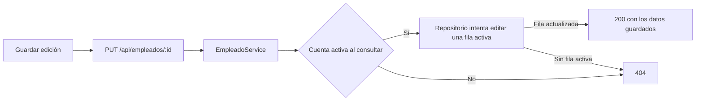
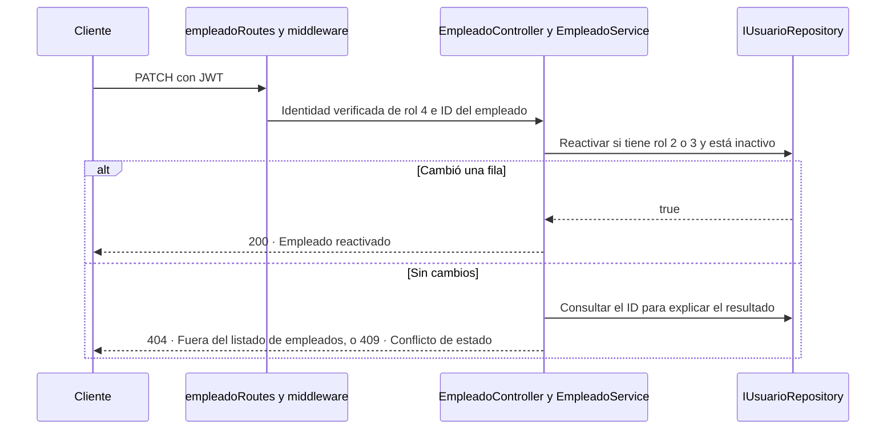

# US-031 · Reactivación de empleados

**Responsable:** Miguel Leal

El Superadmin (rol 4) necesita reincorporar a un trabajador (rol 2) o a un administrador de departamento (rol 3) con su misma cuenta, contraseña, rol y departamento.

## Edición de una cuenta que causó baja

Al guardar el formulario de edición, `EmpleadoService.actualizarEmpleado` comprueba los permisos del actor y el estado del empleado. Tanto `0` como `false` representan una baja. El cliente recibe HTTP 404 si la cuenta está inactiva al consultarla o al intentar guardar los cambios.

`SqlUsuarioRepository.actualizarEmpleado` incluye `Activo = 1` en el propio `UPDATE`. Así, si otro Superadmin da de baja al empleado mientras se procesa la edición, la base de datos conserva sus datos. `MockUsuarioRepository` aplica la misma condición en memoria.

## Reactivación en el backend

`PATCH /api/empleados/:id/reactivar` recibe el identificador del empleado en la ruta. El cliente envía su JWT en la cabecera de autorización. La operación solo cambia `Usuarios.Activo`.

`EmpleadoController` extrae el ID y la identidad autenticada. `EmpleadoService` exige rol 4, valida el ID y delega la escritura a través de `IUsuarioRepository`. Un ID inválido produce 400. El middleware responde 401 si falta la sesión o es inválida y 403 si el actor carece de permisos.

`SqlUsuarioRepository` comprueba el rol y el estado del empleado dentro del mismo `UPDATE` parametrizado. `MockUsuarioRepository` reproduce esa transición en memoria. Si dos solicitudes intentan reincorporar a la misma persona, una obtiene 200 y la otra 409. El cliente puede volver a consultar el listado para mostrar el estado vigente.

## Flujo del panel web

En **Personal Municipal**, el Superadmin puede filtrar por **Solo Inactivos**, elegir **Reactivar** y confirmar el nombre y correo del empleado. Cancelar cierra el diálogo. El rol 3 conserva sus permisos de consulta.

`PersonalDataGrid.tsx` presenta la fila y el diálogo. `usePersonalTableViewModel.ts` coordina la confirmación y bloquea el doble clic. Las dos páginas de personal inyectan el servicio de gestión. `EmpleadoApiService.ts` envía un único PATCH con el token de la sesión.

Tras la respuesta se vuelve a consultar el listado completo respetando los filtros seleccionados. Ante un 409, la fila y el aviso usan el estado que devuelve esa consulta. Si el empleado ya está activo, desaparece del filtro **Solo Inactivos**. Si falla la lectura, **Reintentar** vuelve a consultar el listado y conserva la escritura anterior.
