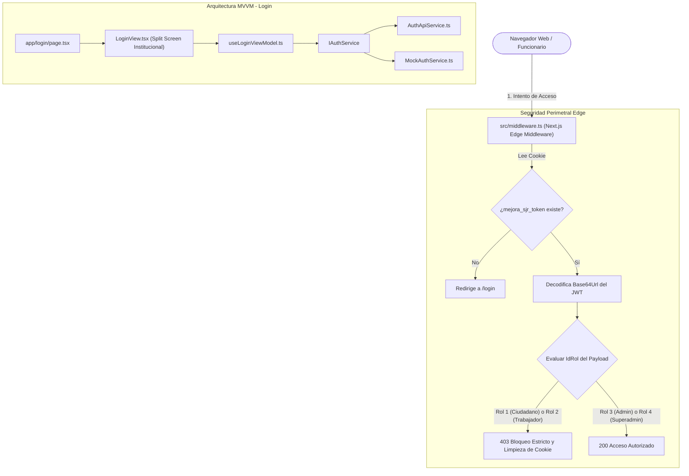

# Documentación Técnica: Historia de Usuario US-005
**Módulo:** Front-End Web (`mejora-sjr-admin/`)  
**Desarrollador a Cargo:** Oscar Abraham Granados  
**Rama de Entrega:** `sP1`  
**Estado:** ✅ Completado y Verificado

---

## 1. Resumen y Valor de Negocio (US-005)
* **Identificador:** US-005
* **Título:** UI de Login Web y Middleware de Protección por Rol
* **Objetivo:** Diseñar una interfaz de inicio de sesión institucional con patrón **Split Screen** y desplegar un **Next.js Edge Middleware** que intercepte y bloquee el acceso al panel a perfiles sin privilegios de gestión (Ciudadanos `IdRol=1` y Trabajadores `IdRol=2`), permitiendo única y exclusivamente la entrada a Administradores de Departamento (`IdRol=3`) y Superadmins (`IdRol=4`).
* **Valor de Negocio:**
  1. **Seguridad y Cero Confianza (Zero Trust):** Previene que usuarios que legítimamente poseen un token móvil ingresen al panel de administración para modificar o alterar información municipal sensible.
  2. **Identidad Institucional:** Provee una estética gubernamental pulcra para el personal del H. Ayuntamiento de San Juan del Río.

---

## 2. Diagrama de Arquitectura (MVVM + Edge Middleware)

---

## 3. Archivos Implementados y Principios SOLID

| Archivo | Capa | Principio SOLID | Responsabilidad |
|---|---|---|---|
| `mejora-sjr-admin/src/models/auth.types.ts` | Modelos | **ISP** / **SRP** | Define contratos de credenciales, respuestas de login, claims del JWT y catálogos de roles. |
| `mejora-sjr-admin/src/services/contracts/IAuthService.ts` | Contratos | **DIP** | Interfaz abstracta que desacopla el ViewModel de la implementación HTTP. |
| `mejora-sjr-admin/src/services/api/AuthApiService.ts` | Servicios | **LSP** | Consume `POST /api/auth/login` y gestiona la cookie `mejora_sjr_token`. |
| `mejora-sjr-admin/src/viewModels/useLoginViewModel.ts` | ViewModel | **SRP** / **MVVM** | Gestiona el estado reactivo del formulario, validaciones y redirección por rol. |
| `mejora-sjr-admin/src/views/auth/LoginView.tsx` | Vista | **SRP** | Interfaz Split Screen institucional con panel heráldico y formulario de acceso. |
| `mejora-sjr-admin/src/middleware.ts` | Seguridad Edge | **Zero Trust** | Intercepta peticiones en el Edge y bloquea el acceso web a roles `1` y `2`. |

---

## 4. Casos de Prueba y Verificación

| Correo de Prueba | Contraseña | Rol | Resultado en Web |
|---|---|:---:|---|
| `ciudadano@test.com` | `Password123!` | `1` (Ciudadano) | ❌ Bloqueado por el Route Guard y el ViewModel (sin privilegios web). |
| `trabajador@test.com` | `Password123!` | `2` (Trabajador) | ❌ Bloqueado por el Route Guard y el ViewModel (sin privilegios web). |
| `admin@test.com` | `Password123!` | `3` (Admin Depto) | ✅ Acceso concedido al panel administrativo. |
| `superadmin@test.com` | `Password123!` | `4` (Superadmin) | ✅ Acceso total concedido al panel administrativo. |
