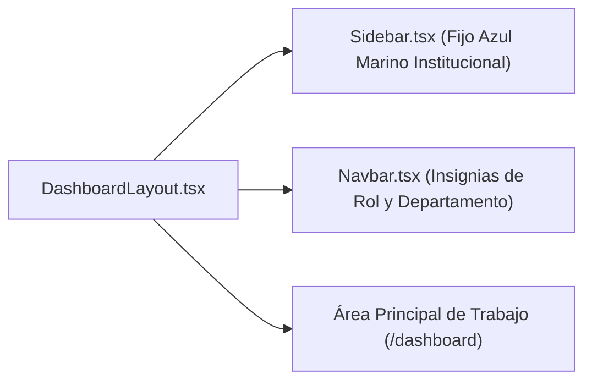

# Documentación Técnica: Historia de Usuario US-006
**Módulo:** Front-End Web (`mejora-sjr-admin/`)  
**Desarrollador a Cargo:** Oscar Abraham Granados  
**Rama de Entrega:** `sP1`  
**Estado:** ✅ Completado y Verificado

---

## 1. Resumen y Valor de Negocio (US-006)
* **Identificador:** US-006
* **Título:** Layout Web (Dashboard) y Validación de Sesión JWT
* **Objetivo:** Construir la estructura visual del panel administrativo mediante un **Sidebar fijo en azul marino institucional** y una barra superior (**Navbar**) con insignias dinámicas de rol y departamento, verificando en tiempo real los claims decodificados del token JWT (`idUsuario`, `email`, `idRol`, `idDepartamento`, `iat`, `exp`).
* **Valor de Negocio:**
  1. Estandariza la navegación administrativa del municipio de San Juan del Río.
  2. Permite identificar visualmente en todo momento qué funcionario y qué dependencia (`JAPAM` o `Servicios Públicos`) opera la sesión activa.

---

## 2. Diagrama de Componentes del Layout

---

## 3. Archivos Implementados y Principios SOLID

| Archivo | Capa | Principio SOLID | Responsabilidad |
|---|---|---|---|
| `mejora-sjr-admin/src/components/layout/Sidebar.tsx` | Componente UI | **SRP** | Barra lateral fija en azul marino institucional con enlaces de navegación y botón de cierre de sesión. |
| `mejora-sjr-admin/src/components/layout/Navbar.tsx` | Componente UI | **SRP** | Cabecera superior que muestra el perfil autenticado, su rol (`Admin` o `Superadmin`) y su departamento. |
| `mejora-sjr-admin/src/views/layout/DashboardLayout.tsx` | Vista Layout | **SRP** / **OCP** | Contenedor estructural reutilizable para todas las pantallas protegidas del panel web. |
| `mejora-sjr-admin/src/app/dashboard/page.tsx` | Página | **MVVM** | Punto de entrada del panel de control administrativo tras la autenticación. |
