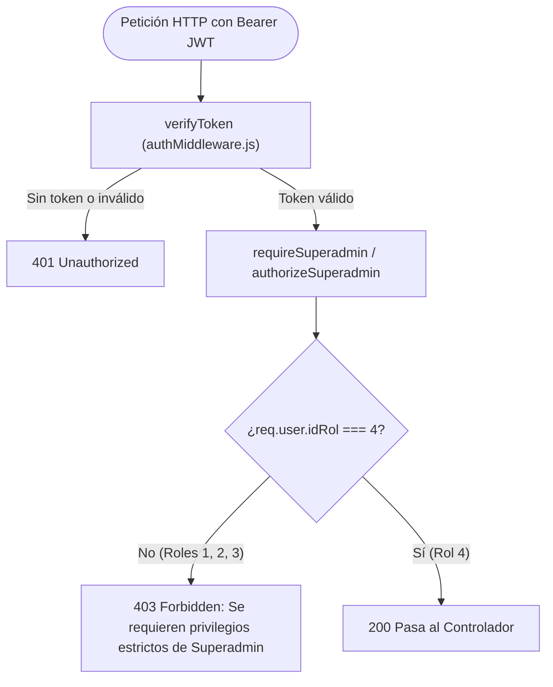

# Documentación Técnica: Historia de Usuario US-007
**Módulo:** Backend API (`mejora-sjr-backend/`)  
**Desarrollador a Cargo:** Oscar Abraham Granados  
**Rama de Entrega:** `sP2`  
**Estado:** ✅ Completado y Verificado

---

## 1. Resumen y Valor de Negocio (US-007)
* **Identificador:** US-007
* **Título:** Middleware RBAC de Autorización Estricta (Backend)
* **Objetivo:** Implementar en Express un middleware de autorización estricta (`authorizeSuperadmin` / `requireSuperadmin`) que valide criptográficamente el token Bearer JWT e impida de forma categórica el acceso a las rutas de gestión administrativa de cuentas cuando `IdRol !== 4`.
* **Valor de Negocio y Seguridad:**
  1. **Principio de Mínimo Privilegio (PoLP):** Garantiza que únicamente el Superadministrador (`IdRol = 4`) posea la facultad de crear, modificar y desactivar cuentas operativas y directivas del municipio.
  2. **Bloqueo Defensivo Multinivel:** Si un usuario con credenciales válidas de Ciudadano (`IdRol = 1`), Trabajador de Campo (`IdRol = 2`) o Administrador Departamental (`IdRol = 3`) intenta ejecutar operaciones de escritura o acceder a rutas exclusivas de Superadmin, el backend responde con `403 Forbidden`.

---

## 2. Flujo de Validación RBAC

---

## 3. Archivos Implementados y Principios SOLID

| Archivo | Capa | Principio SOLID | Responsabilidad |
|---|---|---|---|
| `mejora-sjr-backend/src/middlewares/authMiddleware.js` | Backend - Middleware | **SRP** / **OCP** | Verifica la firma del JWT y expone los guardias `authorizeRoles`, `authorizeSuperadmin` y `requireSuperadmin`. |
| `mejora-sjr-backend/src/routes/empleadoRoutes.js` | Backend - Rutas | **DIP** | Protege las rutas de mutación (`POST`, `PUT`, `PATCH`) exigiendo privilegios de Superadmin. |
| `mejora-sjr-backend/tests/rbacMiddleware.test.js` | Backend - Pruebas | **TDD** | Verifica exhaustivamente las respuestas `401` y `403` para los 6 vectores de prueba (sin token, corrupto, roles 1, 2, 3 y 4). |

---

## 4. Matriz de Casos de Prueba (`tests/rbacMiddleware.test.js`)

| Caso de Prueba | Token Enviado | Código HTTP Esperado | Estado |
|---|---|:---:|:---:|
| 1. Ausencia de Token | Ninguno | `401 Unauthorized` | ✅ Aprobado |
| 2. Token Corrupto / Expirado | `Bearer token_invalido` | `401 Unauthorized` | ✅ Aprobado |
| 3. Ciudadano (`IdRol = 1`) | `Bearer JWT (Rol 1)` | `403 Forbidden` | ✅ Aprobado |
| 4. Trabajador (`IdRol = 2`) | `Bearer JWT (Rol 2)` | `403 Forbidden` | ✅ Aprobado |
| 5. Admin Depto (`IdRol = 3`) | `Bearer JWT (Rol 3)` | `403 Forbidden` | ✅ Aprobado |
| 6. Superadmin (`IdRol = 4`) | `Bearer JWT (Rol 4)` | `200 OK` | ✅ Aprobado |
