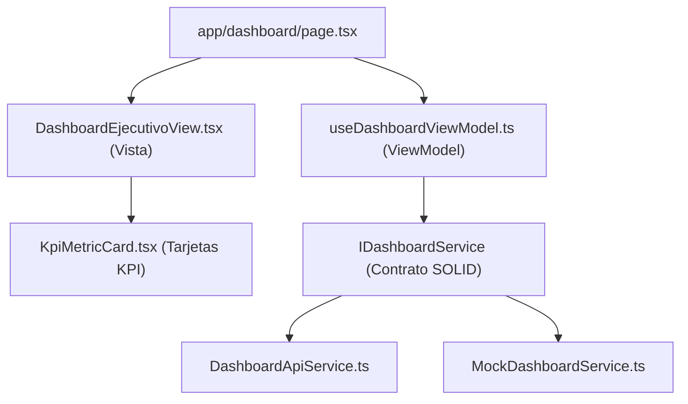

# Documentación Técnica: Historia de Usuario US-014
**Módulo:** Front-End Web Administrativo (`mejora-sjr-admin/`)  
**Desarrollador a Cargo:** Oscar Abraham Granados  
**Rama de Entrega:** `sP3`  
**Estado:** ✅ Completado y Verificado

---

## 1. Resumen y Valor de Negocio (US-014)
* **Identificador:** US-014
* **Título:** Dashboard Ejecutivo (Sustitución de UI)
* **Objetivo:** Reemplazar la vista técnica de validación e impresión del JWT (`/dashboard`) por un **panel de control ejecutivo real**, renderizando tarjetas de métricas (KPIs) como **"Nuevos Reportes"**, **"En Proceso"** y **"Resueltos"**, dejando una interfaz limpia y enfocada en la gestión municipal de San Juan del Río.
* **Entregables Clave:**
  1. **Tarjetas de Métricas Ejecutivas (KPIs):** Tarjetas interactivas para **"Nuevos Reportes"**, **"En Proceso"**, **"Resueltos"** y **"Total Canalizados"** (con tasa de efectividad y tiempo promedio de atención).
  2. **Aislamiento y Filtro Jurisdiccional por Rol:**
     - **Admin de Departamento (`IdRol = 3`):** Visualiza los indicadores correspondientes a su dependencia asignada (`JAPAM` o `Servicios Públicos`).
     - **Superadmin (`IdRol = 4`):** Visualiza el consolidado municipal con selector rápido para filtrar por dependencia.
  3. **Distribución por Categoría Oficial y Bandeja de Reportes Recientes:** Desglose visual de `Fugas de agua`, `Alcantarillado`, `Alumbrado` y `Bacheo`, junto con tabla interactiva de folios recientes.

---

## 2. Diagrama de Arquitectura MVVM (US-014)

---

## 3. Archivos Implementados y Cumplimiento MVVM / SOLID

| Archivo | Extensión | Capa | Responsabilidad |
|---|---|---|---|
| `mejora-sjr-admin/src/models/dashboard.types.ts` | `.ts` | Modelo | Contratos de métricas KPI (`nuevosReportes`, `enProceso`, `resueltos`), distribución por categoría y reportes recientes. |
| `mejora-sjr-admin/src/services/contracts/IDashboardService.ts` | `.ts` | Contrato SOLID | Interfaz abstracta (**DIP**) para obtención de indicadores ejecutivos. |
| `mejora-sjr-admin/src/services/api/DashboardApiService.ts` | `.ts` | Servicio API | Sincroniza categorías oficiales desde `/api/catalogos/categorias` y consolida métricas operativas (**LSP**). |
| `mejora-sjr-admin/src/services/mocks/MockDashboardService.ts` | `.ts` | Servicio Mock | Proveedor determinista de métricas operativas por departamento (**LSP**). |
| `mejora-sjr-admin/src/viewModels/useDashboardViewModel.ts` | `.ts` | ViewModel | Gestiona estado reactivo, alcance departamental RBAC y filtrado interactivo por estatus KPI. |
| `mejora-sjr-admin/src/components/dashboard/KpiMetricCard.tsx` | `.tsx` | Componente UI | Tarjeta reutilizable de métrica ejecutiva con acentos semánticos e interacción por clic. |
| `mejora-sjr-admin/src/views/dashboard/DashboardEjecutivoView.tsx` | `.tsx` | Vista | Interfaz limpia del Dashboard Ejecutivo Municipal que sustituye al visor técnico de JWT. |
| `mejora-sjr-admin/src/app/dashboard/page.tsx` | `.tsx` | Página | Conecta `useDashboardViewModel` y `DashboardEjecutivoView` dentro del `DashboardLayout`. |
