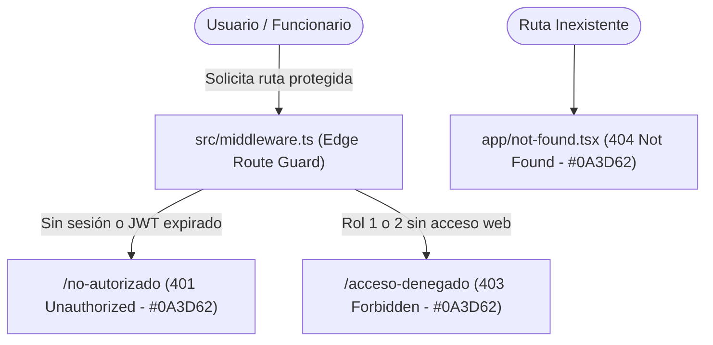

# Documentación Técnica: Historia de Usuario US-015
**Módulo:** Front-End Web Administrativo (`mejora-sjr-admin/`)  
**Desarrollador a Cargo:** Oscar Abraham Granados  
**Rama de Entrega:** `sP3`  
**Estado:** ✅ Completado y Verificado

---

## 1. Resumen y Valor de Negocio (US-015)
* **Identificador:** US-015
* **Título:** Vistas de Intercepción Corporativas (401 / 403 / 404)
* **Objetivo:** Diseñar páginas profesionales de error (**401 Unauthorized**, **403 Forbidden** y **404 Not Found**) con el diseño corporativo institucional (**`#0A3D62`**). Cuando el **Route Guard** (`src/middleware.ts`) expulsa o intercepta a un usuario sin sesión o sin privilegios, aterriza en una pantalla institucional indicando claramente la restricción en lugar de mostrar un error de sistema.
* **Entregables Clave:**
  1. **401 Unauthorized (`/no-autorizado` y `/401`):** Intercepta accesos sin token o con sesión expirada hacia rutas protegidas (`/dashboard/*`, `/admin/*`).
  2. **403 Forbidden (`/acceso-denegado`, `/admin/acceso-denegado` y `/403`):** Pantalla corporativa `#0A3D62` cuando un usuario autenticado carece del rol requerido para el módulo solicitado.
  3. **404 Not Found (`src/app/not-found.tsx`):** Captura rutas inexistentes bajo la misma identidad visual `#0A3D62`.
  4. **Boundary Global (`src/app/error.tsx`):** Resguardo visual ante errores inesperados en tiempo de ejecución.

---

## 2. Diagrama de Intercepción Perimetral (Route Guard + Vistas `#0A3D62`)

---

## 3. Archivos Implementados y Cumplimiento MVVM / SOLID

| Archivo | Extensión | Capa | Responsabilidad |
|---|---|---|---|
| `mejora-sjr-admin/src/models/intercepcion.types.ts` | `.ts` | Modelo | Tipado de códigos `401 \| 403 \| 404`, causas de intercepción y catálogo de textos institucionales. |
| `mejora-sjr-admin/src/viewModels/useIntercepcionViewModel.ts` | `.ts` | ViewModel | Determina el mensaje contextual según el código HTTP, el rol actual y la ruta de origen (`from`). |
| `mejora-sjr-admin/src/views/errors/IntercepcionErrorView.tsx` | `.tsx` | Vista | Pantalla corporativa `#0A3D62` reutilizable para los estados `401`, `403` y `404` (modo pantalla completa o embebido). |
| `mejora-sjr-admin/src/app/no-autorizado/page.tsx` | `.tsx` | Página 401 | Ruta de aterrizaje para intercepciones `401 Unauthorized`. |
| `mejora-sjr-admin/src/app/acceso-denegado/page.tsx` | `.tsx` | Página 403 | Ruta de aterrizaje para intercepciones `403 Forbidden`. |
| `mejora-sjr-admin/src/app/admin/acceso-denegado/page.tsx` | `.tsx` | Página 403 | Vista embebida `403 Forbidden` dentro del panel administrativo. |
| `mejora-sjr-admin/src/app/not-found.tsx` | `.tsx` | Página 404 | Manejador oficial de Next.js App Router para rutas no encontradas (`404 Not Found`). |
| `mejora-sjr-admin/src/middleware.ts` | `.ts` | Route Guard | Redirige accesos no autenticados a `/no-autorizado` y accesos sin privilegios a `/acceso-denegado`. |
