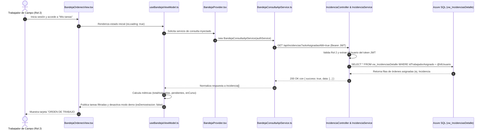

# US-033 · Sincronización de Órdenes Reales para Trabajadores de Campo (Bandeja Operativa Móvil)

**Módulo:** App Móvil (`mejora-sjr-mobile`) y Backend API (`mejora-sjr-backend`)  
**Desarrolladores:** Miguel Leal (Móvil) / Isaac Ochoa (Backend e Integración)  
**Rama:** `sP7`  
**Estado:** ✅ Implementado y Verificado  

---

## 1. Descripción del Requerimiento y Valor de Negocio

El trabajador operativo de campo municipal (Rol 2, e.g. *Luis Ángel* en Servicios Públicos o cuadrillas de JAPAM) requiere consultar en tiempo real las órdenes de trabajo e incidencias asignadas a su persona en el municipio de San Juan del Río.

Previamente, al iniciar sesión con una cuenta de trabajador de campo, la aplicación móvil presentaba:
- El aviso amarillo estático: *"Demostración · Solo lectura. Los datos son de ejemplo. No representan asignaciones reales del municipio."*
- Contadores métricos en cero (*0 Asignadas, 0 Por atender, 0 En curso*).
- Ausencia de datos de órdenes de trabajo, a pesar de existir asignaciones registradas en la base de datos de Azure SQL (e.g. Incidencia `#5` asignada a Luis Ángel).

Con la implementación de **US-033**, la aplicación móvil se conecta al backend mediante `GET /api/incidencias?soloAsignadasAMi=true` autenticado con Bearer JWT, extrayendo las órdenes asignadas reales, eliminando avisos ficticios y calculando las métricas en tiempo real.

---

## 2. Diagrama de Arquitectura (Móvil MVVM + Backend REST + Azure SQL)



---

## 3. Componentes Implementados y Principios SOLID / MVVM

### 3.1. Aplicación Móvil (`mejora-sjr-mobile`)

| Archivo | Capa / Patrón | Responsabilidad y Principios |
| :--- | :--- | :--- |
| `src/services/api/BandejaConsultaApiService.ts` | **Servicio API (LSP / SRP)** | Implementa `IBandejaConsultaService`. Consume `GET /api/incidencias?soloAsignadasAMi=true` inyectando el Bearer Token del trabajador. Normaliza fechas, categorías, estados y referencias de ubicación. Maneja fallas de red con mensajes descriptivos. |
| `src/providers/BandejaProvider.tsx` | **Inyección de Dependencias (DIP)** | Conecta la capa de presentación con `BandejaConsultaApiService` inyectando el `authService` de la sesión. Si no hay sesión válida, utiliza `MockBandejaConsultaService` como fallback. |
| `src/viewModels/useBandejaViewModel.ts` | **ViewModel (MVVM / SRP)** | Administra el ciclo de vida de la consulta, los filtros por estado (`Todas`, `Recibidas`, `En revisión`, `En curso`, `Atendidas`, `Rechazadas`), cálculo de contadores y detección automática de modo demostración (`esDemostracion`). |
| `src/views/BandejaOrdenesView.tsx` | **Vista (UI React Native)** | - Oculta condicionalmente el banner de *"Demostración · Solo lectura"* cuando `!vm.esDemostracion`.<br>- Muestra las tarjetas con encabezado institucional `"ORDEN DE TRABAJO #X"` y `"Fecha de reporte"`.<br>- Adapta botones a `"Actualizar órdenes"`. |

### 3.2. Backend (`mejora-sjr-backend`)

| Archivo | Capa | Responsabilidad |
| :--- | :--- | :--- |
| `src/routes/incidenciaRoutes.js` | Rutas (RBAC) | `router.get('/', authorizeRoles(2, 3, 4), incidenciaController.listar);` permite a los trabajadores de campo (Rol 2) consultar incidencias. |
| `src/services/IncidenciaService.js` | Negocio | En `listarIncidencias`, si `rol === 2` y `filtros.soloAsignadasAMi === true`, inyecta forzosamente `queryFiltros.idTrabajadorAsignado = usuarioAutenticado.idUsuario` asegurando aislamiento estricto. |
| `src/repositories/SqlIncidenciaRepository.js` | Persistencia | Ejecuta consulta parametrizada sobre la vista `vw_IncidenciasDetalle` filtrando por `IdTrabajadorAsignado = @IdTrabajadorAsignado`. |

---

## 4. Reglas de Negocio y Criterios de Aceptación Verificados

1. **Aislamiento por Identidad del Trabajador:**
   - Un trabajador operativo solo puede acceder a las incidencias donde su identificador coincida con `IdTrabajadorAsignado`. No puede ver asignaciones de otros trabajadores.
2. **Eliminación de Mensajes Ficticios en Producción:**
   - En modo conectado (`esDemostracion === false`), no se muestra ningún aviso de demostración ni etiquetas de "ejemplo".
3. **Manejo Resiliente de Red:**
   - Si la red se interrumpe, el servicio emite una excepción clara permitiendo que el ViewModel presente la vista de error con el botón "Reintentar".

---

## 5. Pruebas Unitarias y Cobertura

Se implementó la suite completa de pruebas unitarias en `mejora-sjr-mobile/tests/bandeja-api.test.cjs`:

```powershell
& "C:\Program Files\nodejs\node.exe" --test mejora-sjr-mobile/tests/bandeja-api.test.cjs mejora-sjr-mobile/tests/bandeja.test.cjs
```

### Resultados de Ejecución:
```text
TAP version 13
# Subtest: BandejaConsultaApiService valida idTrabajador correctamente
ok 1 - BandejaConsultaApiService valida idTrabajador correctamente
# Subtest: BandejaConsultaApiService requiere token de autenticación
ok 2 - BandejaConsultaApiService requiere token de autenticación
# Subtest: BandejaConsultaApiService consulta GET /incidencias?soloAsignadasAMi=true con header Bearer
ok 3 - BandejaConsultaApiService consulta GET /incidencias?soloAsignadasAMi=true con header Bearer
# Subtest: BandejaConsultaApiService maneja error HTTP del servidor
ok 4 - BandejaConsultaApiService maneja error HTTP del servidor
# Subtest: BandejaConsultaApiService lanza error cuando la red falla
ok 5 - BandejaConsultaApiService lanza error cuando la red falla
1..5
# tests 5
# pass 5
# fail 0

# Subtest: bandeja.test.cjs
ok 1 - el mock conserva asignaciones fijas y excluye otras
ok 2 - el hook calcula filtros y conteos solo sobre las tareas propias
ok 3 - un perfil inválido no consulta ni utiliza ID de respaldo
ok 4 - el VM también excluye tareas ajenas si la consulta las entrega
ok 5 - un error se distingue de vacío y reintentar permite recuperar la consulta
ok 6 - una lista sin resultados de filtro tiene un mensaje distinto
1..6
# tests 6
# pass 6
# fail 0
```
