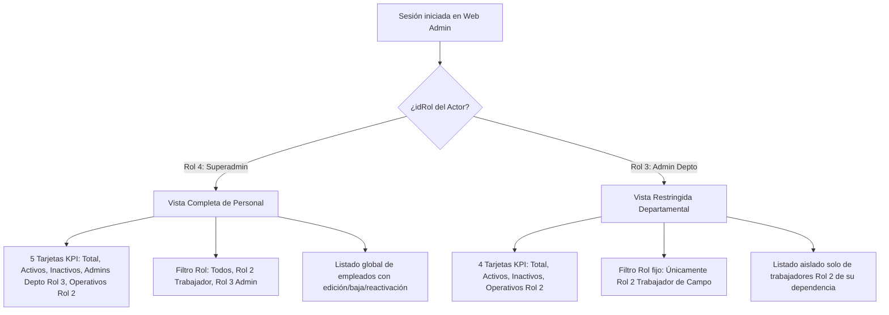

# US-034 · Restricción de Filtros de Rol en Personal para Administrador Departamental

**Módulo:** Web Administrativa (`mejora-sjr-admin`) y Backend API (`mejora-sjr-backend`)  
**Desarrolladores:** Oscar Abraham Granados (Frontend) / Isaac Ochoa (Backend e Integración)  
**Rama:** `sP7`  
**Estado:** ✅ Implementado y Verificado  

---

## 1. Descripción del Requerimiento y Valor de Negocio

En el módulo **Personal Municipal** (`localhost:3000/admin/personal`):
- Los **Administradores Departamentales (Rol 3)** (e.g. *Emily Ochoa* en Servicios Públicos o el Administrador de JAPAM) tienen como única facultad operativa la gestión, consulta y supervisión de los **Trabajadores de Campo (Rol 2)** de su propio departamento.
- No tienen atribuciones para crear, editar, reactivar ni filtrar otros administradores departamentales (Rol 3), ya que la gestión de administradores es facultad exclusiva del **Superadministrador (Rol 4)**.

### Situación Anterior a US-034:
1. El selector desplegable de *"Filtrar por rol"* mostraba las opciones:
   - `Todos los roles`
   - `Rol 2 - Trabajador de Campo`
   - `Rol 3 - Admin Departamental`
2. El Administrador Departamental podía seleccionar *"Rol 3 - Admin Departamental"*, lo cual resultaba confuso y no aportaba valor a su función operativa.
3. Se mostraba una tarjeta métrica superior *"Admins Depto (Rol 3): 0"* irrelevante para el funcionario de área.

### Solución Implementada:
- Cuando el usuario autenticado es Rol 3 (`!vm.esSuperadmin`):
  - El selector de roles se restringe exclusivamente a `<option value="2">Rol 2 - Trabajador de Campo</option>`.
  - La tarjeta KPI de *"Admins Depto (Rol 3)"* se oculta dinámicamente, equilibrando la cuadrícula de métricas en 4 columnas.
  - El ViewModel `usePersonalTableViewModel.ts` fuerza y bloquea el filtro `filtroRol = 2`.
- Cuando el usuario es Superadministrador (Rol 4):
  - Mantiene el acceso completo a todos los roles (`todos`, `2`, `3`) y visualiza las 5 tarjetas métricas.

---

## 2. Diagrama de Arquitectura y Decisión Visual



---

## 3. Componentes Implementados y Modificaciones

### 3.1. `mejora-sjr-admin/src/viewModels/usePersonalTableViewModel.ts`
- **Inicialización Condicional:**
  ```ts
  const esAdminDepto = idRolActor === 3;
  const [filtroRol, setFiltroRol] = useState<FiltroRol>(esAdminDepto ? 2 : 'todos');
  ```
- **Protección de Entrada en `cambiarFiltroRol`:**
  Si un Rol 3 intenta enviar un valor distinto de `2`, la mutación se descarta de forma segura.
- **Restablecimiento en `limpiarFiltros`:**
  Para Rol 3 restablece el filtro a `2`; para Superadmin restablece a `'todos'`.

### 3.2. `mejora-sjr-admin/src/views/personal/PersonalDataGrid.tsx`
- **Restricción de Opciones DOM:**
  ```tsx
  <select id={rolSelectId} value={String(vm.filtroRol)} onChange={(e) => vm.cambiarFiltroRol(...)}>
    {esSuperadmin ? (
      <>
        <option value="todos">Todos los roles</option>
        <option value="2">Rol 2 - Trabajador de Campo</option>
        <option value="3">Rol 3 - Admin Departamental</option>
      </>
    ) : (
      <option value="2">Rol 2 - Trabajador de Campo</option>
    )}
  </select>
  ```
- **Tarjetas KPI Responsivas:**
  La tarjeta métrica *"Admins Depto (Rol 3)"* está encapsulada en `{esSuperadmin && ( ... )}` y la grilla se ajusta mediante `grid-cols-2 md:grid-cols-4 lg:grid-cols-4` para Rol 3.

---

## 4. Matriz de Permisos por Rol en Personal Municipal

| Característica / Elemento | Superadministrador (Rol 4) | Administrador Departamental (Rol 3) |
| :--- | :---: | :---: |
| **Opción "Todos los roles"** | ✅ Visible | ❌ Oculto |
| **Opción "Rol 2 - Trabajador de Campo"** | ✅ Visible | ✅ Única opción activa |
| **Opción "Rol 3 - Admin Departamental"** | ✅ Visible | ❌ Oculto |
| **Tarjeta KPI "Admins Depto (Rol 3)"** | ✅ Visible | ❌ Oculto |
| **Tarjeta KPI "Operativos (Rol 2)"** | ✅ Visible | ✅ Visible |
| **Ámbito de personal listado** | Todo el municipio | Exclusivo de su secretaría |

---

## 5. Pruebas Unitarias Automatizadas

Las pruebas se integraron en `mejora-sjr-admin/tests/personal-table.test.cjs`:

```powershell
& "C:\Program Files\nodejs\node.exe" --test mejora-sjr-admin/tests/personal-table.test.cjs
```

### Resultados de Ejecución:
```text
TAP version 13
# Subtest: PersonalTableViewModel y PersonalDataGrid
ok 1 - inicializa filtroRol en 2 cuando el actor es Rol 3
ok 2 - impide seleccionar Rol 3 cuando el actor es Rol 3
ok 3 - restablece filtroRol a 2 al limpiar filtros si es Rol 3
ok 4 - renderiza únicamente la opción Rol 2 en el select para Rol 3
ok 5 - omite la tarjeta métrica de Admins Depto (Rol 3) para Rol 3
ok 6 - Superadmin conserva todas las opciones (todos, 2, 3) y sus 5 tarjetas métricas
1..6
# tests 6
# pass 6
# fail 0
```
- **Compilación TypeScript:** `npx tsc --noEmit` completado con 0 errores.
