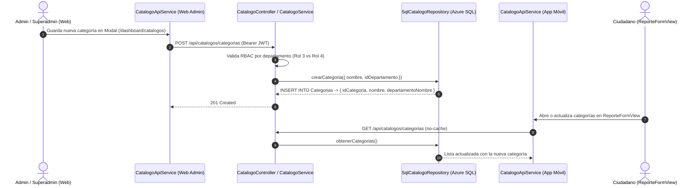

# Documentación Técnica: Historia de Usuario US-035
**Módulos:** Backend (`mejora-sjr-backend/`), Web Admin (`mejora-sjr-admin/`) y App Móvil (`mejora-sjr-mobile/`)  
**Desarrolladores a Cargo:** Oscar Abraham Granados / Isaac Ochoa  
**Rama de Entrega:** `sP7`  
**Estado:** ✅ Completado y Verificado

---

## 1. Resumen y Valor de Negocio (US-035)
* **Identificador:** US-035
* **Título:** Persistencia Real en Azure SQL y Propagación de Nuevas Categorías al Formulario Ciudadano
* **Objetivos Cumplidos:**
  1. **Creación e Inyección de `SqlCatalogoRepository.js`:** Consulta y persiste físicamente en las tablas `Departamentos` y `Categorias` de Azure SQL, reemplazando a `MockCatalogoRepository` dentro de `server.js` cuando `DATA_SOURCE='azure_sql'`.
  2. **Endpoint `POST /api/catalogos/categorias` con Validación RBAC:** Permite a los Administradores Departamentales (`Rol 3`) crear categorías exclusivamente en su propia secretaría (`403 Forbidden` si intentan crearlas en otra dependencia) y al Superadmin (`Rol 4`) en cualquier dependencia oficial, previniendo duplicados (`409 Conflict`).
  3. **Conexión del Modal de la Web Administrativa:** `CatalogoApiService.ts` en `mejora-sjr-admin` envía `POST /api/catalogos/categorias` con el token Bearer JWT, persistiendo físicamente en la tabla `Categorias`.
  4. **Propagación en Tiempo Real hacia la App Móvil (`CrearReporteView` / `ReporteFormView`):** `CatalogoApiService.ts` en `mejora-sjr-mobile` consulta en tiempo real (`Cache-Control: no-cache`) las nuevas categorías y ofrece sincronización inmediata en el formulario ciudadano.

---

## 2. Diagrama de Flujo E2E (Web Admin -> Backend Azure SQL -> App Móvil)

---

## 3. Archivos Implementados / Modificados

| Archivo | Módulo | Responsabilidad |
|---|---|---|
| `mejora-sjr-backend/src/repositories/SqlCatalogoRepository.js` | Backend | Consultas `SELECT` e inserciones `INSERT` parametrizadas sobre `Departamentos` y `Categorias` en Azure SQL. |
| `mejora-sjr-backend/server.js` | Backend | Inyecta `new SqlCatalogoRepository(pool)` cuando `config.dataSource === 'azure_sql'`. |
| `mejora-sjr-backend/src/services/CatalogoService.js` | Backend | Implementa `crearCategoria` y `actualizarCategoria` con aislamiento RBAC departamental. |
| `mejora-sjr-backend/src/controllers/CatalogoController.js` | Backend | Expone los handlers `crearCategoria` (`201 Created`) y `actualizarCategoria` (`200 OK`). |
| `mejora-sjr-backend/src/routes/catalogoRoutes.js` | Backend | Registra `POST /api/catalogos/categorias` protegido con `authenticateToken` y `authorizeRoles(3, 4)`. |
| `mejora-sjr-admin/src/services/api/CatalogoApiService.ts` | Web Admin | Conecta el modal de catálogos con `POST /api/catalogos/categorias` enviando Bearer JWT. |
| `mejora-sjr-mobile/src/services/api/CatalogoApiService.ts` | App Móvil | Consulta sin caché (`no-cache`) las categorías desde `GET /api/catalogos/categorias`. |
| `mejora-sjr-mobile/src/views/CrearReporteView.tsx` y `ReporteFormView.tsx` | App Móvil | Acción de sincronización en tiempo real de categorías dentro del formulario de reporte ciudadano. |
