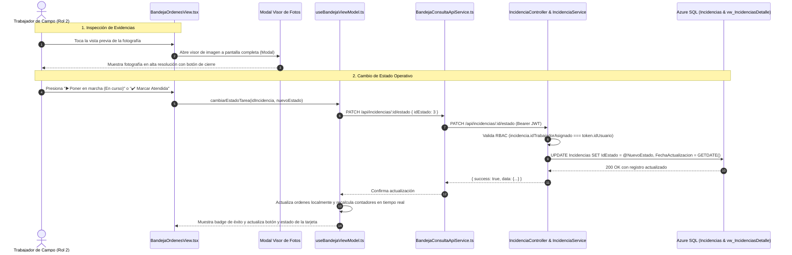

# US-036 · Interacción Operativa en Campo: Visualización de Evidencias Fotográficas y Cambio de Estado de Incidencias

**Módulos:** App Móvil (`mejora-sjr-mobile`) y Backend API (`mejora-sjr-backend`)  
**Desarrolladores:** Miguel Leal (Móvil) / Isaac Ochoa (Backend e Integración)  
**Rama:** `sP7`  
**Estado:** ✅ Implementado y Verificado  

---

## 1. Descripción del Requerimiento y Valor de Negocio

Cuando el trabajador operativo de campo (Rol 2, ej. *Luis Ángel*) consulta sus incidencias asignadas en la aplicación móvil:
1. **Evidencias Fotográficas:** Necesita inspeccionar visualmente la fotografía adjunta por el ciudadano (`fotoInicialUrl`) para identificar de inmediato la falla en campo (ej. luminaria rota, bache o fuga) y poder ampliar la imagen a pantalla completa.
2. **Gestión de Estados en Campo:** Necesita interactuar directamente con la tarjeta de la orden para cambiar su estado operativo:
   - De **En revisión (2)** a **En Progreso / En curso (3)** al comenzar los trabajos en sitio (*"▶️ Poner en marcha"*).
   - De **En curso (3)** a **Atendido (4)** al concluir la reparación física (*"✔️ Finalizar y Atender"*).
   - O regresar a **En revisión (2)** si se requiere reevaluación o material adicional.

---

## 2. Diagrama de Arquitectura E2E



---

## 3. Componentes Implementados

### 3.1. Backend (`mejora-sjr-backend`)
- **`incidenciaRoutes.js`**: Registra `PATCH /api/incidencias/:id/estado` protegido con `authorizeRoles(2, 3, 4)`.
- **`IncidenciaController.js`**: Manejador `actualizarEstado(req, res)` deserializando `id` e `idEstado`.
- **`IncidenciaService.js`**: Valida RBAC estricto:
  - Rol 2 solo puede cambiar incidencias asignadas a él (`idTrabajadorAsignado === usuarioAutenticado.idUsuario`) y únicamente entre estados 2, 3 y 4.
  - Rol 3 solo puede modificar incidencias de su departamento.
  - Rol 4 tiene acceso global.
- **`SqlIncidenciaRepository.js`**: `UPDATE Incidencias SET IdEstado = @NuevoEstado, FechaActualizacion = GETDATE()`.
- **`MockIncidenciaRepository.js`**: Actualización en memoria para pruebas desacopladas.

### 3.2. Aplicación Móvil (`mejora-sjr-mobile`)
- **`bandeja.types.ts`**: `TareaBandeja` incluye `idEstado: number` y `fotoInicialUrl?: string | null`.
- **`IBandejaConsultaService.ts`**: Declara `actualizarEstado?(idIncidencia: number, nuevoEstado: number): Promise<Incidencia>`.
- **`BandejaConsultaApiService.ts`**: Implementa `actualizarEstado` con `PATCH /api/incidencias/:id/estado` enviando Bearer JWT.
- **`useBandejaViewModel.ts`**: Gestiona `cambiarEstadoTarea`, `actualizandoId`, `mensajeOperacion` y `errorOperacion`.
- **`BandejaOrdenesView.tsx`**:
  - Miniatura interactiva de evidencia fotográfica con badge *"🔍 Toca para ampliar evidencia"*.
  - Componente `<Modal>` para visualización de fotografía completa en alta resolución con botón de cierre.
  - Botones de acción dinámicos según el estado actual de la orden (*"▶️ Poner en marcha"*, *"✔️ Marcar Atendida"*, *"↩️ En revisión"*).
  - Feedback visual con `ActivityIndicator` durante la actualización y banner institucional de confirmación.

---

## 4. Pruebas Unitarias Automatizadas

```powershell
& "C:\Program Files\nodejs\node.exe" --test mejora-sjr-mobile/tests/bandeja-api.test.cjs mejora-sjr-mobile/tests/bandeja.test.cjs
```

- **Backend:** 22/22 pruebas aprobadas en `tests/incidencias.test.js` (incluyendo validación RBAC de cambio de estado).
- **Móvil:** 6/6 pruebas aprobadas en `tests/bandeja-api.test.cjs` y 6/6 en `tests/bandeja.test.cjs`.
- **TypeScript:** 0 errores de compilación en `mejora-sjr-mobile` y `mejora-sjr-admin`.
