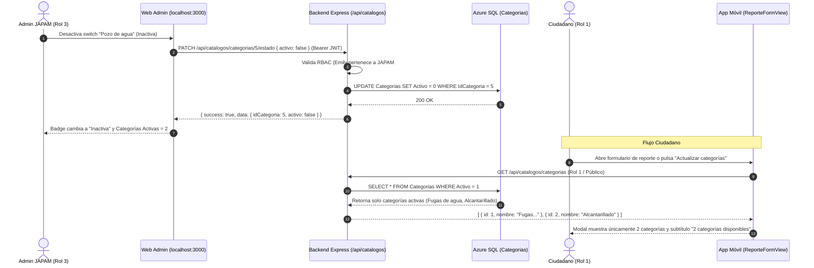

# Historia de Usuario: US-038

## **Título:** Persistencia de Estado Activo/Inactivo de Categorías y Restricción Dinámica en el Formulario Ciudadano

- **Módulos Afectados:** Web Admin (`mejora-sjr-admin`), Backend API (`mejora-sjr-backend`), App Móvil (`mejora-sjr-mobile`)
- **Roles Involucrados:** Rol 3 (Administrador Departamental), Rol 4 (Superadministrador), Rol 1 (Ciudadano)
- **Sprint:** Sprint 7
- **Estado:** ✅ **Implementado y Verificado**

---

### **1. Narrativa Ágil:**
> **Como** Administrador Departamental o de Dependencia (Rol 3, ej. *Emily Ochoa* en JAPAM),  
> **Quiero** poder desactivar o activar categorías de reportes desde el panel administrativo de Catálogos y que el cambio persista en la base de datos central,  
> **Para** que los ciudadanos no puedan seleccionar ni levantar reportes de incidencias en categorías dadas de baja temporal o definitivamente (por ejemplo, "Pozo de agua").

---

### **2. Causa Raíz Identificada:**
1. **Frontend Web sin persistencia remota:** En `mejora-sjr-admin/src/services/api/CatalogoApiService.ts`, el método `cambiarEstadoCategoria(idCategoria, activo)` únicamente modificaba un array reactivo en memoria local del navegador (`this.store.cambiarEstadoCategoria(...)`), sin invocar ninguna petición HTTP al backend.
2. **Esquema de Base de Datos sin columna de estado:** En `mejora-sjr-backend/schema.sql`, la tabla `Categorias` no poseía columna `Activo BIT`, impidiendo almacenar si una categoría está habilitada o inhabilitada.
3. **Backend sin endpoint ni filtrado por rol:** No existía la ruta `PATCH /api/catalogos/categorias/:id/estado`. Además, `CatalogoService.listarCategorias` retornaba indistintamente todas las categorías sin distinguir si el solicitante era un ciudadano o un administrador.
4. **App móvil sin filtrado de inactivas:** En `mejora-sjr-mobile/src/viewModels/useReporteViewModel.ts`, el selector de categorías solo filtraba por dependencia (`idDepartamento`), permitiendo que categorías marcadas como Inactivas en la web siguieran apareciendo con palomita y seleccionables para los ciudadanos (mostrando por ejemplo *"3 categorías disponibles"* en lugar de *"2"*).

---

### **3. Solución Técnica Implementada:**

#### **A. Base de Datos (Azure SQL & Repositorios):**
- Migración idempotente en `SqlCatalogoRepository.js`:
  ```sql
  IF COL_LENGTH('Categorias', 'Activo') IS NULL
  BEGIN
      ALTER TABLE Categorias ADD Activo BIT NOT NULL DEFAULT 1;
  END
  ```
- Implementación de `cambiarEstadoCategoria(idCategoria, activo)` en `SqlCatalogoRepository` y `MockCatalogoRepository`.
- Filtrado condicional en `obtenerCategorias(idDepartamento, soloActivas)` para devolver únicamente filas con `Activo = 1` cuando `soloActivas === true`.

#### **B. Backend (`mejora-sjr-backend`):**
- **Skinny Controller (`CatalogoController.js`):**
  - Se añadió `cambiarEstado(req, res)` delegando inmediatamente al servicio sin lógica de negocio, cumpliendo estrictamente la directriz de arquitectura Prompt Maestro.
- **Servicio (`CatalogoService.js`):**
  - `listarCategorias`: Determina automáticamente el rol del solicitante. Para ciudadanos (Rol 1 o peticiones anónimas), fuerza `soloActivas = true`. Para administradores (Rol 3/4), muestra todas salvo indicación explícita.
  - `cambiarEstadoCategoria(idCategoria, datosEstado, usuarioAutenticado)`: Valida RBAC jerárquico. Un Administrador Departamental (Rol 3) solo puede activar/desactivar categorías de su propia dependencia; el Superadmin (Rol 4) opera sobre cualquier dependencia.
- **Ruta (`catalogoRoutes.js`):**
  - Registro de `PATCH /categorias/:id/estado` protegido con autenticación Bearer JWT y middleware `authorizeRoles(3, 4)`.
- **Validación en Incidencias (`IncidenciaService.js`):**
  - Se añadió validación al levantar reportes para impedir la creación de incidencias en categorías inactivas (`c.activo !== false`), arrojando HTTP 400 Bad Request si se intenta vulnerar la API.

#### **C. Web Administrativa (`mejora-sjr-admin`):**
- En `CatalogoApiService.ts`, `cambiarEstadoCategoria` ahora realiza una llamada `PATCH /api/catalogos/categorias/:id/estado` con el token JWT de autenticación y maneja sincronización con el store local.

#### **D. App Móvil (`mejora-sjr-mobile`):**
- Actualización de modelo `Categoria` con `activo?: boolean`.
- En `CatalogoApiService.ts`, mapeo explícito de la bandera `activo: c.activo !== false`.
- En `useReporteViewModel.ts`, filtrado automático de `categoriasItems` para omitir categorías inactivas. El contador de categorías disponibles ahora muestra exactamente las activas (ej. *"2 categorías disponibles"* al desactivar *"Pozo de agua"*).

---

### **4. Diagrama de Secuencia E2E:**



---

### **5. Criterios de Aceptación (Gherkin):**

```gherkin
Escenario: Administrador desactiva una categoría y se persiste en Azure SQL
  Dado que la administradora de JAPAM "Emily Ochoa" (Rol 3) visualiza el catálogo de categorías
  Cuando pulsa el botón de estado de la categoría "Pozo de agua" para cambiarla a inactiva
  Entonces el frontend envía "PATCH /api/catalogos/categorias/5/estado" con { "activo": false }
  Y el backend actualiza la columna "Activo = 0" en Azure SQL
  Y responde HTTP 200 con la confirmación.

Escenario: El ciudadano ya no puede visualizar ni seleccionar la categoría inactiva
  Dado que la categoría "Pozo de agua" está marcada como Activo = 0
  Cuando un ciudadano abre el formulario de nuevo reporte en la aplicación móvil
  Entonces el modal de selección de categorías solo muestra "Fugas de agua" y "Alcantarillado"
  Y la categoría inactiva "Pozo de agua" queda completamente excluida
  Y el encabezado indica correctamente "2 categorías disponibles".

Escenario: Intento de levantar reporte con categoría inactiva por manipulación de API
  Dado que un cliente intenta enviar "POST /api/incidencias" con IdCategoria = 5 (inactiva)
  Cuando el backend procesa la solicitud en IncidenciaService
  Entonces rechaza la petición con HTTP 400 y mensaje "La categoría seleccionada no se encuentra activa".
```

---

### **6. Cobertura de Pruebas Automatizadas:**
- **Backend:** `tests/catalogos.test.js` (**15 de 15 pruebas pasadas**, incluyendo conmutación de estado, validación departamental y filtrado por rol).
- **Backend Incidencias:** `tests/incidencias.test.js` (**22 de 22 pruebas pasadas**).
- **Mobile:** `tests/reporte-form.test.cjs` (**29 de 29 pruebas pasadas**).
- **Mobile Propagación E2E:** `tests/us035-propagacion-categorias.test.cjs` (**2 de 2 pruebas pasadas**).
- **Suite Integral Backend:** **242 de 242 pruebas pasadas** en 14 suites.
