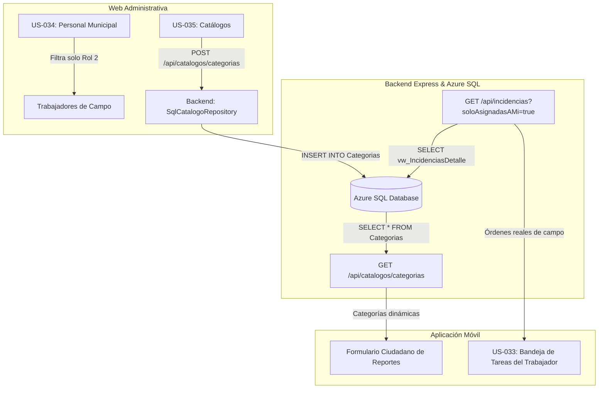

# Sprint 7 · Historias de Usuario y Plan de Implementación

**Proyecto:** Mejora SJR (San Juan del Río)  
**Ciclo:** Sprint 7  
**Enfoque:** Conexión operativa móvil, consistencia de roles y persistencia de catálogos en Azure SQL.

---

## 📋 Resumen Ejecutivo del Sprint 7

| ID | Módulos Afectados | Título de la Historia de Usuario | ¿Qué deben de hacer? (Acciones Clave) | Estado |
| :--- | :--- | :--- | :--- | :---: |
| **US-033** | Mobile (`mejora-sjr-mobile`) + Backend (`mejora-sjr-backend`) | **Sincronización de Órdenes Reales para Trabajadores de Campo (Bandeja Operativa)** | 1. Crear `BandejaConsultaApiService.ts` en la app móvil que consuma `GET /api/incidencias?soloAsignadasAMi=true` con el JWT.<br>2. Reemplazar `MockBandejaConsultaService` en `BandejaProvider.tsx`.<br>3. Eliminar el aviso estático de *"Demostración · Solo lectura"* y renderizar las tarjetas y KPIs reales asignados al trabajador (ej. *Luis Ángel*). | ✅ **Implementado y Verificado** |
| **US-034** | Web Admin (`mejora-sjr-admin`) + Backend (`mejora-sjr-backend`) | **Restricción de Filtros de Rol en Personal para Administrador Departamental** | 1. En `PersonalDataGrid.tsx`, ocultar la opción `<option value="3">` (Admin Departamental) cuando el usuario activo sea Rol 3 (`!vm.esSuperadmin`).<br>2. Ocultar o adaptar la tarjeta KPI de *"Admins Depto (Rol 3)"* para administradores de área.<br>3. Asegurar en `usePersonalTableViewModel.ts` y en el backend que Rol 3 solo gestione y filtre a cuadrillas de campo (Rol 2). | ✅ **Implementado y Verificado** |
| **US-035** | Backend (`mejora-sjr-backend`), Web Admin (`mejora-sjr-admin`) y Mobile (`mejora-sjr-mobile`) | **Persistencia Real en Azure SQL y Propagación de Nuevas Categorías al Formulario Ciudadano** | 1. Crear `SqlCatalogoRepository.js` con consultas a Azure SQL e inyectarlo en `server.js` (reemplazando `MockCatalogoRepository`).<br>2. Crear el endpoint `POST /api/catalogos/categorias` con validación RBAC departamental.<br>3. Conectar el modal de la web para persistir en la tabla `Categorias`.<br>4. Asegurar que la app móvil lea en tiempo real las nuevas categorías en el formulario de reporte ciudadano. | ✅ **Implementado y Verificado** |
| **US-036** | Mobile (`mejora-sjr-mobile`) + Backend (`mejora-sjr-backend`) | **Interacción Operativa en Campo: Visualización de Evidencias Fotográficas y Cambio de Estado de Incidencias** | 1. Implementar `PATCH /api/incidencias/:id/estado` con RBAC para permitir a cuadrillas (Rol 2) actualizar órdenes asignadas a En curso (3) o Atendida (4).<br>2. En `TareaCard`, renderizar vista previa de la fotografía ciudadana (`fotoInicialUrl`) y modal a pantalla completa.<br>3. Integrar botones de acción interactiva en la tarjeta ("▶️ Poner en marcha", "✔️ Marcar Atendida").<br>4. Actualizar contadores y filtros reactivamente en `useBandejaViewModel.ts`. | ✅ **Implementado y Verificado** |
| **US-037** | Mobile (`mejora-sjr-mobile`) | **Seguimiento y Transparencia Ciudadana: Semáforo de Estatus, Stepper Visual de 4 Fases y Visor de Evidencia en "Mis Reportes"** | 1. Implementar stepper visual interactivo de 4 etapas (Recibido -> En revisión -> En curso -> Atendido).<br>2. Diseñar semáforo y chip de estado por color y background (`#16A34A` verde para Atendido, `#2563EB` azul para En progreso, etc.).<br>3. Agregar mensaje explicativo de transparencia ciudadana por cada fase municipal.<br>4. Integrar banner de acceso rápido al seguimiento en `CrearReporteView.tsx` y visor modal de fotografía de evidencia. | ✅ **Implementado y Verificado** |
| **US-038** | Web Admin (`mejora-sjr-admin`), Backend (`mejora-sjr-backend`) y Mobile (`mejora-sjr-mobile`) | **Persistencia de Estado Activo/Inactivo de Categorías y Restricción Dinámica en el Formulario Ciudadano** | 1. Agregar columna `Activo BIT NOT NULL DEFAULT 1` a la tabla `Categorias` en Azure SQL.<br>2. Crear endpoint `PATCH /api/catalogos/categorias/:id/estado` con RBAC departamental y Skinny Controller.<br>3. Conectar la Web Admin para enviar el cambio de estado con Bearer JWT.<br>4. Filtrar categorías inactivas en el backend para ciudadanos y en la app móvil, actualizando el selector y conteo disponible en tiempo real. | ✅ **Implementado y Verificado** |

---

## 🗺️ Flujo de Integración entre Componentes



---

## 🚀 Historia de Usuario: US-033

### **Título:** Sincronización de Órdenes Reales para Trabajadores de Campo (Bandeja Operativa Móvil)
- **Módulos:** `mejora-sjr-mobile` & `mejora-sjr-backend`  
- **Roles:** Rol 2 (Trabajador Operativo de Campo)

### **1. Narrativa Ágil:**
> **Como** trabajador operativo de campo municipal (Rol 2, ej. *Luis Ángel*),  
> **Quiero** que al iniciar sesión en la aplicación móvil mi bandeja de tareas consulte las incidencias asignadas a mi usuario en la base de datos real,  
> **Para** conocer inmediatamente mis órdenes de trabajo pendientes, su ubicación y detalles técnicos sin ver información vacía ni avisos de datos ficticios/demostración.

### **2. Causa Raíz Identificada:**
- En `mejora-sjr-mobile`, `BandejaProvider.tsx` instancia fija e incondicionalmente `MockBandejaConsultaService.ts`.
- La pantalla `BandejaOrdenesView.tsx` muestra el mensaje *"Demostración · Solo lectura. Los datos son de ejemplo. No representan asignaciones reales del municipio."* y todos los contadores en 0 porque nunca llama a `GET /api/incidencias?soloAsignadasAMi=true`.
- Aunque en base de datos la incidencia `#5` (Alumbrado) ya está asignada a Luis Ángel (`IdTrabajadorAsignado = 17`), la app móvil no la muestra.

### **3. Reglas de Negocio:**
1. **Aislamiento por Identidad del Trabajador:** Un trabajador de campo autenticado únicamente puede ver las incidencias donde `IdTrabajadorAsignado` coincida con su `idUsuario` del token JWT.
2. **Cero Mocks en Producción/Conexión:** La app debe conectarse al servicio HTTP `BandejaConsultaApiService` inyectando el token JWT.
3. **Métricas en Tiempo Real:** Las tarjetas *"Asignadas"*, *"Por atender"* y *"En curso"* deben calcularse a partir de los folios reales asignados.

### **4. Criterios de Aceptación (Gherkin):**
```gherkin
Escenario: Visualización de incidencias asignadas en la app móvil
  Dado que el trabajador de campo "Luis Ángel" (IdUsuario = 17, Rol 2) inicia sesión con credenciales válidas
  Y tiene asignada la incidencia real #5 en la base de datos
  Cuando ingresa a la pantalla "Mis tareas"
  Entonces la aplicación consulta "GET /api/incidencias?soloAsignadasAMi=true" enviando su Bearer Token
  Y se muestra la tarjeta de la incidencia #5 con folio, categoría "Alumbrado", descripción y ubicación
  Y el contador "Asignadas" muestra al menos "1"
  Y desaparece el banner de "Demostración · Solo lectura".

Escenario: Trabajador sin reportes asignados
  Dado que un trabajador operativo no tiene reportes asignados en la base de datos
  Cuando consulta su bandeja de tareas
  Entonces se muestra el estado vacío amigable: "No tienes órdenes de trabajo asignadas en este momento".
```

---

## 👥 Historia de Usuario: US-034

### **Título:** Restricción de Filtros de Rol en Personal para Administrador Departamental
- **Módulos:** `mejora-sjr-admin` & `mejora-sjr-backend`  
- **Roles:** Rol 3 (Administrador Departamental) y Rol 4 (Superadministrador)

### **1. Narrativa Ágil:**
> **Como** Administrador Departamental (Rol 3, ej. *Emily Ochoa* en Servicios Públicos o Admin de JAPAM),  
> **Quiero** que en el módulo de Personal Municipal el selector de roles muestre únicamente la opción de "Trabajador de Campo (Rol 2)",  
> **Para** gestionar exclusivamente a las cuadrillas de campo de mi secretaría y evitar confusión visual con roles que no están bajo mi competencia jerárquica.

### **2. Causa Raíz Identificada:**
- En `PersonalDataGrid.tsx` (líneas 301-304), el elemento `<select aria-label="Filtrar por rol">` tiene codificadas fijas las opciones:
  - `Todos los roles`
  - `Rol 2 - Trabajador de Campo`
  - `Rol 3 - Admin Departamental`
- No valida si el usuario logueado es Administrador Departamental (`idRol === 3`), quien solo tiene facultad sobre Rol 2. Además, el contador superior muestra *"Admins Depto (Rol 3): 0"* innecesariamente para Rol 3.

### **3. Reglas de Negocio:**
1. **Jerarquía Administrativa:** Un Administrador de Departamento (Rol 3) solo gestiona operativos (Rol 2). No da de alta, no edita, no desactiva ni filtra otros Administradores (Rol 3).
2. **Superadministrador Omnisciente:** Únicamente el Superadministrador (Rol 4) visualiza y puede filtrar por ambos roles (Rol 2 y Rol 3), así como ver la tarjeta métrica de Administradores.
3. **Consistencia de Estado:** Para Rol 3, `filtroRol` debe fijarse o limitarse a Rol 2, ocultando la opción de Rol 3 en el DOM.

### **4. Criterios de Aceptación (Gherkin):**
```gherkin
Escenario: Administrador Departamental consulta Personal Municipal
  Dado que un usuario con Rol 3 (Admin de JAPAM o Servicios Públicos) entra a "/admin/personal"
  Cuando abre el desplegable de "Filtrar por rol"
  Entonces únicamente visualiza la opción "Rol 2 - Trabajador de Campo" (o no se le permite seleccionar Rol 3)
  Y no se muestra la tarjeta KPI de "Admins Depto (Rol 3)" o se restringe al personal operativo.

Escenario: Superadministrador consulta Personal Municipal
  Dado que el usuario autenticado tiene Rol 4 (Superadmin)
  Cuando entra a "/admin/personal"
  Entonces visualiza en el filtro: "Todos los roles", "Rol 2 - Trabajador de Campo" y "Rol 3 - Admin Departamental".
```

---

## 🗄️ Historia de Usuario: US-035

### **Título:** Persistencia Real en Azure SQL y Propagación de Nuevas Categorías al Formulario Ciudadano
- **Módulos:** `mejora-sjr-backend`, `mejora-sjr-admin` & `mejora-sjr-mobile`  
- **Roles:** Rol 3 (Admin Departamental), Rol 4 (Superadmin), Rol 1 (Ciudadano)

### **1. Narrativa Ágil:**
> **Como** Administrador de Dependencia (JAPAM / Servicios Públicos),  
> **Quiero** que al crear una nueva categoría desde el módulo de Catálogos esta se guarde físicamente en la tabla `Categorias` de Azure SQL,  
> **Para** que los ciudadanos puedan seleccionarla inmediatamente al levantar reportes desde la aplicación móvil.

### **2. Causa Raíz Identificada:**
- En Azure SQL, la tabla `Categorias` solo tiene los 4 registros semilla iniciales.
- En `mejora-sjr-backend/server.js` (línea 37), `catalogoRepository` se instancia como `new MockCatalogoRepository()`, incluso cuando `dataSource === 'azure_sql'`.
- No existe la clase `SqlCatalogoRepository.js` conectada a `dbPool` con métodos `INSERT INTO Categorias`.
- `catalogoRoutes.js` carece del endpoint `POST /api/catalogos/categorias`.

### **3. Reglas de Negocio:**
1. **Persistencia Estricta:** Toda alta de categoría debe ejecutarse mediante `INSERT INTO Categorias (Nombre, IdDepartamento)` en Azure SQL.
2. **Aislamiento en Creación (RBAC):**
   - Un Administrador de JAPAM (Rol 3, Depto 1) solo puede registrar categorías asignadas a JAPAM (`IdDepartamento = 1`).
   - Un Administrador de Servicios Públicos (Rol 3, Depto 2) solo puede registrar categorías asignadas a Servicios Públicos (`IdDepartamento = 2`).
   - El Superadmin (Rol 4) puede crear categorías en cualquier dependencia.
3. **Disponibilidad Inmediata para el Ciudadano:** El endpoint `GET /api/catalogos/categorias` debe leer directamente de la tabla `Categorias` de Azure SQL, de modo que la app móvil refleje la nueva opción sin reiniciar servidores ni apps.

### **4. Criterios de Aceptación (Gherkin):**
```gherkin
Escenario: Creación exitosa de categoría por Administrador de JAPAM
  Dado que el Admin de JAPAM completa el formulario modal con nombre "Fuga en medidor"
  Cuando presiona "Guardar Categoría"
  Entonces el frontend envía "POST /api/catalogos/categorias" con su token JWT
  Y el backend ejecuta el INSERT en Azure SQL asignando IdDepartamento = 1
  Y la base de datos devuelve HTTP 201 Created con el nuevo IdCategoria generado.

Escenario: Visualización en el formulario móvil del ciudadano
  Dado que se insertó la categoría "Fuga en medidor" en Azure SQL
  Cuando un ciudadano abre la app móvil para levantar un reporte de JAPAM
  Entonces el selector de categorías lista "Fuga en medidor"
  Y el ciudadano puede seleccionarla y registrar su reporte exitosamente.
```

---

## 🚫 Historia de Usuario: US-038

### **Título:** Persistencia de Estado Activo/Inactivo de Categorías y Restricción Dinámica en el Formulario Ciudadano
- **Módulos:** `mejora-sjr-admin`, `mejora-sjr-backend` & `mejora-sjr-mobile`  
- **Roles:** Rol 3 (Admin Departamental), Rol 4 (Superadmin), Rol 1 (Ciudadano)

### **1. Narrativa Ágil:**
> **Como** Administrador Departamental o de Dependencia (Rol 3, ej. *Emily Ochoa* en JAPAM),  
> **Quiero** poder desactivar o activar categorías de reportes desde el panel administrativo de Catálogos y que el cambio persista en la base de datos central,  
> **Para** que los ciudadanos no puedan seleccionar ni levantar reportes de incidencias en categorías dadas de baja temporal o definitivamente (por ejemplo, "Pozo de agua").

### **2. Causa Raíz Identificada:**
1. **Frontend Web sin persistencia remota:** En `mejora-sjr-admin/src/services/api/CatalogoApiService.ts`, el método `cambiarEstadoCategoria(idCategoria, activo)` únicamente modificaba un array reactivo en memoria local del navegador, sin invocar peticiones HTTP al backend.
2. **Esquema de Base de Datos sin columna de estado:** En `mejora-sjr-backend/schema.sql`, la tabla `Categorias` no poseía columna `Activo BIT`, impidiendo almacenar si una categoría está habilitada o inhabilitada.
3. **Backend sin endpoint ni filtrado por rol:** No existía la ruta `PATCH /api/catalogos/categorias/:id/estado`. Además, `CatalogoService.listarCategorias` retornaba indistintamente todas las categorías sin distinguir si el solicitante era un ciudadano o un administrador.
4. **App móvil sin filtrado de inactivas:** En `mejora-sjr-mobile/src/viewModels/useReporteViewModel.ts`, el selector de categorías solo filtraba por dependencia (`idDepartamento`), permitiendo que categorías inactivas siguieran apareciendo seleccionables para los ciudadanos (mostrando por ejemplo *"3 categorías disponibles"* en lugar de *"2"*).

### **3. Reglas de Negocio:**
1. **Persistencia Estricta de Estado:** Todo cambio de estado de una categoría debe ejecutarse en Azure SQL mediante `UPDATE Categorias SET Activo = @Activo WHERE IdCategoria = @IdCategoria`.
2. **Aislamiento Departamental (RBAC):** Un Administrador Departamental (Rol 3) solo puede activar/desactivar categorías de su propia dependencia. El Superadmin (Rol 4) tiene acceso irrestricto.
3. **Filtrado Ciudadano Automático:** Al consultar categorías con rol ciudadano o anónimo, el backend únicamente devuelve registros con `Activo = 1`.
4. **Validación de Integridad:** El backend bloquea con HTTP 400 cualquier intento de crear una incidencia en una categoría inactiva.
5. **Sincronización en la App Móvil:** La app móvil excluye del selector cualquier categoría inactiva y recalcula el conteo visible de categorías disponibles al instante.

### **4. Criterios de Aceptación (Gherkin):**
```gherkin
Escenario: Administrador desactiva una categoría y se persiste en Azure SQL
  Dado que la administradora de JAPAM "Emily Ochoa" (Rol 3) visualiza el catálogo de categorías
  Cuando pulsa el botón de estado de la categoría "Pozo de agua" para cambiarla a inactiva
  Entonces el frontend envía "PATCH /api/catalogos/categorias/5/estado" con { "activo": false }
  Y el backend actualiza la columna "Activo = 0" en Azure SQL
  Y responde HTTP 200 con la confirmación.

Escenario: El ciudadano ya no puede visualizar ni seleccionar la categoría inactiva
  Dado que la categoría "Pozo de agua" está marcada como Activo = 0
  Cuando un ciudadano abre el formulario de nuevo reporte en la aplicación móvil
  Entonces el modal de selección de categorías solo muestra "Fugas de agua" y "Alcantarillado"
  Y la categoría inactiva "Pozo de agua" queda completamente excluida
  Y el encabezado indica correctamente "2 categorías disponibles".
```
